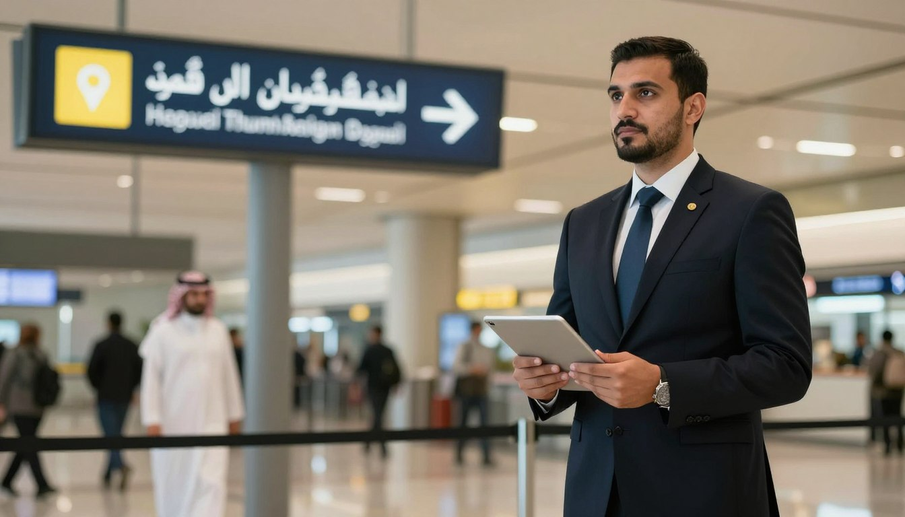
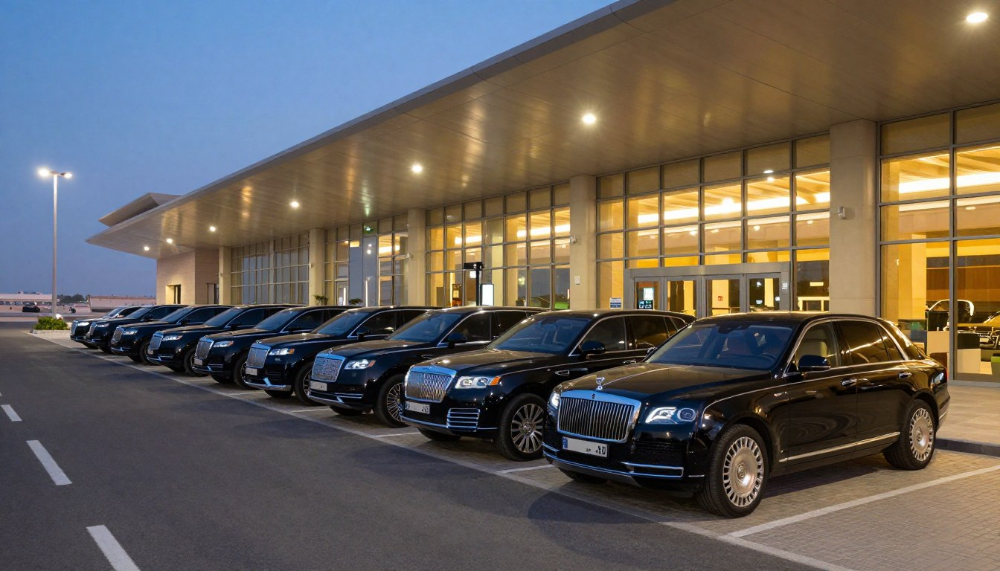

# **Airport Transfers in Saudi Arabia: Executive Airport Transfer Saudi Arabia**

Our managed airport transfer Saudi Arabia connects arriving executives and delegations with licensed private chauffeurs across every commercial terminal. We maintain round the clock dispatch and continuous flight tracking for punctual arrivals across Riyadh, Jeddah and Dammam gateways.

Whether arriving on commercial airlines or private aviation charters, travellers receive coordinated terminal welcomes and luggage assistance directly to premium vehicles.

[Book now](https://seowriting.ai/services/airport-transfers) [Request a proposal](https://seowriting.ai/services/airport-transfers)

Quote details: Pick up, Drop off, Date and time, Get a quote.

Coverage

## **Airport Transfers across Saudi Arabia**

Our dedicated operations desks coordinate flight arrivals across the primary commercial gateways of the Kingdom. Each operational hub oversees local terminal procedures, private aviation tarmac access and prompt chauffeur positioning for seamless onward ground transportation.

### **Riyadh**

Serving King Khalid International Airport with dedicated terminal coordination and private aviation handling. Chauffeurs facilitate seamless transitions to King Abdullah Financial District, Diplomatic Quarter embassies and luxury hotels across the capital.

[Riyadh transfers](https://seowriting.ai/services/airport-transfers/saudi-arabia/riyadh)

### **Jeddah**

Covering King Abdulaziz International Airport across executive terminals and private aviation lounges. Our team manages direct transfers to central business districts, the Corniche commercial corridor and scheduled intercity routes connecting to Mecca.

[Jeddah transfers](https://seowriting.ai/services/airport-transfers/saudi-arabia/jeddah)

### **Dammam**

Operating across King Fahd International Airport for multinational corporate teams visiting the Eastern Province. Professional chauffeurs provide point to point travel to Al Khobar, Dhahran energy headquarters and regional commercial centres.

[Dammam transfers](https://seowriting.ai/services/airport-transfers/saudi-arabia/dammam)

Fleet

## **Executive Fleet for Airport Transfer Saudi Arabia**

Our countrywide vehicle allocation consists exclusively of late model, immaculate black vehicles maintained to stringent international safety specifications. Every luxury vehicle provides climate control, premium leather seating and generous luggage accommodation suited for long haul international travellers.

Corporate travellers can reserve an airport limousine Saudi Arabia tailored to executive party size, luggage count and roadshow itineraries.

### **First Class Sedan**

Flagship black sedans such as the Mercedes Benz S Class or similar \[Confirm\] accommodate up to three passengers and two luggage pieces, delivering quiet luxury and privacy for senior executives.

### **Executive SUV**

Spacious luxury sport utility vehicles including the Cadillac Escalade or similar \[Confirm\] provide seating for six passengers and five suitcases, offering elevated comfort for corporate roadshows and VIP delegations.

### **Premium MPV**

Versatile executive people movers such as the Mercedes V Class or similar \[Confirm\] seat up to six passengers with ample luggage capacity, supporting mobile meetings and diplomatic security entourages.

### **Executive Minibus**

High capacity executive vehicles including the Mercedes Sprinter or similar \[Confirm\] seat up to fourteen passengers with ten bags, serving event delegations, conference groups and corporate teams seamlessly.

Process

## **How Ground Transport Dispatch Operates**

Managing airport ground logistics requires coordinated oversight between airline schedules, terminal security and ground chauffeurs. Our central control desk integrates live telemetry with on tarmac assets to maintain frictionless travel transitions across the Kingdom.

Clients seeking multi destination itineraries can schedule regional routes through our central [Airport Transfers](https://seowriting.ai/services/airport-transfers) desk.

### 1. **Reserve Your Chauffeur Service**

Book through our central dispatch portal with flight numbers and passenger schedules. We confirm vehicle allocation, driver details and corporate account billing before aircraft departure.

### 2. **Flight Tracked Pickup Saudi Arabia**

Our operations desk monitors airspace telemetry in real time. We coordinate your flight tracked pickup Saudi Arabia automatically, adjusting staging times whenever flight schedules experience delays.

### 3. **Airport Meet and Greet Saudi Arabia**

A professional chauffeur delivers our airport meet and greet Saudi Arabia service in arrivals with personalised signage, assists with luggage handling, and escorts guests directly to the staged vehicle.

Standards

## **Licensing and Standards for Airport Transfer Saudi Arabia**

Every vehicle and private driver operates under strict regulatory compliance with the Transport General Authority, holding local licence \[Confirm\] accreditation across the Kingdom. Chauffeurs undergo extensive background vetting, non disclosure agreements and defensive driving certification. We uphold comprehensive duty of care protocols, live GPS tracking and commercial passenger insurance, giving enterprise clients complete risk mitigation over executive mobility.

Review operational standards and municipal staging perimeters through our dedicated [Saudi Arabia](https://seowriting.ai/locations/saudi-arabia) network desk.

## **Frequently Asked Questions**

Practical information regarding terminal access perimeters, dispatch coordination and corporate ground mobility standards across the Kingdom.

### **Which commercial and private aviation terminals do you serve across Saudi Arabia?**

We provide comprehensive gateway coverage across King Khalid International Airport in Riyadh, King Abdulaziz International Airport in Jeddah and King Fahd International Airport in Dammam. Our operations team coordinates terminal curbside collections as well as tarmac transfers for private aviation flights at dedicated executive terminals. Every chauffeur monitors regional gate assignments to support prompt positioning upon passenger arrival.

### **How does your airport meet and greet service operate for international arrivals?**

Our dedicated meet and greet service assigns a professional chauffeur to receive passengers directly inside the arrival hall after customs clearance. The chauffeur holds a bespoke digital tablet displaying the traveller name or corporate emblem, assists with heavy baggage, and guides guests smoothly to the awaiting luxury vehicle staged in reserved executive parking zones.

### **What happens if an inbound international flight suffers a schedule delay?**

All flight arrivals undergo continuous radar monitoring by our 24/7 dispatch desk in Riyadh. Chauffeur staging schedules adjust automatically according to verified landing telemetry, so delays do not disrupt your airport pickup Saudi Arabia arrangements. Passengers receive complimentary waiting time following touchdown, allowing relaxed navigation through immigration control and customs baggage claim without unexpected penalties.

### **Can corporate travel managers establish central billing and monthly invoicing?**

Enterprise clients can open a corporate account with itemised monthly invoice settlements mapped to internal cost centres. This managed ground transportation framework consolidates transfers across regional offices in Riyadh, Dubai, Abu Dhabi and Doha into a transparent billing profile. Travel coordinators receive direct booking access, consolidated electronic receipts and dedicated account manager oversight for international personnel.

### **What vehicle types are available for airport limousine bookings?**

Our airport limousine fleet comprises premium black executive sedans, spacious luxury SUVs, business multi purpose vehicles and executive minibuses. Every vehicle remains meticulously valeted to executive protocol standards, featuring climate control, leather upholstery and complimentary bottled water. Larger corporate delegations can coordinate multi car motorcades under a single booking confirmation managed through our command centre.

### **How does AB maintain passenger duty of care across the Middle East?**

We operate directly in Saudi Arabia, all seven UAE emirates and Qatar, maintaining strict duty of care protocols across every territory. All vehicles feature live GPS tracking overseen by our 24/7 dispatch desk at AB Riyadh headquarters. Chauffeurs undergo rigorous background auditing, defensive road training and sign comprehensive non disclosure agreements to safeguard client confidentiality.

### **How far in advance should an airport transfer Saudi Arabia be scheduled?**

We recommend scheduling an airport transfer Saudi Arabia at least twelve hours prior to aircraft arrival to confirm preferred vehicle allocation. Same day requests receive prompt attention subject to regional fleet availability. Enterprise clients with active corporate accounts benefit from priority reservation channels and expedited chauffeur dispatch around the clock across all participating terminals.

## **Reserve Your Executive Airport Transfer Saudi Arabia**

Connect with our Riyadh dispatch desk to schedule seamless executive airport transfers across the Kingdom.

[Request a proposal](https://seowriting.ai/services/airport-transfers) [Book a transfer](https://seowriting.ai/services/airport-transfers)