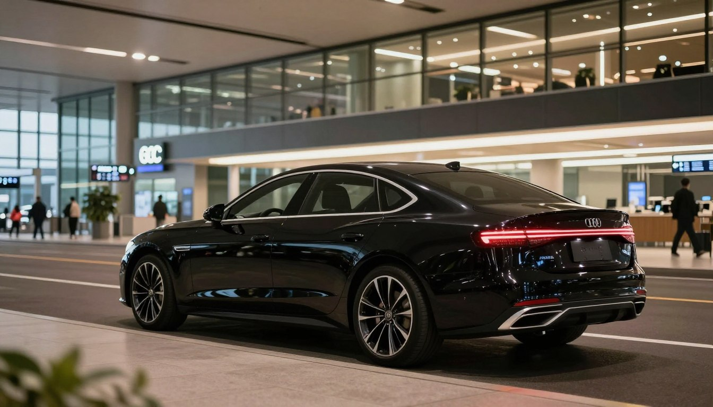

# **Executive Airport Transfer Services Designed for Seamless Arrivals**

Coordinating an executive airport transfer requires total operational precision across every regional arrival. AB delivers managed ground transportation for business leaders, delegations and event groups with live schedule monitoring and discreet terminal meet and assist services.

[Request a proposal](https://seowriting.ai/quote/book) [All services](https://seowriting.ai/services)

**24/7 dispatch**

**3 countries with our own fleet**

**8 airports served**

How we work

Every private airport transfer scheduled through AB connects directly with our central Riyadh operations centre. Continuous flight telemetry and experienced local dispatchers support seamless vehicle staging, eliminating roadside delays while maintaining the highest standard of regional duty of care.

What you get

## **Built for airport transfers**

### **1\. Flight tracked pickups**

Every flight tracked pickup integrates dynamic airline telemetry. Automated operational alerts adjust driver dispatch timing for early touchdowns or unexpected air traffic holds before wheels touch the ground.

### **2\. Meet and greet inside the terminal**

Our airport meet and greet provides an immediate escort past customs. A professional chauffeur holds personalised passenger identification and manages luggage directly to your waiting luxury vehicle.

### **3\. VIP and private terminals**

Specialised tarmac and fixed base operator staging protocols serve private aviation hubs. Operations teams align security clearances and discreet tarmac positioning for private aircraft arrivals across the region.

### **4\. Group arrivals**

Large corporate delegations receive dedicated on-site logistics coordinators. Multi-vehicle movements synchronise premium people movers and executive saloons to move congress attendees smoothly to city centre hotels.

How it runs

## **Three stages, one accountable partner**

### **1\. Book**

Submit flight numbers and passenger schedules through our digital portal or via dedicated corporate account reservation channels.

### **2\. Track**

Our 24/7 dispatch operations track commercial and private flight radar in real time, automatically recalibrating chauffeur staging windows.

### **3\. Meet**

Your private driver welcomes travellers in the arrival hall, assists with baggage handling, and escorts guests directly to the car.

## **Where we run it**

AB operates owned fleet assets across primary commercial hubs throughout Saudi Arabia, the UAE and Qatar. Our centralised operations infrastructure provides consistent chauffeur service standards across all regional destinations.

- [Airport Transfers in Saudi Arabia](https://seowriting.ai/services/airport-transfers/saudi-arabia)
- [Airport Transfers in UAE](https://seowriting.ai/services/airport-transfers/uae)
- [Airport Transfers in Qatar](https://seowriting.ai/services/airport-transfers/qatar)

Direct terminal operations run daily across primary gateway hubs:

- King Khalid International Airport: [RUH](https://seowriting.ai/airports/ruh)
- King Abdulaziz International Airport: [JED](https://seowriting.ai/airports/jed)
- Prince Mohammad Bin Abdulaziz International Airport: [MED](https://seowriting.ai/airports/med)
- King Fahd International Airport: [DMM](https://seowriting.ai/airports/dmm)
- Dubai International Airport: [DXB](https://seowriting.ai/airports/dxb)
- Al Maktoum International Airport: [DWC](https://seowriting.ai/airports/dwc)
- Zayed International Airport: [AUH](https://seowriting.ai/airports/auh)
- Hamad International Airport: [DOH](https://seowriting.ai/airports/doh)

Vehicles typically deployed:

- Business Sedan
- First Class Sedan
- Executive SUV
- Premium MPV

[View the full fleet](https://seowriting.ai/fleet)

Questions

## **Frequently asked questions**

### **How does AB handle delayed or early flight arrivals?**

Our dispatchers utilise live aviation radar and automated flight tracking systems linked directly to airline data feeds. When a commercial flight lands ahead of schedule or faces tarmac holds, chauffeur pickup schedules update automatically. This continuous flight tracking approach removes the need for travellers or travel managers to report schedule adjustments manually.

### **Where does the chauffeur meet arriving passengers at the terminal?**

For standard commercial arrivals, the professional chauffeur positions inside the arrivals concourse immediately following customs clearance. The driver displays an electronic tablet or printed signage with passenger details or corporate logos as specified. Passengers requiring private terminal handling are met at fixed base operator lounges or tarmac vehicle clearance points.

### **Can corporate clients arrange cross-border invoicing and consolidated billing?**

Corporate travel departments can open a dedicated [corporate account](https://seowriting.ai/corporate-accounts) with AB. This facility allows organisations to consolidate regional ground transport charges into a single monthly invoice with itemised journey logs. Corporate billing structures support transactions in local currencies across Riyadh, Dubai, Abu Dhabi and Doha.

### **What vehicle categories are available for executive airport journeys?**

Our fleet features premium vehicles suited to diverse corporate transport requirements. Options include executive business sedans, prestigious first class sedans for diplomatic dignitaries, spacious sports utility vehicles and premium passenger vans for delegation transport. Every vehicle is maintained to meticulous corporate hygiene and mechanical safety guidelines.

### **How does AB provide airport transportation across the UAE?**

Clients booking an [airport chauffeur service Dubai](https://seowriting.ai/airports/dubai-international-dxb) receive dedicated terminal arrivals assistance across all terminals. Furthermore, executive travellers can arrange a Dubai airport transfer with chauffeur directly to regional destinations including Sharjah and northern emirates. In the federal capital, passengers can book an [Abu Dhabi airport chauffeur service](https://seowriting.ai/airports/zayed-international-auh) or reserve a targeted [airport transfer Abu Dhabi](https://seowriting.ai/services/airport-transfers/uae/abu-dhabi) for corporate engagements. We also support regional connections including a [Sharjah airport transfer](https://seowriting.ai/services/airport-transfers/uae/sharjah).

### **How is duty of care maintained during each airport pickup?**

Duty of care forms the core foundation of our regional operations. All vehicles undergo regular preventative maintenance and feature real time GPS tracking monitored around the clock by our Riyadh command centre. Chauffeurs are full time vetted professionals trained in defensive driving protocols, customer privacy standards and regional terminal navigation.

### **Can AB support large delegations and event arrivals simultaneously?**

Our operational framework accommodates complex flight arrival manifests for summits, exhibitions and state delegations. On site dispatch managers coordinate vehicle staging areas, passenger manifest matching and staggered motorcades. This structured approach helps corporate clients move hundreds of inbound attendees from terminal gates to accommodation centres without logistical friction.

### **How far in advance should an airport limousine be booked?**

While our 24/7 dispatch network responds promptly to short notice bookings, reserving an airport limousine at least 24 hours prior to departure is recommended. Advanced notice helps our operations team reserve preferred vehicle tiers, assign specialised drivers and verify flight tracking details before passenger travel commences.

## **Other services**

AB coordinates comprehensive ground transportation solutions across the Middle East. Beyond airport transfer logistics, our fleet and central operations team support corporate and protocol transport programmes:

- [Chauffeur Service](https://seowriting.ai/services)
- [Corporate Transportation](https://seowriting.ai/services)
- [Event Transportation](https://seowriting.ai/services)
- [Intercity Transfers](https://seowriting.ai/services)
- [Hourly Chauffeur Service](https://seowriting.ai/services)
- [Delegation Transportation](https://seowriting.ai/services)
- [VIP Protocol Transportation](https://seowriting.ai/services)
- [Private Aviation Ground Transfers](https://seowriting.ai/services)

## **Planning airport transfers?**

Organise reliable airport transfer arrangements for corporate executives and inbound delegations across our regional operating hubs today.

[Request a proposal](https://seowriting.ai/quote/book) [Talk to a planner](https://seowriting.ai/quote/book)