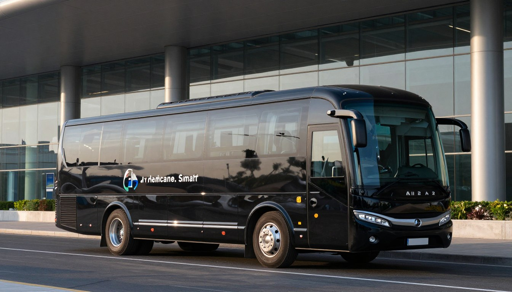

# **Bus & Coach Hire in Qatar: Bus Rental Qatar**

Reliable bus rental Qatar operations support corporate delegations, airport arrivals, and private summit transportation across Doha and neighbouring municipalities with coordinated precision.

Fleet selection depends upon passenger volume, luggage requirements, and schedule flexibility for transfers across national business districts.

[Book now](https://seowriting.ai/services/bus-coach-hire) [Request a proposal](https://seowriting.ai/services/bus-coach-hire)

Route scheduling parameters: Pick up, Drop off, Date and time, Get a quote through dispatch.

Coverage

## **Bus & Coach Hire across Qatar**

AB coordinates intercity mobility across primary business centres and governmental zones throughout Qatar. Among bus rental companies in Qatar, our operational network links major industrial nodes, coastal developments, and central commercial hubs through unified central dispatch.

Organisations pairing large coach movements with individual executive sedans rely on our managed [chauffeur service Qatar](https://seowriting.ai/locations/qatar) network for synchronised VIP arrivals. Every journey follows precleared route schedules monitored by operational teams in Riyadh and Doha.

### **Doha**

Corporate delegations book managed [bus rental Doha](https://seowriting.ai/services/bus-coach-hire/qatar/doha) charters for rapid transit between Hamad International Airport and West Bay financial towers. Scheduled shuttles support conference programmes, embassy events, and corporate headquarters operations across the capital city.

### **Lusail**

Institutions select dedicated [bus rental Lusail](https://seowriting.ai/services/bus-coach-hire/qatar/lusail) services to transport delegates to waterfront exhibition centres, modern commercial districts, and entertainment venues. Real time routing avoids congestion during major trade expos and public events.

### **Al Wakrah**

Specialised industrial and sports charters utilize [bus rental Al Wakrah](https://seowriting.ai/services/bus-coach-hire/qatar/al-wakrah) transfers connecting southern logistics parks and coastal venues with metropolitan Doha. Coordinated scheduling facilitates efficient crew rotations and event attendee shuttles.

Fleet

## **Fleet Specifications for Bus Rental Qatar**

Managing group ground transportation requires diverse vehicle classes configured for executive comfort, luggage capacity, and onboard productivity. Maintaining strict bus rental Qatar standards across every chassis supports corporate travel managers organizing regional summits.

Arranging structured coach hire Qatar services enables institutions to move project teams between commercial districts and event venues. Choosing minibus rental Qatar options provides agile transport for smaller delegations navigating tight city streets, while luxury bus rental Qatar configurations cater to senior dignitaries.

### **Executive Minibus**

Configured for smaller corporate groups, offering leather seating, personal climate vents, and ample luggage space for airport transfers. Mercedes Sprinter or similar \[Confirm\].

### **Luxury Midi Coach**

Designed for mid size delegations requiring extra legroom and dedicated overhead baggage compartments between city destinations. Isuzu Novo or similar \[Confirm\].

### **Full Size Coach**

Engineered for major conference shuttles and event movements, providing high passenger capacity and underfloor storage. Mercedes Tourismo or similar \[Confirm\].

| Vehicle Class | Passenger Range | Baggage Space  | Recommended Deployment                                  |
| ------------- | --------------- | -------------- | ------------------------------------------------------- |
| Minibus       | Up to 16        | Cabin and rear | Diplomatic delegations and corporate airport shuttles   |
| Midi Coach    | Up to 30        | Dedicated bays | Intercity team transit and private executive excursions |
| Full Coach    | Up to 50        | Large hold     | International summits and venue event transportation    |

Operations

## **How Bus Rental Qatar Operations Function**

Executing bus rental Qatar itineraries requires detailed coordination between event teams and our centralized transport operations desk. Booking bus hire with driver Qatar operations secures vetted personnel trained in diplomatic protocol and local navigation.

Each movement is supported by 24/7 dispatch from the Riyadh operations centre, working alongside local teams in Doha. From private driver logistics to large scale passenger operations, the booking and dispatch process remains fully transparent.

### 1. **Itinerary and Manifest Review**

Clients submit travel schedules, passenger counts, and luggage requirements to our team. Route specialists evaluate timing, security access perimeters, and vehicle suitability.

### 2. **Chauffeur and Fleet Allocation**

Dispatch assigns a professional chauffeur and luxury vehicle matched to the group profile. Flight tracking monitors inbound arrivals to adjust pickup timing automatically.

### 3. **Onsite Execution and Telemetry**

Vehicles deploy with active GPS tracking and meet and greet protocols at terminal arrival gates. Chauffeurs maintain direct communication with the central dispatch desk throughout the journey.

Enterprise clients managing complex event itineraries can establish a corporate account with consolidated monthly invoice options, reducing administrative overhead across regional travel programmes.

Compliance

## **Licensing and Standards for Bus Rental Qatar**

Operating bus rental Qatar services demands strict compliance with national transport regulations, public safety codes, and international duty of care benchmarks. Commercial passenger operations require approved local licence \[Confirm\] accreditation to transport domestic and international passengers across municipal routes.

Chauffeurs undergo comprehensive background auditing, medical clearances, and protocol orientation before deployment. Our regional network across Saudi Arabia, UAE, and Qatar operates under uniform governance, linking administrative desks in Riyadh, Jeddah, Dubai, Abu Dhabi, and Doha.

Regulatory frameworks in Qatar require verified commercial operator permits and passenger transport coverage. Contact the AB Doha operations office at Office 110, Building 100, Zone 26, Street 310, Old Airport Road, Doha, Qatar for compliance documentation.

+974 7734 3300

## **Frequently Asked Questions About Bus Rental Qatar**

### **How do corporate bus rental companies in Qatar manage large event manifests?**

Specialised providers evaluate headcount, flight schedules, and security perimeters to create phased transport schedules. Dispatch teams assign dedicated coordinators to oversee passenger loading, route monitoring, and communication across corporate summits in Qatar.

### **Can organisations book coach hire Qatar services for recurring employee transit?**

Organisations frequently establish recurring contracts for daily staff mobility between residential areas and commercial headquarters. These arrangements include scheduled pickups, designated routes across Qatar, and priority vehicle allocation through centralized corporate accounts.

### **What passenger capacity is typical for minibus rental Qatar charters?**

Executive minibuses operating in Qatar generally seat between twelve and twenty passengers depending on luggage requirements. They provide an agile option for navigating dense city streets while maintaining high comfort standards for executive teams.

### **Why should corporate clients choose bus hire with driver Qatar solutions rather than unmanaged charters?**

Selecting professional drivers familiar with local municipal traffic rules and venue protocol reduces transit delays. Each driver holds verified security clearance, commercial licensing, and protocol training tailored for corporate and diplomatic clients across Qatar.

### **What amenities are included with luxury bus rental Qatar deployments?**

High tier coaches feature leather appointed seating, individual climate controls, charging ports, and onboard connectivity. Tinted privacy glass, smooth air suspension, and quiet cabin acoustic insulation support executive comfort across extended itineraries in Qatar.

### **How far in advance should clients book bus rental Qatar services?**

Booking at least several days ahead is recommended for standard transfers, while large summit operations require earlier scheduling. Securing bus rental Qatar reservations early allows dispatch to allocate exact vehicle classes and coordinate route timing efficiently.

### **Are airport greeters included with bus rental Qatar bookings?**

Dedicated airport meet and greet personnel can be arranged at Hamad International Airport to assist arriving groups. Coordinators guide arriving passengers through terminal exits directly to their designated luxury bus rental Qatar coach.

### **How does AB coordinate dispatch across Qatar and neighbouring GCC countries?**

AB operates a centralized 24/7 dispatch hub from its Riyadh headquarters while maintaining local operational desks in Doha, Dubai, and Abu Dhabi. This unified structure manages cross border logistics, fleet tracking, and consistent duty of care standards throughout the region.

## **Book Executive Bus Rental Qatar for Your Next Group Transfer**

Partnering with a professional ground transport operator delivers organized passenger movements for conferences, airport transfers, and corporate roadshows. Coordinated fleet dispatch and transparent billing simplify procurement for international business delegations visiting the region.

### **Plan Corporate Group Ground Transport**

Submit detailed passenger manifests and route schedules to receive an itemised fleet proposal.

[Request a proposal](https://seowriting.ai/services/bus-coach-hire) [Book a transfer](https://seowriting.ai/services/bus-coach-hire)