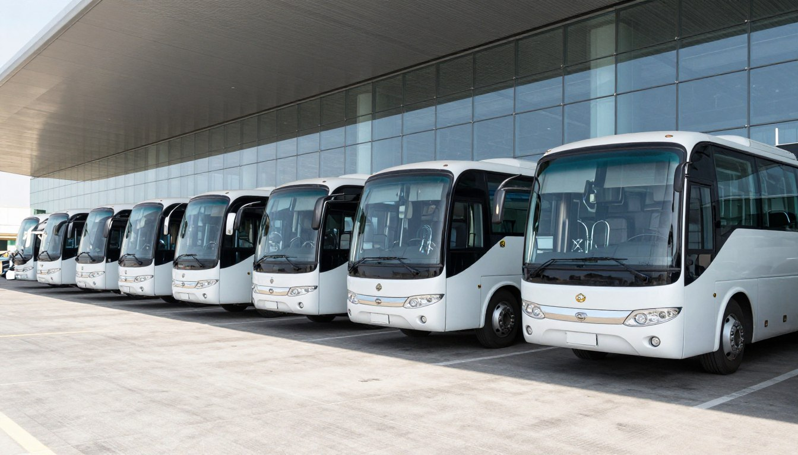
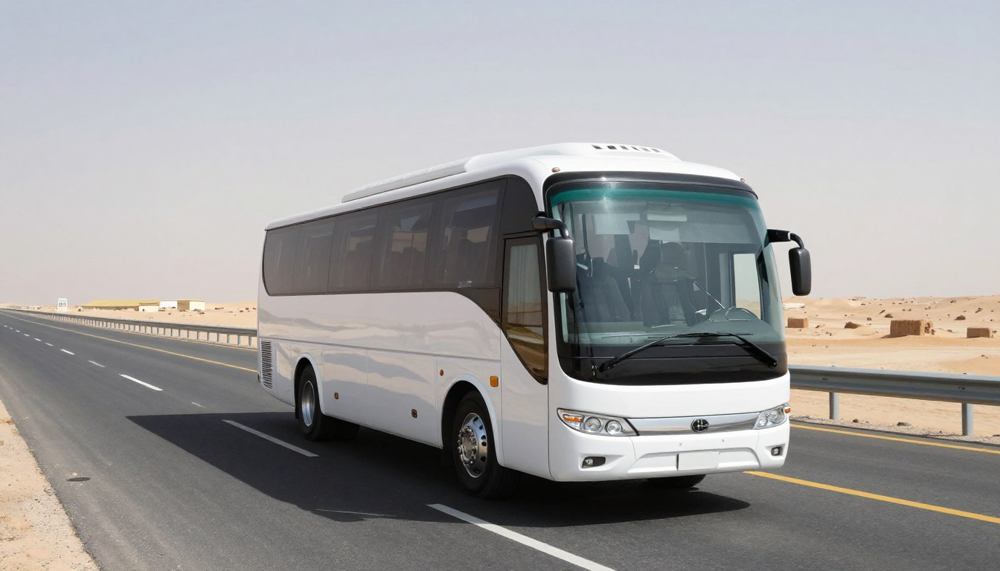
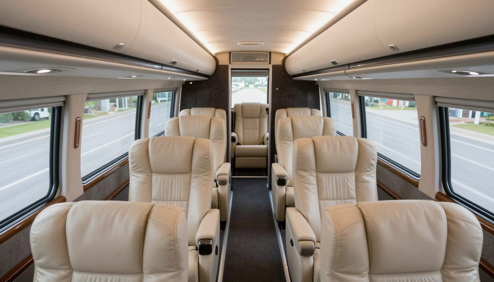
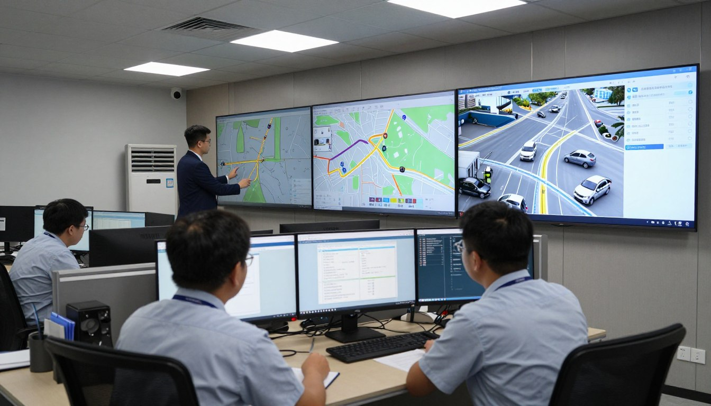
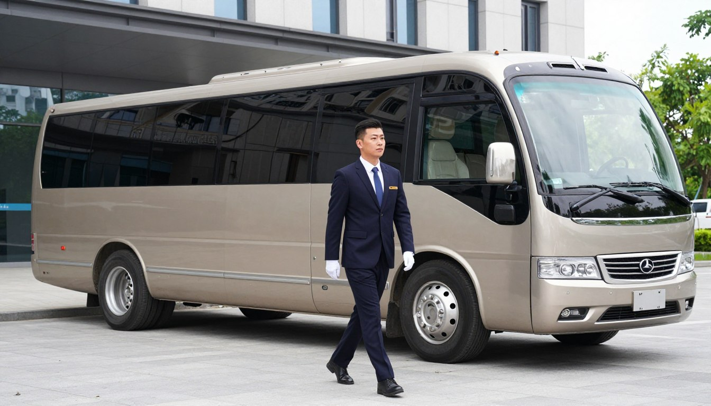

# **Bus & Coach Hire in Saudi Arabia: Bus Rental Saudi Arabia**

AB delivers reliable bus rental Saudi Arabia operations for corporate delegations, summits and private enterprise movements across the Kingdom. Managed ground transportation coordinates group travel with executive standards, professional chauffeurs and central dispatch from our Riyadh headquarters.

Organisations balance vehicle capacity, schedule fluidity and duty of care when planning passenger transport. Strategic dispatch desk coordination aligns passenger volume with appropriate fleet assets to maintain schedule precision across every route.

[Book now](https://seowriting.ai/services/bus-coach-hire) [Request a proposal](https://seowriting.ai/locations/saudi-arabia)

Pick up: Specify terminal, hotel or corporate venue. Drop off: Designate target arrival location. Date and time: Schedule movement timings. Get a quote: Coordinate itinerary parameters directly with central dispatch.

Coverage

## **Bus & Coach Hire across Saudi Arabia**

Enterprise logistics require consistent operational execution across diverse metropolitan centres and industrial corridors. AB deploys structured passenger transport solutions connecting key economic zones, airport terminals and project sites throughout the country.

Centralized fleet coordination links regional transit networks with local operational knowledge. Ground teams monitor traffic density, security perimeters and regional access protocols to support seamless passenger journeys across major municipal hubs.

Corporate travel programmes benefit from unified standards across all operating territories. Dedicated transport coordinators manage local vehicle staging, driver briefings and route planning to support complex business itineraries.

### **Riyadh**

Corporate delegations coordinate transfers through our central hub. Secure executive group transit connects King Khalid International Airport with diplomatic and financial districts. Book dedicated [bus rental Riyadh](https://seowriting.ai/services/bus-coach-hire/saudi-arabia/riyadh) services for seamless group logistics.

### **Jeddah**

Coastal commercial operations require dependable airport and port shuttles. Chauffeur driven coaches serve corporate summits and marine terminals along the Red Sea. Arrange premium [bus rental Jeddah](https://seowriting.ai/services/bus-coach-hire/saudi-arabia/jeddah) itineraries for executive travel.

### **Dammam**

Industrial delegations across the Eastern Province rely on punctual passenger transport. Coordinated fleets serve King Fahd International Airport, Al Khobar and corporate headquarters. Schedule reliable [bus rental Dammam](https://seowriting.ai/services/bus-coach-hire/saudi-arabia/dammam) movements with centralized dispatch.

### **Makkah**

Specialised pilgrimage logistics and high capacity group movements demand meticulous schedule coordination. Coordinated coach fleets manage intercity transfers connecting hotel districts with holy sites. Access structured transport via [Makkah](https://seowriting.ai/services/bus-coach-hire/saudi-arabia/mecca) operations desks.

### **Madinah**

Executive delegations and conference groups require serene, punctual travel solutions. Premium buses connect Prince Mohammad Bin Abdulaziz International Airport with key central zones. Route coordination is managed through [Madinah](https://seowriting.ai/services/bus-coach-hire/saudi-arabia/medina) transit specialists.

### **Tabuk**

Northern infrastructure projects and visiting development teams depend on robust passenger transport. High clearance coaches handle transfers between regional air terminals and project perimeters. Explore logistical reach through [Tabuk](https://seowriting.ai/services/bus-coach-hire/saudi-arabia/tabuk) fleet management.

### **NEOM**

Future forward development zones require innovative, zero compromise mobility management. Executive coaches provide daily project shuttles and high level site visits across emerging sectors. Connect regional logistics with [NEOM](https://seowriting.ai/services/bus-coach-hire/saudi-arabia/neom) transport frameworks.

Nationwide fleet staging supports point to point intercity travel across the Kingdom.

Fleet

## **Executive Fleet for Bus Rental Saudi Arabia**

AB maintains a versatile selection of premium passenger vehicles configured for corporate, diplomatic and institutional transit. Every vehicle category is maintained to stringent mechanical benchmarks, supporting exceptional comfort and operational safety during travel.

Selecting the appropriate vehicle class depends on passenger manifest numbers, luggage requirements and route characteristics. Our transport planners assist corporate travel managers in matching group size to optimal vehicle configurations.

Uniform vehicle presentation and immaculate passenger cabins establish an executive environment for traveling personnel. Dedicated amenities support mobile productivity and restful transit between meeting destinations.

| Vehicle Class     | Seating Style      | Luggage Room | Primary Application                                     |
| ----------------- | ------------------ | ------------ | ------------------------------------------------------- |
| Executive Minibus | Leather Recline    | Moderate     | Board roadshows and small group airport runs            |
| Luxury Midi Coach | Ergonomic Fabric   | Generous     | Corporate team shuttles and regional conferences        |
| Full Size Coach   | Contoured Highback | Substantial  | Convention transfers and major event delegate logistics |
| VIP Luxury Coach  | Premium Leather    | Configurable | State protocol and high level executive delegations     |

### **Executive Minibus**

Mercedes Sprinter or similar \[Confirm\]. Designed for diplomatic delegations and board level transfers, offering leather seating, privacy glazing and climate control. Professional chauffeurs handle airport runs and financial district roadshows smoothly.

### **Luxury Midi Coach**

Volvo 9700 or similar \[Confirm\]. Configured for medium sized enterprise teams requiring dedicated intercity transit between commercial centres. Features ergonomic seating, generous luggage capacity and smooth suspension for long distance comfort.

### **Full Size Executive Coach**

Mercedes Tourismo or similar \[Confirm\]. Built for large corporate groups, international congress transfers and major event transport. Provides spacious reclining seats, individual ventilation controls and ample underfloor luggage compartments.

### **VIP Luxury Coach**

Neoplan Cityliner or similar \[Confirm\]. Tailored for state protocol missions, executive roadshows and VIP delegations needing mobile meeting spaces. Outfitted with premium leather interiors, onboard connectivity and refined privacy amenities.

Cabin configurations prioritise passenger comfort and productivity throughout extended travel corridors.

Process

## **Operational Booking and Dispatch Framework**

Coordinating group transportation requires systematic planning and flawless communication between clients and control rooms. AB implements a structured workflow that eliminates friction from initial quotation through trip completion.

Centralized dispatch monitors each deployment through automated tracking and continuous driver communication. Operational resilience reduces travel delays and adapts quickly to dynamic event schedules or flight updates.

### **Standard Group Travel Risks**

- Unverified driver licensing and inconsistent vehicle standards.
- Fragmented communication across individual route operators.
- Unclear billing structures and unpredictable invoice adjustments.

### **Managed AB Protocol**

- Audited fleet assets and certified professional chauffeurs.
- Continuous control room tracking and central operational coordination.
- Transparent corporate billing consolidated through single invoices.

### 1. **Itinerary Enquiry and Scope Assessment**

Submit travel dates, passenger manifests and route parameters to our Riyadh dispatch team. Operational coordinators assess vehicle requirements, parking permissions and timing corridors to formulate a transparent transport plan.

### 2. **Manifest Finalisation and Vehicle Allocation**

Review the detailed logistics proposal, confirm vehicle classes and receive dedicated chauffeur details. Fleet operations assigns vetted chauffeurs, stages inspected vehicles and verifies flight details or venue access clearances.

### 3. **Monitored Execution and Final Account**

Chauffeurs execute scheduled movements backed by live GPS tracking and our 24/7 dispatch desk. Corporate clients receive real time operational oversight, followed by consolidated invoicing mapped directly to company cost centres.

Our 24/7 dispatch desk in Riyadh oversees fleet telemetry and route execution across every active booking.

Compliance

## **Licensing, Safety and Duty of Care**

Enterprise passenger logistics demand uncompromising attention to safety standards and statutory obligations. Every passenger movement complies with Transport General Authority regulations, holding local licence \[Confirm\] across regional corridors.

AB enforces comprehensive duty of care protocols, encompassing exhaustive background verification, defensive driving credentials and non disclosure agreements for every professional chauffeur. Chauffeurs complete extensive route training and protocol briefings before handling client missions.

Fleet vehicles undergo scheduled mechanical audits, tyre assessments and climate control inspections before deployment, maintaining pristine safety records across the Kingdom. Real time GPS monitoring connects every vehicle directly to our centralized operations centre.

Enterprise clients access verified driver documentation and commercial regulatory permits directly through account managers, facilitating smooth audit reporting and enterprise risk compliance.

Pre departure mechanical inspections verify vehicle readiness before every scheduled deployment.

+966 58 111 8720

## **Frequently Asked Questions**

### **What vehicle capacities are available for coach hire Saudi Arabia journeys?**

Coach hire Saudi Arabia deployments range from compact executive minibuses seating smaller delegations to full size coaches accommodating large passenger contingents. Vehicle allocation aligns directly with passenger manifests and baggage allowances to preserve space and comfort across urban and intercity travel routes.

### **How does minibus rental Saudi Arabia support corporate delegations?**

Minibus rental Saudi Arabia offers flexible mobility for corporate roadshows, airport transfers and site inspections. Compact passenger dimensions facilitate straightforward navigation through congested metropolitan districts while providing executive leather interiors, climate management and dedicated luggage space suited for executive teams.

### **What qualifications do drivers possess for bus hire with driver Saudi Arabia services?**

Drivers assigned to bus hire with driver Saudi Arabia itineraries hold valid commercial driving credentials, extensive route knowledge and comprehensive security vetting. Every chauffeur undergoes background screening, signs formal non disclosure agreements and completes advanced defensive driving programmes to maintain client duty of care.

### **What amenities distinguish luxury bus rental Saudi Arabia bookings?**

Luxury bus rental Saudi Arabia specifications include ergonomic leather seating, individual climate vents, personal device charging outlets and onboard Wi-Fi connectivity \[Confirm\]. VIP coach interiors feature acoustic insulation and privacy glazing, providing an executive environment suitable for mobile meetings and rest between official engagements.

### **How does AB coordinate airport group arrivals across international terminals?**

Airport greeting teams monitor inbound passenger flights through live flight tracking software to accommodate schedule adjustments. Chauffeurs stage vehicles in designated commercial parking areas, while meet and greet representatives welcome arriving groups inside the terminal to coordinate prompt, organised boarding.

### **Can corporate accounts access consolidated monthly invoice billing?**

Corporate account facilities provide centralised billing structures with itemised monthly invoices mapped to client cost centres. Enterprise travel managers receive clear audit records detailing route corridors, vehicle classes and usage durations, streamlining administrative reconciliations for recurring operations.

### **Are intercity passenger routes available between Riyadh and Jeddah?**

Point to point intercity travel connects Riyadh, Jeddah, Dammam and regional development centres across Saudi Arabia. Dedicated long distance coaches provide uninterrupted transit with relief driver planning where required, avoiding the complexities and airport connection times associated with domestic flights.

### **How does AB support cross border travel into neighbouring Gulf nations?**

AB directly serves Saudi Arabia, all seven UAE emirates and Qatar through established regional offices in Riyadh, Dubai, Abu Dhabi and Doha. Transit into Bahrain, Kuwait and Oman is coordinated on request through thoroughly vetted partner networks to maintain operational standards throughout the Gulf region.

## **Secure Executive Bus Rental Saudi Arabia Operations**

Enterprise travel managers balance scheduling precision, passenger comfort and organizational duty of care when arranging group transport across the Kingdom. AB coordinates vetted chauffeurs, premium coaches and centralized 24/7 dispatch to maintain reliable service delivery for corporate events, summits and ongoing shuttle operations.

### **Reserve Executive Group Transport**

Connect with our central dispatch desk to coordinate detailed itineraries, fleet allocations and corporate account setups.

[Request a proposal](https://seowriting.ai/services/bus-coach-hire) [Book a transfer](https://seowriting.ai/locations/saudi-arabia)