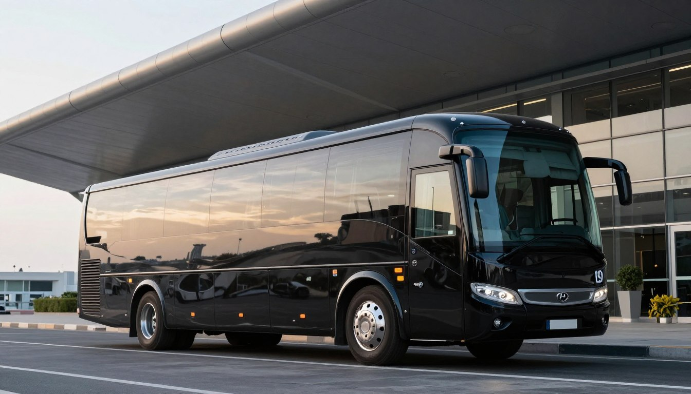
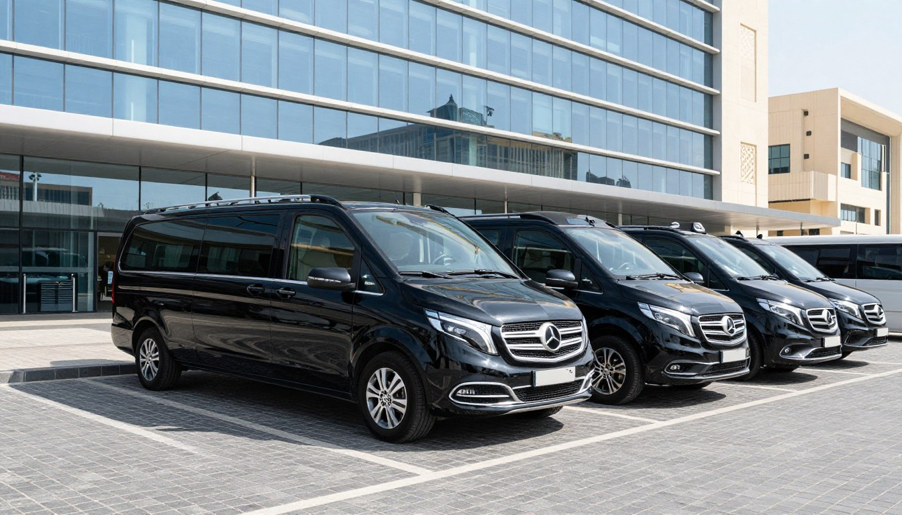
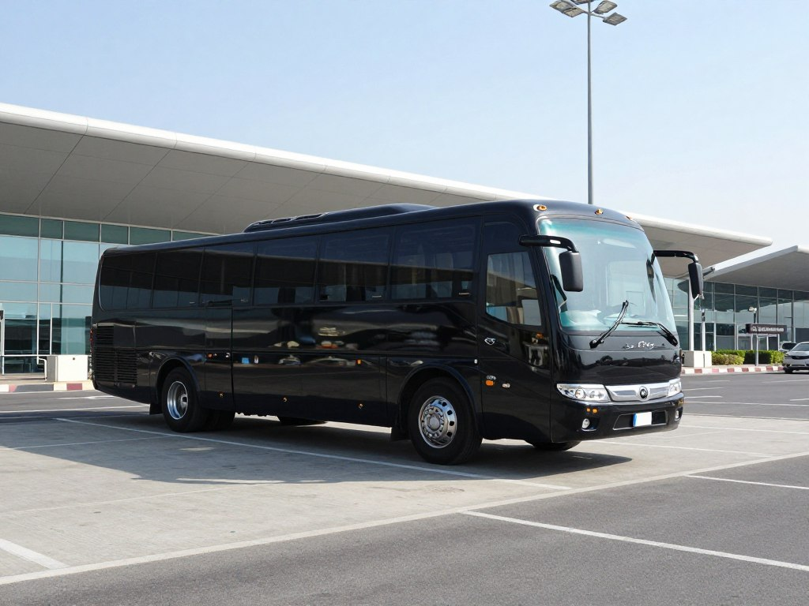
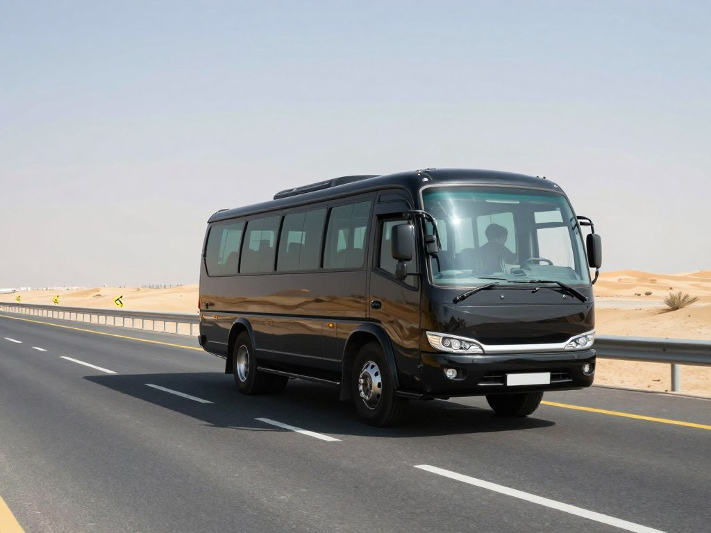
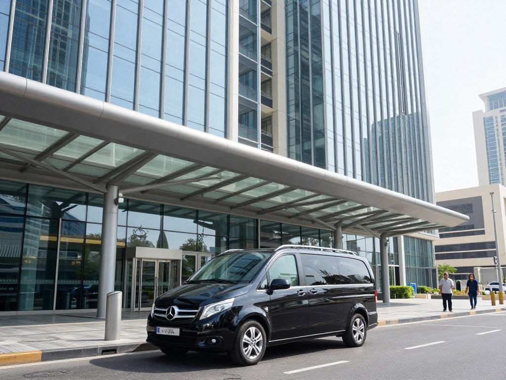
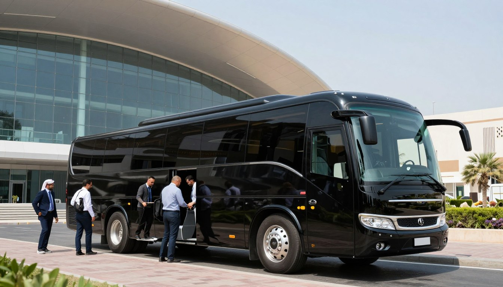

# **Bus & Coach Hire in Dubai: Executive Bus Rental Dubai**

AB delivers executive bus rental Dubai services for corporate delegations, scheduled business shuttles, and large group transfers across Dubai. Every deployment pairs immaculate passenger vehicles with licensed chauffeurs under the continuous oversight of centralized regional dispatch.

[Book now](https://seowriting.ai/quote/book) [View the fleet](https://seowriting.ai/services/bus-coach-hire)

Rapid reservations are available for transfers originating at Dubai International Airport (DXB) as well as scheduled corporate runs and regional group itineraries. Specify pick up, drop off, and date and time details directly through our portal to get a quote.

Dubai Operations

## **Managed Fleet Operations for Bus Rental Dubai**

AB manages coordinated group ground transportation across the commercial and financial centres of Dubai. Our operational model links licensed professional drivers, scheduled fleet sanitisation, and active flight tracking across every major urban corridor. \[Confirm: what AB runs here\] Standard procedures follow strict duty of care protocols to support passenger safety, vehicle presentation, and precise timetable adherence for visiting organisations.

Centralized 24/7 dispatch from our regional command centre in Riyadh works directly with local coordinators to monitor road conditions and venue access points. Organise intercity group travel across all seven emirates by selecting [Bus & Coach Hire UAE](https://seowriting.ai/services/bus-coach-hire/uae) for cross border movements. Continuous GPS tracking and automated communication ensure that executive transport schedules proceed without operational friction.

Every assignment operates under centralized supervision, coordinating airport arrivals, protocol escorts, and multi vehicle movements throughout Dubai and the northern emirates.

Fleet Categories

## **Vehicle Categories for Bus Rental Dubai**

Selecting the right vehicle class allows corporate travel managers to align transport capacity with passenger profiles and luggage requirements. Whether booking an executive van, arranging a luxury bus rental Dubai programme, or scheduling a comprehensive coach rental dubai contract, AB supplies pristine black vehicles maintained to executive livery benchmarks. Corporate teams can also book dedicated transfers using our [Bus & Coach Hire](https://seowriting.ai/services/bus-coach-hire) services across the region.

For executive team members requiring individual transit between meetings, reserve a [personal chauffeur Dubai](https://seowriting.ai/locations/uae/dubai) to maintain continuous schedule alignment. The Dubai fleet operates across the following defined classes:

- **Standard Sedan:** Practical executive transport. Ideal for individual corporate transfers and airport runs, providing quiet cabin comfort and professional driver standards across urban Dubai. \[Confirm: local fleet\]
- **Business Sedan:** Executive corporate saloon. Business Sedans serve corporate account holders requiring discreet and comfortable travel between office locations and commercial meetings. Each vehicle maintains premium seating, digital climate regulation, and ample working space for busy executives. \[Confirm: local fleet\]
- **First Class Sedan:** Flagship prestige mobility. First Class Sedans represent the pinnacle of chauffeured luxury for diplomatic guests and senior leadership. Refined leather interiors, acoustic glass, and silent performance deliver uncompromising prestige throughout urban and regional journeys. \[Confirm: local fleet\]
- **Executive SUV:** Spacious luxury presence. Executive SUVs combine elevated road presence with expansive luggage accommodation for visiting delegations. Spacious seating configurations and all weather stability allow smooth transit across urban centres, private residences, and business venues. \[Confirm: local fleet\]
- **Premium MPV:** Flexible group versatility. Premium MPVs accommodate small management teams and VIP families requiring flexible conference seating and abundant luggage room. Climate control and quiet ride characteristics support productivity while moving between business commitments. \[Confirm: local fleet\]
- **Executive Van:** Dedicated delegation transport. Executive Vans deliver comfortable transit for medium sized delegations, event personnel, and corporate project teams. High roof cabins, individual leather seats, and USB connectivity provide superior comfort for group journeys across the city. \[Confirm: local fleet\]
- **Coach:** Large scale passenger charter. Coaches provide high capacity transport for corporate events, workforce shuttles, and touring groups throughout the emirates. Expansive tinted windows, reclining seats, underfloor luggage bays, and advanced air conditioning maintain passenger comfort on long journeys. \[Confirm: local fleet\]

From agile minibus rental Dubai solutions to large scale transfers, our fleet accommodates diverse team sizes while preserving consistent service quality across every deployment.

Popular journeys

## **Across Dubai and beyond**

AB coordinates daily group movements connecting primary aviation gates, financial hubs, and exhibition complexes across the United Arab Emirates. Direct routes link commercial districts in Dubai with regional hubs in Abu Dhabi, Doha, and Riyadh, supported by professional drivers and continuous fleet oversight. Clients managing large scale delegations rely on our corporate bus rental Dubai solutions to synchronize passenger arrivals and departures seamlessly.

Airport Transfer

### **Dubai International Airport to Downtown Dubai**

From \[AED price\] · \[Confirm\] minutes. Direct terminal pickup connects international arrivals directly to central hotel towers and corporate headquarters. \[Confirm: 3 routes or venues with times\]

Intercity Transfer

### **Dubai to Abu Dhabi City Centre**

From \[AED price\] · \[Confirm\] minutes. Intercity group transport links commercial districts between emirates with comfortable seating and continuous climate management. \[Confirm: 3 routes or venues with times\]

Exhibition Transfer

### **Dubai Marina to Dubai World Trade Centre**

From \[AED price\] · \[Confirm\] minutes. Dedicated event transfers move corporate teams and exhibition delegates between coastal accommodations and primary convention halls. \[Confirm: 3 routes or venues with times\]

Schedule arrivals directly through [Dubai International Airport (DXB)](https://seowriting.ai/airports/dubai-international-dxb) pickup points to coordinate with live flight tracking. Experienced chauffeurs greet visiting groups inside arrivals areas, handle luggage transfer, and escort passengers straight to awaiting coaches.

Recent work

## **Coordinated Transport for Global Energy Summit**

AB managed scheduled passenger logistics for an international energy conference hosted in Dubai. Operations linked coastal hotels, convention venues, and airport terminals through synchronized coach schedules and live central coordination. \[Confirm: one local example\] Ground personnel maintained strict arrival timetables, seamless passenger onboarding, and continuous communication with event directors throughout the multi day programme.

Onsite coordinators oversaw boarding queues, monitored route traffic patterns, and communicated real time vehicle coordinates directly to conference organisers.

## **Bus & Coach Hire in Dubai: your questions**

### **What permits are required for bus rental Dubai airport transfers?**

Commercial airport pickups in Dubai require authorized regulatory permits and registered vehicle clearances issued by the local transport authority. AB manages all operational permits, gate access passes, and flight tracking data in advance. \[Confirm: 2 local FAQs\] Chauffeurs coordinate directly with airport dispatch to greet arriving delegations inside designated passenger collection zones without transit delays.

### **Can bus rental Dubai services operate into other UAE emirates?**

AB maintains cross emirate operational permissions enabling direct travel between Dubai, Abu Dhabi, Sharjah, and northern regions. Managed passenger journeys proceed across internal borders without requiring vehicle transfers or secondary passenger manifests. \[Confirm: 2 local FAQs\] Operations dispatch monitors intercity highway conditions continuously to maintain accurate schedule timing for corporate groups travelling between key business districts.

### **What amenities are included in luxury bus rental Dubai vehicles?**

Executive coaches and passenger minibuses feature high capacity air conditioning, ergonomic reclining leather seats, individual USB charging ports, and tinted privacy glass. Larger vehicles such as a 50 seater bus rental dubai or a 30 seater bus rental in dubai provide dedicated underfloor luggage compartments and overhead parcel racks. Onboard wireless connectivity and quiet cabin acoustics support passenger productivity during corporate transfers and regional road journeys.

### **How does AB handle duty of care and passenger safety?**

Passenger safety operates under rigid compliance protocols, comprehensive vehicle inspections, and professional chauffeur licensing. Every vehicle in the fleet undergoes scheduled mechanical audits before departure, and automated GPS tracking monitors vehicle location continuously. Operations teams maintain active communication with drivers throughout every route to uphold organizational duty of care standards for corporate clients.

### **What options exist for corporate bus rental Dubai contracts?**

Organisations can establish a corporate account providing priority vehicle access, dedicated account managers, and consolidated monthly invoice billing. Flexible charter terms accommodate scheduled daily employee shuttles, temporary conference movements, and complex multi vehicle roadshows. Account managers assist with route planning, passenger capacity scaling, and bespoke reporting to streamline enterprise transportation management.

### **Is bus hire with driver Dubai available for private social events?**

Private charters are available for family celebrations, wedding transfers, and private group gatherings requiring bus hire with driver Dubai. Clients seeking party bus rental dubai or festive evening transportation receive professional chauffeurs who oversee route management and passenger comfort. Professional dispatch coordinates pickup schedules and venue drop offs to support smooth group transit without driving concerns.

## **Book bus & coach hire in Dubai**

AB Dubai: Suite 206, DBC Building, Al Khabaisi, Deira, Dubai, UAE, +971 50 781 3880

+971 50 781 3880

Arranging professional bus rental Dubai ensures synchronized schedules, premium passenger comfort, and meticulous route execution for every group itinerary. Coordinate your upcoming corporate transfer, event movement, or private group charter with our regional transport specialists. Secure your vehicle allocation early to align dispatch logistics with your exact travel schedule.

### **Reserve Executive Group Transport**

Connect with regional operations to schedule your upcoming bus rental Dubai itinerary or request detailed charter pricing.

[Request a proposal](https://seowriting.ai/quote/book) [Book a transfer](https://seowriting.ai/quote/book)