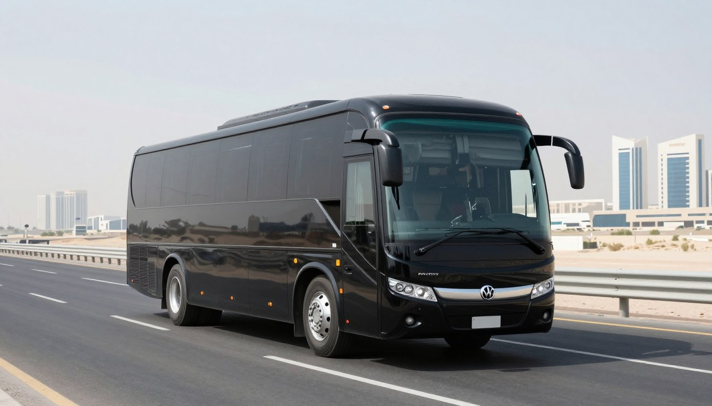
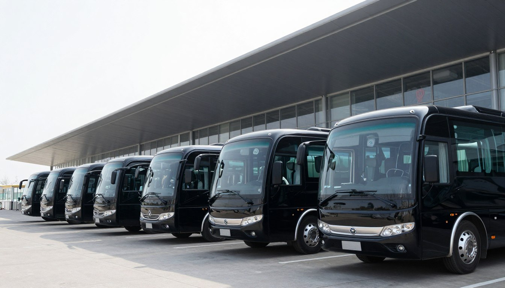
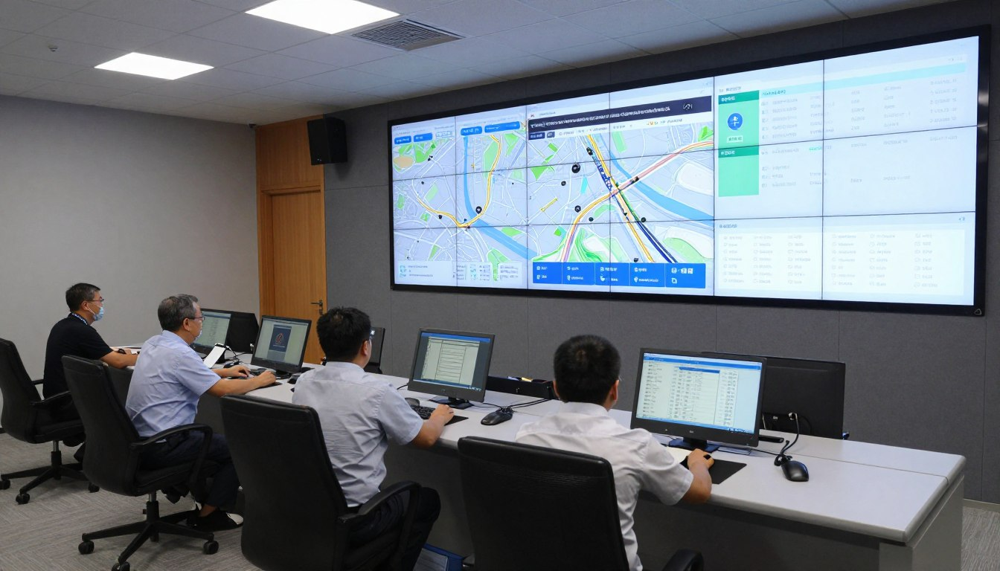
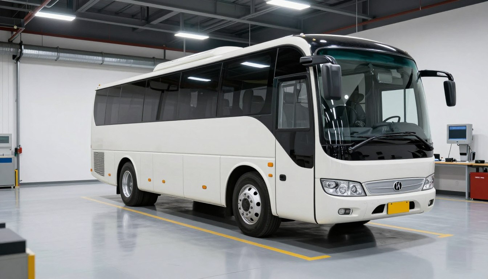

# **Bus & Coach Hire in UAE: Bus Rental UAE**

AB provides executive bus rental UAE services engineered for corporate delegations, major summits, and enterprise airport transfers across the country. Our managed ground transportation delivers licensed vehicles, vetted drivers, and centralized billing coordinated directly through our national operations network.

Passenger movements require dependable scheduling, route monitoring, and strict duty of care across all seven emirates. Organizations rely on our dedicated team to coordinate multi vehicle itineraries with absolute operational precision.

[Book now](https://seowriting.ai/services/bus-coach-hire) [Request a proposal](https://seowriting.ai/services/bus-coach-hire)

**Pick up:** Terminal, hotel, or office location. **Drop off:** Scheduled destination point. **Date and time:** Continuous calendar coordination. **Get a quote:** Formal itinerary estimation via central dispatch.

Coverage

## **Bus & Coach Hire across UAE**

Our transport network supports bus rental UAE operations with regional coordination desks that understand municipal traffic flows, airport protocols, and security perimeters. We maintain continuous operational capabilities connecting the commercial, industrial, and government quarters of every major emirate.

### **Dubai**

Corporate delegations and exhibition shuttles operating around DIFC and Expo City require reliable transit. Book premium [bus rental Dubai](https://seowriting.ai/services/bus-coach-hire/uae/dubai) options tailored for summit movements and executive transfers.

### **Abu Dhabi**

Government delegations and multinational summits demand elevated protocol standards and vetted drivers. Arrange secure [bus rental Abu Dhabi](https://seowriting.ai/services/bus-coach-hire/uae/abu-dhabi) services with complete perimeter clearance and flight tracking.

### **Sharjah**

Industrial logistics and intercity group movements run on strict operating schedules between emirates. Schedule dependable [bus rental Sharjah](https://seowriting.ai/services/bus-coach-hire/uae/sharjah) capacity for daily corporate shuttles and conference travel.

### **Ajman**

Enterprise operations in the northern emirates connect directly to international air hubs through dedicated transport. Reserve punctual [bus rental Ajman](https://seowriting.ai/services/bus-coach-hire/uae/ajman) shuttles managed through regional operations coordinators.

Fleet

## **Fleet Options for Bus Rental UAE**

Our fleet delivers immaculate black vehicles configured for executive road travel, conference shuttles, and airport hospitality across the Arabian Gulf.

### **Luxury Minibus**

Configured for executive teams and airport transfers, featuring leather seating and climate control. Typical models include the Mercedes Benz Sprinter or similar \[Confirm\].

### **Executive Midi Coach**

Engineered for medium sized corporate groups requiring spacious seating, generous luggage capacity, and refined interiors. Typical models include the King Long midi or similar \[Confirm\].

### **Full Size Passenger Coach**

Built for large scale summit movements and site transfers with quiet cabins and panoramic windows. Typical models include the Volvo luxury coach or similar \[Confirm\].

Dedicated passenger vehicles prepared for group transfers and protocol assignments.

Process

## **How Group Transport Operates**

AB coordinates every booking through a structured procedure designed to eliminate transit friction for multinational travel programs.

### 1. **Scope Definition**

Share passenger manifests, route waypoints, and scheduling timetables with our dedicated reservation team for accurate vehicle allocation and route planning.

### 2. **Vehicle Allocation**

Dispatch assign appropriate luxury vehicle classes with trained chauffeurs possessing valid credentials, vehicle registration, and terminal access permits.

### 3. **Live Journey Management**

Operations desks track route progress using GPS tracking, monitoring traffic density and flight tracking updates around the clock.

Operations desks maintain live visibility over road itineraries throughout each journey.

Compliance

## **Operational Standards and Regulatory Compliance**

Operating passenger vehicles in the United Arab Emirates requires rigorous regulatory adherence. Chauffeurs hold official commercial driving permits, clean driving records, and local licence \[Confirm\] authorization issued by municipal transport authorities. Vehicles undergo periodic mechanical inspections, feature speed governors, and carry comprehensive commercial passenger insurance.

Our regional operations also connect with our broader Middle East infrastructure, including dedicated offices in Saudi Arabia and Qatar. Clients needing private driver arrangements alongside large coach charters can coordinate full [chauffeur service UAE](https://seowriting.ai/locations/uae) packages through our central operations team.

Physical offices support regional accountability: AB Dubai operates from Suite 206, DBC Building, Al Khabaisi, Deira, Dubai, UAE (+971 50 781 3880), while AB Abu Dhabi is located at Office 03, Mezzanine Floor, Building C57, Abu Dhabi, UAE (+971 50 918 0556). Headquarters and 24/7 dispatch operate from Building 3036, Office 08, 2nd Floor, Umar Ibn Abdulaziz Road, Al Malaz, Riyadh, Saudi Arabia (+966 58 111 8720), alongside our regional hub AB Doha at Office 110, Building 100, Zone 26, Street 310, Old Airport Road, Doha, Qatar (+974 7734 3300).

Every vehicle meets stringent regulatory guidelines before entering operational service.

## **Frequently Asked Questions About Bus Rental UAE**

### **What vehicle sizes are available through coach hire UAE services?**

Our [coach hire UAE](https://seowriting.ai/services/bus-coach-hire) options range from fourteen seat executive vans to fifty seat long distance coaches. Vehicle assignments match exact headcount, luggage volume, and route characteristics to provide comfortable group transportation across urban corridors or intercity highways.

### **How are corporate employee bus transportation UAE contracts structured?**

Organizations booking employee bus transportation UAE arrangements can establish recurring shuttle contracts with fixed timetables and dedicated route planning. Recurring agreements provide priority fleet staging, centralized monthly invoice processing, and route optimization that supports daily commuter efficiency between residential areas and commercial headquarters.

### **Can organizations arrange minibus rental UAE for airport meet and greet?**

Yes, minibus rental UAE bookings regularly manage airport logistics across major international terminals. A private driver or professional chauffeur coordinates flight tracking, meets arrivals in the terminal, and escorts executive teams directly to staged vehicles for immediate departure.

### **What qualifications do drivers possess for bus hire with driver UAE bookings?**

Every driver assigned to bus hire with driver UAE services completes background vetting, defensive driving assessments, and regulatory medical clearances. Drivers possess official commercial licensing, extensive familiarity with regional road networks, and strict professional protocol training for corporate and VIP client interactions.

### **What amenities are included with luxury bus rental UAE charters?**

Each luxury bus rental UAE charter includes dual zone climate control, reclining leather seats, individual device charging outlets, and generous luggage bays. Vehicles present a discreet black exterior suitable for VIP summits, corporate roadshows, and official government delegations.

### **Can AB coordinate cross border journeys between the UAE and neighbouring states?**

AB coordinates intercity corridors throughout the Emirates and operates directly across Saudi Arabia and Qatar, with transport desks in Riyadh, Jeddah, and Doha. Land border transits or partner charters into Bahrain, Kuwait, and Oman are arranged on request through vetted regional transportation partners.

### **How does billing work for an enterprise corporate account?**

A corporate account provides consolidated billing mapped to specific department cost codes, electronic receipts, and flexible payment terms via monthly invoice. This transparent structure simplifies reporting for travel managers supervising complex ground transportation itineraries across multiple cities.

## **Reserve Your Bus Rental UAE Transport with AB**

Coordinate managed passenger logistics across the Emirates with verified vehicle safety, professional chauffeurs, and dependable schedule governance.

### **Plan Your Group Itinerary**

Submit your delegation travel requirements to receive a detailed service proposal and vehicle allocation plan.

[Request a proposal](https://seowriting.ai/services/bus-coach-hire) [Book a transfer](https://seowriting.ai/services/bus-coach-hire)