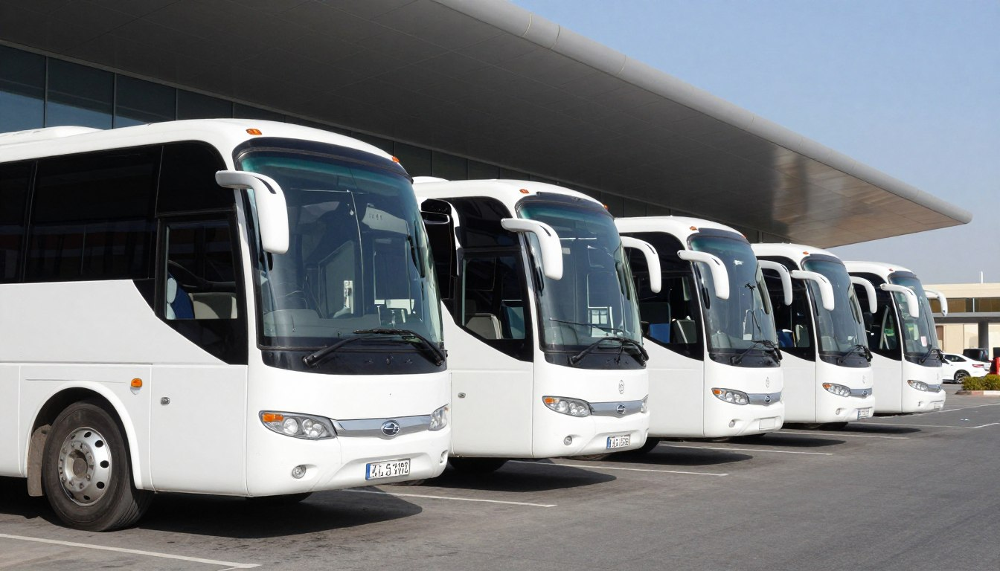

# **Executive Bus Rental and Group Mobility Across the Region**

Professional bus rental provides seamless regional transport for delegations, business teams and large event movements across the Middle East. AB delivers planned coach hire solutions supported by centralised coordination, vetted professional drivers and continuous fleet oversight.

Coordinated ground transportation keeps schedules aligned across major commercial destinations, cross border routes and complex multi venue transfer programmes. Operations run under strict safety standards tailored to corporate requirements.

[Request a proposal](https://seowriting.ai/quote/book) [All services](https://seowriting.ai/services)

- 24/7 dispatch
- 3 countries with our own fleet
- 8 airports served

How we work

## **Disciplined bus rental coordination**

Our managed bus rental network operates through dedicated dispatch teams who monitor regional routes and terminal arrivals continuously. AB coordinates every vehicle journey with unified accountability, giving corporate travel managers direct visibility and complete duty of care.

What you get

## **Built for bus & coach hire**

Transport operations scale to accommodate executive summit programmes, daily corporate shuttles and long distance regional transits.

### 1. **Minibuses to coaches**

Fleet configurations range from compact minibus rental vehicles for executive teams to high capacity coaches for expansive workforce logistics.

### 2. **Licensed drivers**

Every journey operates as a professional bus hire with driver, conducted by fully vetted personnel trained in regional protocol and road safety.

### 3. **Event and staff programmes**

Scheduled luxury bus rental allocations manage daily workforce site shuttles, conference transfers and private group transport on dedicated corporate timetables.

### 4. **Tours and group trips**

Comprehensive coach hire itineraries connect hotels, major project sites, city centres and regional venues with constant operational tracking.

How it runs

## **Three stages, one accountable partner**

Structured operational delivery removes logistical friction across every passenger movement.

### 1. **Brief**

Share passenger manifests, route preferences, schedule requirements and luggage specifications directly with our transportation coordination desk.

### 2. **Plan**

Operations teams structure vehicle allocations, review regional access regulations, schedule route timing and assign experienced driving teams.

### 3. **Operate**

Our Riyadh control centre tracks fleet progress using active GPS monitoring, maintaining schedule fidelity through local dispatch support.

Proven in the region

## **Recent work**

AB handles high profile group logistics across complex commercial, sporting and governmental programmes.

### **FIFA World Cup Qatar 2022**

Coordinated extensive delegate transport, guest shuttles and multi venue fleet logistics throughout the international tournament in Doha under continuous operations control.

### **NEOM Trojena Project**

Delivered rugged passenger transit, remote workforce deployment and technical team movements across remote desert and mountain infrastructure sectors in northwest Saudi Arabia.

Regional coverage

## **Where we run it**

AB operates direct ground transportation infrastructure throughout three primary territories, delivering coordinated services across key metropolitan hubs.

- [bus rental Saudi Arabia](https://seowriting.ai/services/bus-coach-hire/saudi-arabia) serving major industrial hubs, regional airports and corporate developments
- [Bus & Coach Hire in UAE](https://seowriting.ai/services/bus-coach-hire/uae) supporting business summits, hospitality groups and intercity transfers
- [coach hire Qatar](https://seowriting.ai/services/bus-coach-hire/qatar) handling high capacity international delegations, sports groups and corporate shuttles

Local teams support transit across Riyadh, Jeddah, Dubai, Abu Dhabi and Doha, with services in Bahrain, Kuwait and Oman arranged through audited partner networks.

Vehicles typically deployed:

- Executive Van for executive personnel, delegation leadership and VIP support groups
- Coach for high volume team transit, conference shuttles and major site operations

Explore full vehicle specifications and seating configurations: [View the full fleet](https://seowriting.ai/fleet).

Questions

## **Frequently asked questions**

### **What vehicle capacities are available for group transport?**

Vehicle options range from premium passenger vans accommodating smaller executive teams to high capacity touring coaches designed for large delegations. Coordinators evaluate group manifests and baggage volumes to assign the appropriate luxury vehicle configuration for city or highway routes.

### **How does AB manage flight schedules and airport pickups?**

Our operations desk maintains live flight tracking across 8 airports served in Saudi Arabia, the UAE and Qatar. Dedicated meet and greet personnel receive arriving groups, coordinate luggage handling and direct passengers smoothly to the waiting ground transportation fleet.

### **What qualifications do drivers hold?**

Every professional chauffeur and coach operator holds complete regional commercial licensing, background clearances and defensive driving certification. Regular technical training reinforces passenger comfort, route familiarity and strict compliance with local transport authority guidelines across urban and remote sectors.

### **How are routes tracked during multi vehicle corporate events?**

Central teams supervise every journey through integrated GPS tracking managed from the Riyadh control centre. Real time vehicle monitoring allows 24/7 dispatch specialists to update drivers regarding traffic bottlenecks, terminal congestion or itinerary modifications instantly.

### **Can corporate clients set up unified regional billing?**

Organisations managing frequent intercity transport can open a [corporate account](https://seowriting.ai/corporate-accounts) with AB. This operational structure provides consolidated billing, a single monthly invoice and transparent reporting across journeys booked in Riyadh, Dubai, Abu Dhabi and Doha.

### **What past experience does AB have with major sporting tournaments?**

During the FIFA World Cup Qatar 2022, AB mobilised coordinated transport networks across Doha, moving corporate delegates and international sponsor groups between stadiums, accommodation centres and media zones without logistical interruptions.

### **How does AB support infrastructure project logistics in remote regions?**

For the NEOM Trojena Project, our operations division deployed dedicated personnel, heavy transport coaches and support vehicles to sustain daily transit across demanding mountain topography in northern Saudi Arabia, maintaining duty of care standards under rigorous environmental conditions.

### **Which metropolitan centres feature direct AB branch support?**

AB maintains company offices in Riyadh, Dubai, Abu Dhabi and Doha. Clients can arrange specialised [bus rental Riyadh](https://seowriting.ai/services/bus-coach-hire/saudi-arabia/riyadh), book a tailored [bus rental Dubai](https://seowriting.ai/services/bus-coach-hire/uae/dubai) package, schedule a premium [bus rental Abu Dhabi](https://seowriting.ai/services/bus-coach-hire/uae/abu-dhabi) service, or reserve dedicated [bus rental Doha](https://seowriting.ai/services/bus-coach-hire/qatar/doha) transfers through local operations personnel, including options for coach rental dubai.

Fleet solutions

## **Complete mobility services**

Alongside group charters, AB provides a comprehensive selection of executive mobility solutions across the Gulf region:

- Airport Transfers
- Chauffeur Service
- Intercity Transfers
- Event Transportation
- Corporate Shuttles
- VIP Limousine Service
- Private Driver Hire
- Long Term Vehicle Leasing

Review our entire service portfolio online: [Explore all services](https://seowriting.ai/services).

## **Planning bus & coach hire?**

Coordinate your regional group transport with dedicated fleet management, licensed professional drivers and 24/7 operations support across the Middle East. Request an executive bus rental proposal tailored precisely to your schedule.

### **Custom proposals for regional group itineraries**

Organise dependable corporate charters, summit logistics and airport transfers with unified billing and constant flight tracking.

[Request a proposal](https://seowriting.ai/quote/book) [Talk to a planner](https://seowriting.ai/quote/book)

To schedule an immediate single journey or airport connection, you can also [Book a transfer](https://seowriting.ai/quote/book) online.