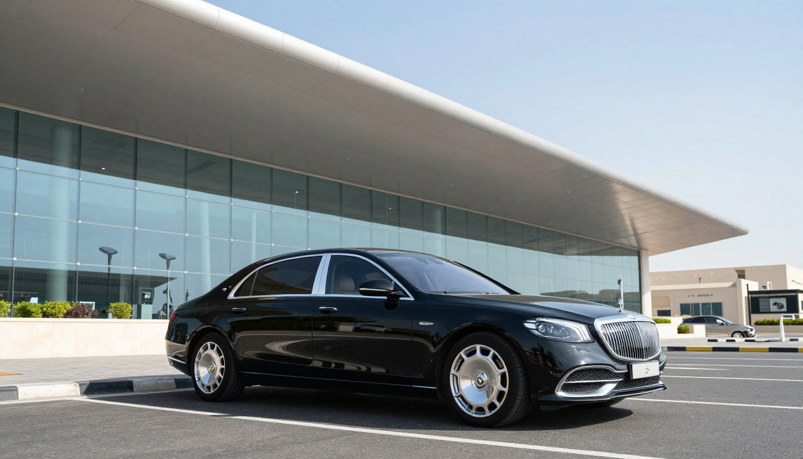
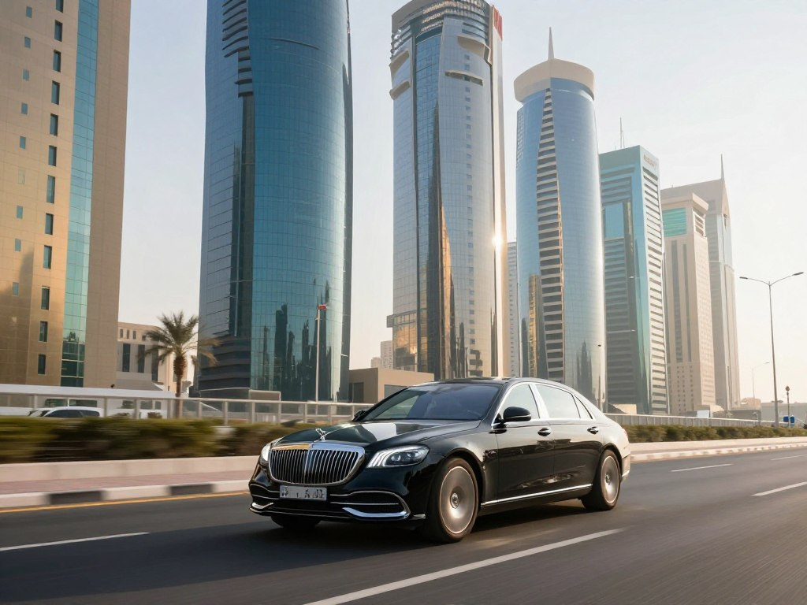
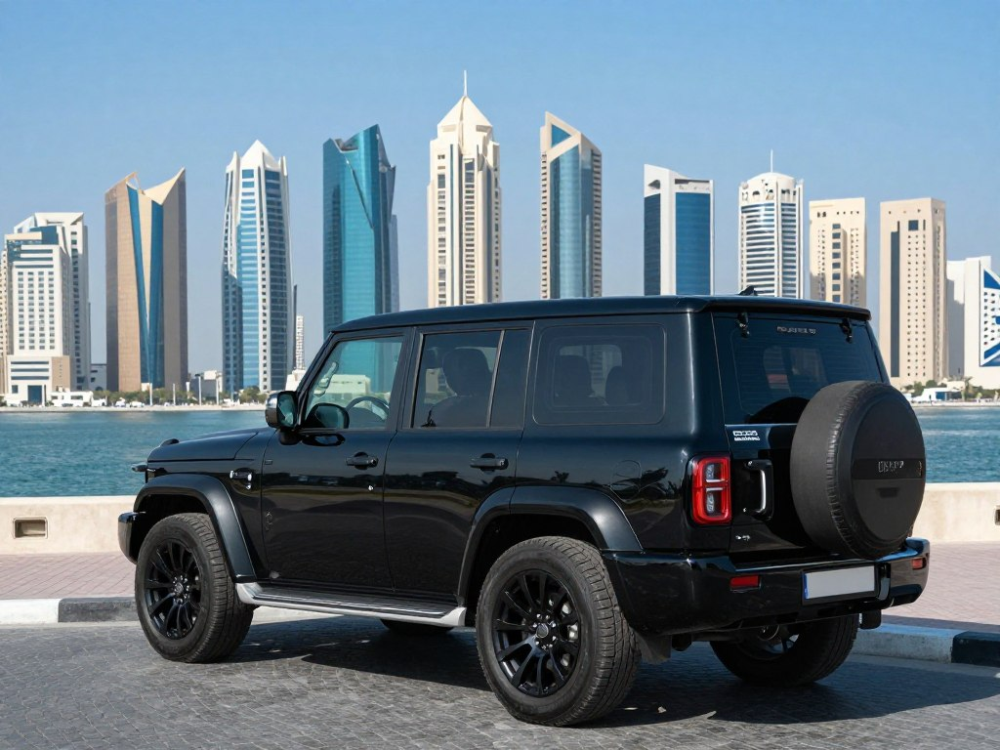
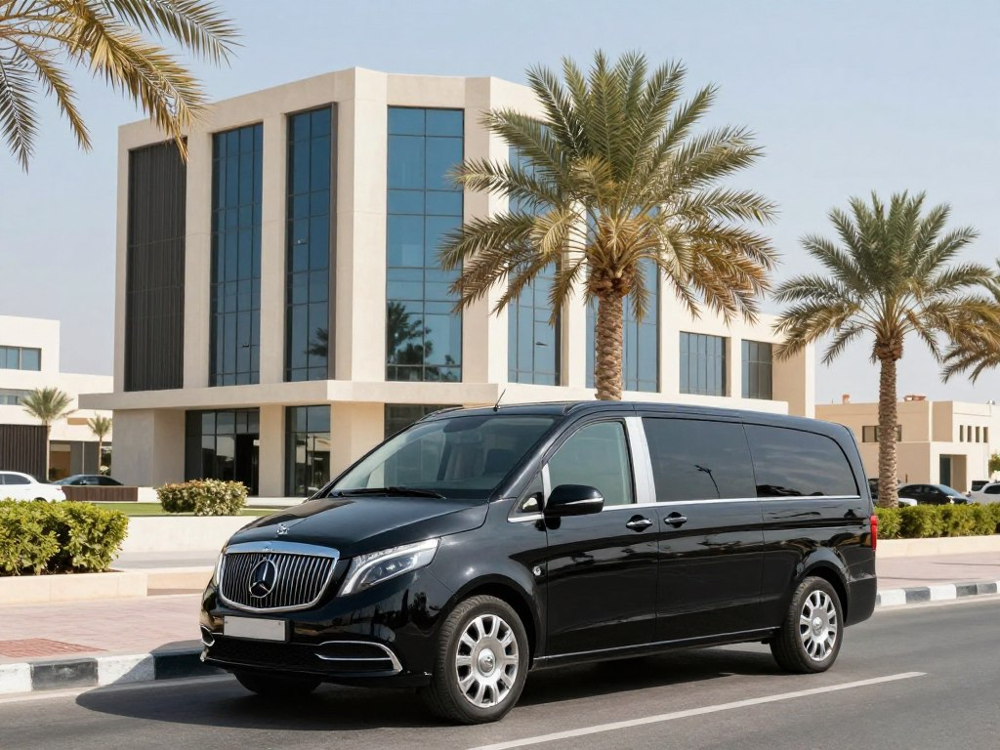
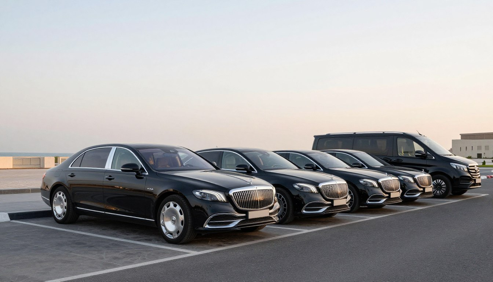
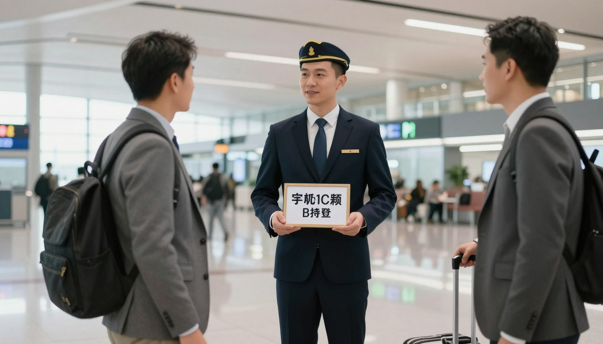

# **Chauffeur & VIP in Qatar Limousine Service**

AB provides premium qatar limousine service for corporate organisations, diplomatic missions, and executive delegations across the country. Our managed ground transportation delivers punctual airport transfers, as directed hourly bookings, and intercity mobility with absolute discretion and professional protocol standards.

[Book now](https://seowriting.ai/services/chauffeur-vip) [Request a proposal](https://seowriting.ai/services/chauffeur-vip)

| Pick up                     | Drop off      | Date and time     | Get a quote |
| --------------------------- | ------------- | ----------------- | ----------- |
| Hamad International Airport | West Bay Doha | Selected Schedule | Get a quote |

Coverage

## **Chauffeur & VIP across Qatar**

Executive travel demands precision timing across every commercial district and government enclave in the country. Our managed operations desk coordinates vehicle deployments across major urban centres, connecting financial districts, diplomatic missions, and deepwater maritime facilities. For organisations requiring nationwide mobility, our managed [chauffeur service Qatar](https://seowriting.ai/locations/qatar) network covers all commercial zones and transport terminals.

Corporate itineraries frequently require fluid movement between business meetings in the capital, project sites in coastal zones, and state summits in newly developed urban centres. Ground travel in the region involves navigating complex highway networks and stringent security perimeters. AB maintains constant operational communication with local drivers to circumvent traffic congestion around key business corridors.

Organisations seeking dedicated VIP transport Qatar solutions benefit from our managed fleet and protocol trained drivers. Our dispatchers monitor regional road developments, peak hour congestion patterns, and municipal access regulations continuously. This active coordination protects executive schedules, allowing corporate travelers to concentrate on commercial objectives while in transit.

Strategic vehicle staging near central commercial districts supports rapid mobilization for unexpected scheduling adjustments or urgent delegation arrivals. Whether coordinating transport for a single chief executive or managing an entire conference convoy, our operations framework maintains strict service consistency across all Qatari municipalities.

### **Doha**

Corporate travel in Doha demands punctuality across West Bay, Msheireb Downtown, and diplomatic quarters. AB coordinates executive transfers, airport arrivals from Hamad International Airport, and protocol movements across the capital. Corporate teams rely on our dedicated chauffeurs for efficient transfers between high level appointments.

[VIP chauffeur Doha](https://seowriting.ai/services/chauffeur-vip/qatar/doha)

### **Lusail**

Lusail represents the modern commercial frontier of Qatar, housing multinational headquarters, entertainment venues, and Marina promenade developments. AB provides seamless intercity connectivity between central Doha and Lusail commercial towers. Corporate clients rely on our chauffeurs for discrete executive travel throughout this expanding smart city.

[Explore Lusail](https://seowriting.ai/services/chauffeur-vip/qatar/lusail)

### **Al Wakrah**

Al Wakrah connects southern commercial operations, logistics centres, and historic coastal districts with the capital. AB manages corporate journeys and event transfers connecting Al Wakrah with major transport corridors and industrial zones. Our professional chauffeurs maintain timely arrivals for enterprise teams traveling across the municipality.

[Explore Al Wakrah](https://seowriting.ai/services/chauffeur-vip/qatar/al-wakrah)

Fleet

## **Executive Fleet for Limousine Service Qatar**

A distinguished fleet serves as the operational backbone for our executive transportation programmes. Booking a VIP chauffeur Qatar through AB guarantees access to premium sedans, SUVs, and luxury vans maintained to international standards. Every vehicle in our fleet features a uniform black exterior livery, creating an understated and authoritative presence suited for corporate and diplomatic engagements.

Passenger cabins are prepared to pristine executive standards before each dispatch. Vehicles feature supple leather seating, individual climate zone controls, acoustic insulation, and onboard wireless connectivity. These appointments transform travel time into productive working hours, allowing visiting executives to review confidential documents or conduct telephone conferences in total privacy.

Fleet governance follows strict manufacturer maintenance schedules alongside regular commercial safety audits. Our technicians conduct routine mechanical evaluations, tyre inspections, and diagnostic system checks before any vehicle departs the staging facility. This meticulous preventive care reduces operational risks and supports smooth journeys across urban highways and intercity routes.

To satisfy diverse corporate travel requirements, AB classifies vehicles according to passenger volume and luggage capacity. Corporate travel managers can select specific configurations based on delegation size, ensuring that executive personnel and their belongings travel without physical constraints.

All fleet vehicles feature real time digital telemetry and GPS tracking monitored continuously by our central dispatch desk. This operational oversight allows route coordinators to support driver navigation and verify passenger safety throughout every scheduled journey.

### **First Class Sedan**

Flagship luxury sedans offer quiet passenger cabins, climate controls, and refined leather seating for executive travel. Suited for senior executives and diplomatic transfers. Mercedes S Class or similar \[Confirm\].

### **Executive SUV**

Spacious luxury sport utility vehicles deliver commanding road presence with ample room for passengers and executive luggage. Suited for project delegations and site visits. Cadillac Escalade or similar \[Confirm\].

### **Luxury MPV**

Premium multi purpose vehicles feature conference style seating configurations allowing executives to collaborate on road journeys between corporate meetings. Suited for executive teams and small delegations. Mercedes V Class or similar \[Confirm\].

### **Executive Minibus**

Refined high capacity vehicles accommodate corporate event groups and conference attendees without compromising passenger comfort. Suited for delegation transfers and summit operations. Mercedes Sprinter or similar \[Confirm\].

Operations

## **How Our Qatar Limousine Service Operates**

Organised executive mobility relies on clear operational processes and structured dispatch protocols. Selecting a managed executive car service Qatar eliminates ground travel uncertainties during high profile summits. Our reservation system links directly with the regional transport control room, where controllers manage flight schedules, route timing, and driver assignments around the clock.

When booking an airport transfer, flight tracking technology updates our dispatch desk regarding departure times, airborne progress, and arrival runway touch downs. If a corporate flight experiences delays or arrives ahead of schedule, dispatchers adjust driver staging times automatically. This continuous tracking eliminates passenger waiting times and prevents unnecessary vehicle idling outside airport terminals.

Our operations framework integrates comprehensive driver vetting, digital route navigation, and centralized enterprise invoicing. Clients booking ground travel across multiple Gulf destinations can coordinate all itineraries through a single point of contact. This unified approach simplifies logistics management for corporate travel administrators and executive support teams.

The reservation workflow follows three straightforward phases designed to deliver dependable ground transportation for enterprise travelers and international delegations.

1. **Submit Route Details**: Provide your itinerary, passenger manifest, flight numbers, and vehicle preferences through our reservation portal or concierge dispatch team. Corporate travel managers receive immediate confirmation with allocated booking references.
2. **Professional Chauffeur Dispatch**: Our operations centre assigns a licensed chauffeur, stages the sanitized luxury vehicle, and monitors inbound flights in real time. Passengers receive driver details and vehicle registration before departure.
3. **Flawless Journey Execution**: Experience terminal meet and greet arrivals, discreet executive transport, and proactive route management across all Qatari destinations. Corporate billing consolidates all journey items into a transparent monthly invoice.

Compliance

## **Qatar Limousine Service Standards and Duty of Care**

AB operates in strict compliance with Qatari transport regulations and national licensing frameworks. Every vehicle in our fleet holds full commercial registration, comprehensive passenger insurance, and valid municipal permits. Our professional chauffeurs possess verified commercial driving credentials, local licence \[Confirm: licensing credential\], and protocol clearance. We enforce rigorous duty of care protocols, regular mechanical inspections, and non disclosure confidentiality agreements to safeguard corporate travelers throughout Qatar.

Every chauffeur driven car Qatar deployed by AB undergoes mechanical maintenance and daily safety checks. Drivers undergo extensive background evaluations, medical fitness reviews, and advanced road safety training. These measures protect passenger welfare and support compliance with enterprise duty of care mandates established by global corporations and governmental bodies.

Confidentiality represents a core tenet of our executive transportation services. Chauffeurs understand the sensitive nature of discussions conducted in passenger cabins during financial roadshows and state visits. Personnel adhere to non disclosure commitments and maintain an unobtrusive, professional demeanor throughout every assignment.

Cross border executive transportation across the wider region is managed through our established network of regional offices. Headquartered in Riyadh, Saudi Arabia, AB operates regional branches in Dubai, Abu Dhabi, and Doha. The Doha operational base is situated at Office 110, Building 100, Zone 26, Street 310, Old Airport Road, Doha, Qatar, +974 7734 3300. Journeys extending into Bahrain, Kuwait, and Oman are coordinated through thoroughly vetted regional partners upon request.

Duty of care compliance includes comprehensive passenger liability coverage, emergency response procedures, and continuous journey monitoring from our regional operations desk in Riyadh.

## **Frequently Asked Questions**

### **How does AB coordinate VIP transport Qatar for corporate executives?**

AB manages VIP transport Qatar through our dedicated operations desk, providing luxury vehicles and licensed chauffeurs for executive travel. Corporate clients submit flight itineraries or meeting schedules, and our team monitors route conditions in real time. Each journey includes professional greeting services, executive luggage assistance, and transparent billing managed through an established corporate account.

### **What qualifications does each VIP chauffeur Qatar maintain?**

Every VIP chauffeur Qatar working with AB undergoes comprehensive background verification, protocol training, and defensive driving assessments. Chauffeurs hold commercial driving licences, local licence \[Confirm: licensing credential\], and municipal permits required for operating executive transport. Our personnel sign strict non disclosure agreements to safeguard client confidentiality during roadshows, diplomatic visits, and corporate transfers.

### **Can multinational companies establish a corporate account for limousine service Qatar?**

Multinational firms and government entities can establish a centralized corporate account for limousine service Qatar with AB. Corporate accounts provide priority vehicle allocation, flexible payment terms, and consolidated monthly invoice reporting mapped to specific internal cost centres. Dedicated account managers assist travel administrators with multi city itineraries across Qatar, Saudi Arabia, and the UAE.

### **What flight monitoring features support executive car service Qatar airport transfers?**

When booking an executive car service Qatar airport transfer at Hamad International Airport, our dispatch desk tracks flight arrivals automatically. Chauffeurs adjust staging times according to early landings or flight delays without requiring client intervention. The chauffeur greets passengers inside the arrival terminal, assists with luggage, and escorts travelers directly to the waiting vehicle.

### **How can clients book a chauffeur driven car Qatar on an hourly basis?**

Clients can reserve a chauffeur driven car Qatar under an as directed hourly booking arrangement for flexible daily schedules. This service provides continuous vehicle standby between corporate appointments, financial roadshows, and official functions across Doha and Lusail. Travel managers can adjust destinations spontaneously while the private driver remains available throughout the reserved booking duration.

### **Which vehicle classes are available for qatar limousine service bookings?**

Our qatar limousine service fleet comprises late model black luxury sedans, premium sport utility vehicles, executive multi purpose vehicles, and executive minibuses. Flagship sedans suit individual executive travel, while larger luxury vans accommodate corporate delegations and summit transport. Every vehicle features immaculate leather interiors, climate control, and digital communications equipment.

### **What duty of care measures govern ground transportation operations in Qatar?**

AB enforces comprehensive duty of care protocols across all ground transportation movements in Qatar. Vehicles undergo routine mechanical inspections and digital GPS tracking overseen continuously by our operations centre. Our operations desk adheres to local transport authority standards, maintains full commercial passenger insurance, and audits chauffeur driving records periodically.

### **How does AB support cross border executive travel within the GCC?**

AB coordinates regional executive transportation directly across Qatar, Saudi Arabia, and all seven emirates of the UAE. Cross border journeys between Doha, Riyadh, and Dubai are supported by our centralized dispatch desk and pre cleared documentation. Services connecting Bahrain, Kuwait, and Oman are facilitated through thoroughly vetted regional partner networks on request.

## **Reserve Your Qatar Limousine Service in Qatar**

Coordinate reliable corporate ground transportation with AB for executive meetings, airport transfers, and delegation summits across the country. Our 24/7 dispatch desk supports corporate travel managers with transparent billing, flight tracking, and dedicated chauffeurs.

### **Executive Chauffeur Reservations Across Qatar**

Submit your delegation itinerary or establish a managed corporate mobility account with AB.

[Request a proposal](https://seowriting.ai/services/chauffeur-vip) [Book a transfer](https://seowriting.ai/services/chauffeur-vip)