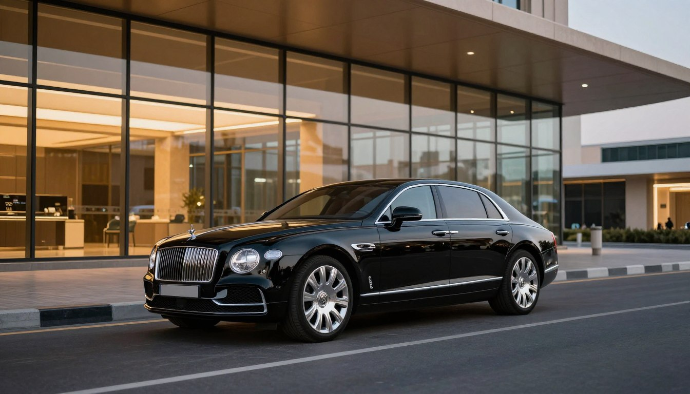
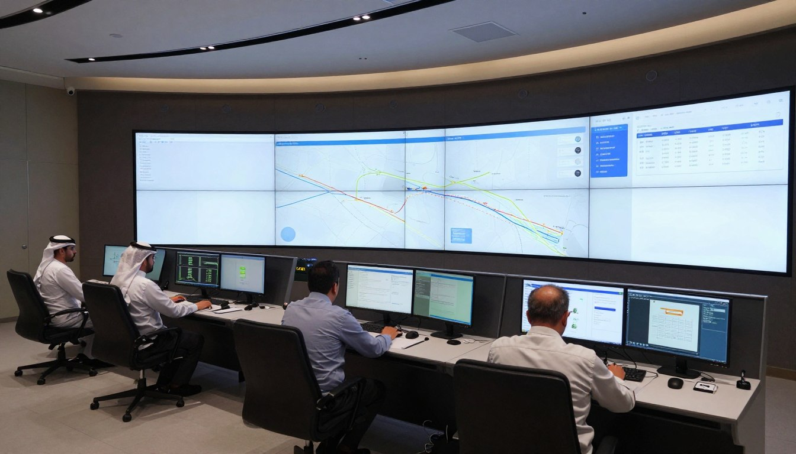
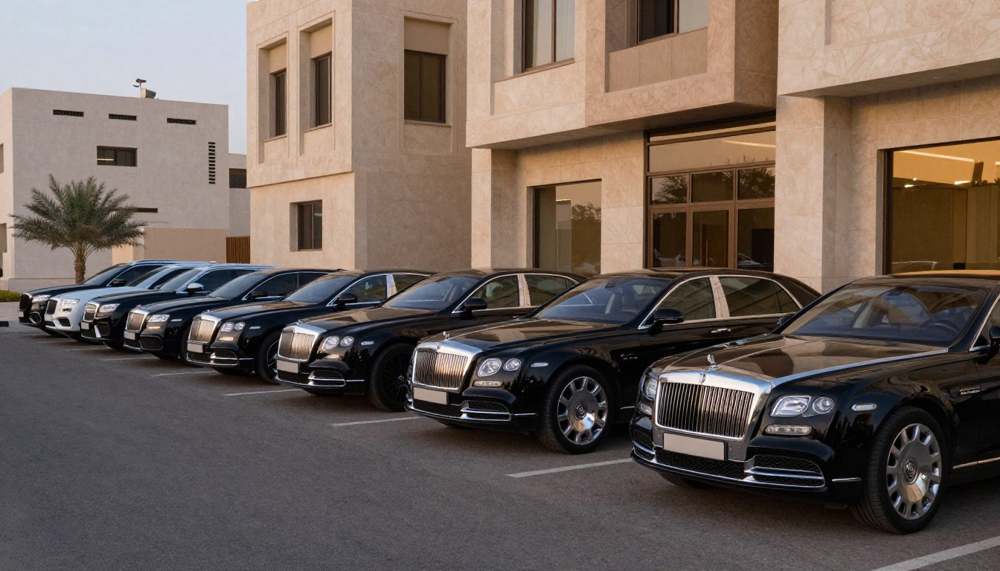
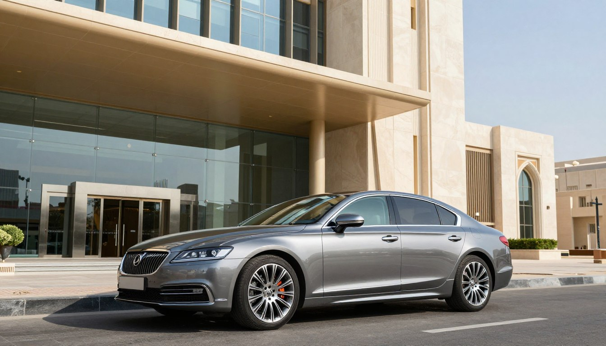

# **Chauffeur & VIP in Riyadh: VIP Transport Riyadh**

AB provides discreet VIP transport Riyadh solutions for corporate delegations and executive leaders across the capital. Professional chauffeurs navigate central Riyadh with precision, connecting premier commercial districts, government ministries, and private aviation terminals smoothly every day.

Corporate travel requirements depend on itinerary complexity, vehicle capacity needs, and required protocol levels. Selecting the appropriate luxury vehicle and reservation framework supports efficient movement throughout the metropolitan area.

[Book now](https://seowriting.ai/quote/book) [View the fleet](https://seowriting.ai/services/chauffeur-vip)

| Pick up                                 | Drop off         | Date and time   | Quote                                           |
| --------------------------------------- | ---------------- | --------------- | ----------------------------------------------- |
| King Khalid International Airport (RUH) | City destination | Select schedule | [Get a quote](https://seowriting.ai/quote/book) |

Capital City Operations

## **Operational Excellence in VIP Transport Riyadh**

AB coordinates ground logistics across the capital through a dedicated central operations facility. Our dispatch infrastructure supports multinational enterprises, ministerial delegations, and visiting dignitaries navigating major financial and diplomatic districts. Detailed local fleet distribution and operational capacities are verified prior to formal contract deployment \[Confirm: what AB runs here\].

Ground operations connect seamlessly with regional networks across Saudi Arabia as well as direct hubs in the UAE and Qatar. Our team oversees private driver schedules, protocol clearances, and round the clock operations to maintain high service standards. Corporate clients rely on centralised coordination for both individual transfers and complex multi vehicle programmes.

Central operations coordinate every VIP transport Riyadh itinerary using active route tracking and proactive traffic mitigation. Real time dispatch supervision assists drivers in avoiding congested corridors during peak business hours.

Comprehensive fleet oversight enables timely vehicle positioning for corporate events, financial summits, and diplomatic engagements. Discover our broader national presence through [Chauffeur & VIP Saudi Arabia](https://seowriting.ai/services/chauffeur-vip/saudi-arabia) solutions designed for enterprise mobility.

Executive Fleet

## **Executive Fleet Options for VIP Transport Riyadh**

AB maintains an immaculate fleet of late model vehicles configured specifically for corporate and diplomatic mobility. Every luxury vehicle undergoes rigorous mechanical servicing, multi point safety checks, and daily detailing to preserve an exceptional standard of presentation. Private cabins provide quiet workspaces where passengers can conduct conversations or review briefing documents in comfort.

Fleet allocation aligns with passenger volume, luggage volume, and specific event security requirements. Dedicated account managers assist clients in reserving the ideal category for single transfers, continuous as directed service, or large scale summit logistics. Discover our core vehicle classes available for deployment across the capital \[Confirm: local fleet\]:

- **Standard Sedan**: Refined city transit for individual passengers. Equipped for swift urban transfers, providing comfortable leather seating and climate control. Ideal for corporate associates travelling between central commercial offices and scheduled appointments across Riyadh \[Confirm: local fleet\].
- **Business Sedan**: Professional travel for corporate management. Featuring premium interior appointments, integrated device charging, and acoustic dampening. Chosen by business executives requiring a quiet cabin environment to prepare for meetings throughout the capital \[Confirm: local fleet\].
- **First Class Sedan**: Flagship prestige for executive leadership. Supplying extended legroom, refined cabin materials, and active air purification systems. Tailored for diplomatic visitors and chief executives demanding exceptional privacy during vital metropolitan transfers \[Confirm: local fleet\].
- **Executive SUV**: Elevated presence and generous luggage space. Combining commanding road visibility with generous rear seating and expansive luggage volume. Suitable for visiting delegations, security details, and executives managing regional site visits across Riyadh province \[Confirm: local fleet\].
- **Premium MPV**: Versatile luxury for collaborative teams. Configured with flexible conference style seating arrangements and onboard connectivity. Suited for project teams and corporate groups conducting discussions whilst travelling between business hubs and official venues \[Confirm: local fleet\].
- **Executive Van**: Coordinated transport for delegate groups. Designed for larger management delegations, media production crews, or ministerial support teams. Provides ample headroom, dedicated baggage capacity, and effortless boarding for scheduled event transfers across the city \[Confirm: local fleet\].
- **Coach**: Large scale logistics for summit delegations. Delivering comfortable group movements for international congresses, corporate gatherings, and official symposiums. Outfitted with reclining seats, overhead storage, and climate management for extended delegate journeys \[Confirm: local fleet\].

Each category represents a dependable ground transportation asset managed through unified dispatch protocols. Whether scheduling a premium saloon or an executive van, clients receive uniform service quality backed by professional fleet governance.

Popular journeys

## **Across Riyadh and beyond**

Navigating the sprawling road network of Riyadh requires strategic timing and in depth route knowledge. Our chauffeurs select optimal travel corridors to maintain punctual arrivals at critical commercial and administrative centres across the capital. Standard point to point journeys and flexible as directed reservations provide continuous mobility for demanding business schedules.

Reliable airport transfers remain a cornerstone of our daily metropolitan operations. Arriving guests connect smoothly from [King Khalid International Airport](https://seowriting.ai/airports/king-khalid-international-ruh) terminals to central business addresses, avoiding rental queues and navigation stress. Review our common operational corridors across the city \[Confirm: 3 routes or venues with times\]:

### **Airport to KAFD Financial District**

From \[SAR price\] · \[Confirm\] minutes

Direct route linking international arrivals to corporate towers in King Abdullah Financial District \[Confirm: 3 routes or venues with times\].

### **Diplomatic Quarter to Olaya District**

From \[SAR price\] · \[Confirm\] minutes

Secure ground travel between embassy compounds and central commercial headquarters along King Fahd Road \[Confirm: 3 routes or venues with times\].

### **Airport to Historic Diriyah Gate**

From \[SAR price\] · \[Confirm\] minutes

Executive transit connecting private aviation terminals with premier cultural venues and luxury hospitality hubs \[Confirm: 3 routes or venues with times\].

Intercity transit extends from central Riyadh to industrial hubs, eastern province offices, and regional development zones. Fixed pricing structures and upfront journey coordination provide full clarity for corporate expense auditing.

Recent work

## **Recent Deployment in the Capital**

During a major international economic forum in the capital, AB deployed a dedicated fleet of executive sedans and multi purpose vehicles. Operations staff coordinated airport arrivals, hotel transfers, and secure venue transit across four consecutive days with continuous central dispatch monitoring. Complete local operational specifics, vehicle counts, and exact delegate profiles remain on record with dispatch management \[Confirm: one local example\].

Event logistics require meticulous schedule synchronisation to handle sudden flight diversions and changing meeting locations. Central dispatchers update driver itineraries instantly using internal tracking software.

The successful execution of multi vehicle movements demonstrates the strength of our local infrastructure. Detailed reporting and centralised billing allowed the organising protocol committee to review ground logistics efficiency across all operational phases.

## **Chauffeur & VIP in Riyadh: your questions**

### **How does AB coordinate arrivals at King Khalid International Airport?**

AB flight tracking systems monitor commercial and private aviation movements in real time before vehicle dispatch. Chauffeurs provide a professional meet and greet service inside the terminal hall, assisting with luggage before escorting passengers to their waiting vehicle. Operational protocols for customs clearance and terminal staging remain tailored to current airport authority regulations \[Confirm: 2 local FAQs\].

### **Can AB provide access to restricted zones like the Diplomatic Quarter?**

Chauffeurs assigned to diplomatic missions possess verified identification and follow official access procedures for diplomatic compounds across Riyadh. Our 24/7 dispatch desk coordinates security manifests in advance to facilitate smooth entry through perimeter checkpoints without administrative delays. Detailed gate protocols and credential verifications are established directly with client travel managers \[Confirm: 2 local FAQs\].

### **How does AB uphold duty of care for corporate travellers?**

AB enforces strict driver background screening, comprehensive insurance coverage, and continuous GPS tracking across the entire fleet. Every vehicle undergoes daily mechanical inspections and sanitisation procedures before deployment. Corporate clients receive full transparency regarding routing, driver credentials, and real time vehicle positioning throughout every reserved journey.

### **Can corporate accounts receive consolidated monthly invoicing?**

Corporate account holders gain access to centralised billing solutions that aggregate regional ground transportation expenses into one monthly invoice. This streamlined accounting structure simplifies expense reporting and VAT documentation for multinational finance departments. Account coordinators also provide custom management reports detailing trip volumes, route frequencies, and expenditure breakdowns upon request.

### **What distinguishes a private driver from an executive chauffeur Riyadh service?**

While a basic private driver provides standard transit, an executive chauffeur Riyadh service provides advanced protocol training, defensive driving skills, and heightened discretion. Chauffeurs anticipate schedule adjustments, maintain pristine vehicle presentations, and coordinate closely with central dispatch. Visiting executives who book our [chauffeur service in Riyadh](https://seowriting.ai/locations/saudi-arabia/riyadh) experience a productive mobile workspace between appointments.

### **How far in advance should clients book VIP chauffeur Riyadh vehicles?**

Reservations can be confirmed through our digital booking portal or regional dispatch team up to several months ahead of scheduled travel. While on demand requests are accommodated subject to vehicle availability, advance notice helps operations secure specific vehicle classes for multi car delegations. Early reservation is particularly recommended during peak commercial summit seasons in the capital.

AB Riyadh, headquarters and 24/7 dispatch: Building 3036, Office 08, 2nd Floor, Umar Ibn Abdulaziz Road, Al Malaz, Riyadh, Saudi Arabia, +966 58 111 8720.

## **Book chauffeur & vip in Riyadh**

Selecting professional ground transport provides executive passengers with dependable mobility, discretion, and peace of mind across the capital. Enterprise organisations benefit from structured billing, duty of care compliance, and unified dispatch coordination for all urban movements.

### **Reserve Your VIP Ground Transport**

Arrange your VIP transport Riyadh reservations with our 24/7 operations team to receive seamless ground travel management across the Kingdom.

[Request a proposal](https://seowriting.ai/quote/book) [Book a transfer](https://seowriting.ai/quote/book)

+966 58 111 8720