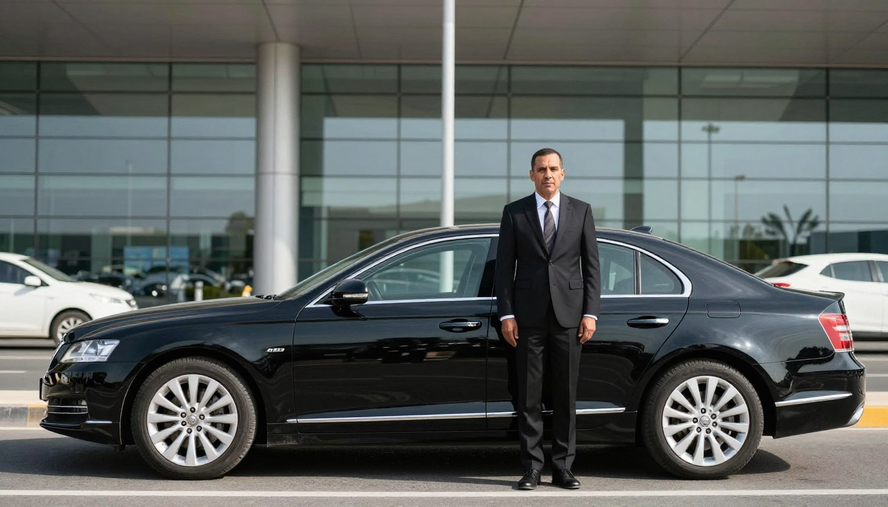

# **Chauffeur Service Across Saudi Arabia, the UAE and Qatar**

AB delivers managed chauffeur service solutions across Saudi Arabia, the UAE and Qatar for corporate and official delegations. Our operations connect executive teams with vetted drivers, uniform luxury vehicles and continuous route monitoring from our primary control centre.

Schedules remain coordinated whether booking an airport transfer or organising multi city itineraries. Every booking reflects strict safety protocols, transparent billing and direct communication with transport dispatchers.

[Request a proposal](https://seowriting.ai/quote/book) [All services](https://seowriting.ai/services)

24/7dispatch

3countries with our own fleet

8airports served

How we work

## **A Chauffeur Service Built for Regional Mobility**

Our chauffeur service operates through centrally owned fleet assets and local operations teams in Riyadh, Dubai, Abu Dhabi and Doha. We coordinate executive car service itineraries with constant flight tracking, transparent reporting and dedicated fleet managers who maintain protocol standards on every journey.

What you get

## **Built for chauffeur & vip**

### **1\. Executive and VIP travel**

Tailored mobility programmes for senior leadership, state visitors and corporate delegations. Each VIP chauffeur maintains strict confidentiality while operating premium sedans or luxury sport utility vehicles.

### **2\. Hourly and daily chauffeurs**

Flexible scheduling structured around demanding meeting calendars and diplomatic summits. Book an hourly chauffeur or secure daily standby coverage with dedicated vehicles remaining on site.

### **3\. Protocol and discretion**

Chauffeurs trained in regional etiquette, diplomatic motorcade procedures and non disclosure standards. Journeys remain private, calm and aligned with official ministerial or corporate governance guidelines.

### **4\. One account**

Consolidated billing across multiple GCC jurisdictions through a single corporate framework. Receive transparent monthly invoice statements with detailed trip data, route logs and uniform pricing.

How it runs

## **Three stages, one accountable partner**

### **1\. Brief**

Submit flight schedules, passenger manifests and vehicle tier preferences to our coordination desk. We review route access, terminal regulations and timing windows across each destination.

### **2\. Plan**

Our operations team assigns dedicated vehicles, performs route verifications and coordinates security credentials. Flight tracking and driver details are confirmed well before arrival.

### **3\. Operate**

Vehicles deploy under active GPS tracking and continuous central dispatch oversight. Drivers manage curbside arrivals, luggage handling and route adjustments without passenger disruption.

Proven in the region

## **Recent work**

### **Best Supplier Award in the Middle East**

Recognised across regional transport networks for dependable execution, fleet presentation standards and complex multi vehicle coordination during large scale commercial summits.

### **presidential delegation**

Delivered secure motorcade support and continuous standby chauffeur operations for visiting heads of state, international ministries and official diplomatic attachés.

## **Where we run it**

AB operates owned fleet networks across primary Gulf commercial centres, delivering consistent standards across national borders. Select a territory to view local fleet allocations and operational capabilities:

- [Chauffeur & VIP in Saudi Arabia](https://seowriting.ai/services/chauffeur-vip/saudi-arabia)
- [Chauffeur & VIP in UAE](https://seowriting.ai/services/chauffeur-vip/uae)
- [Chauffeur & VIP in Qatar](https://seowriting.ai/services/chauffeur-vip/qatar)

Clients arranging [VIP transport Riyadh](https://seowriting.ai/services/chauffeur-vip/saudi-arabia/riyadh) assignments or reserving an [executive chauffeur Riyadh](https://seowriting.ai/services/chauffeur-vip/saudi-arabia/riyadh) team benefit from direct coordination through our central operations office. We also support corporate programmes in the Emirates through our [VIP chauffeur Dubai](https://seowriting.ai/services/chauffeur-vip/uae/dubai) team, provide cross border support via our [qatar limousine service](https://seowriting.ai/services/chauffeur-vip/qatar) network, and arrange private bookings such as a [luxury car with driver Riyadh](https://seowriting.ai/locations/saudi-arabia/riyadh) schedule.

### **Vehicles typically deployed**

Our fleet consists of late model luxury vehicles prepared under strict maintenance guidelines. Passengers can relax in a comfortable chauffeur driven car tailored to their travel specifications:

- Business Sedan: premium executive travel suited for solo corporate travellers and airport transfers.
- First Class Sedan: flagship luxury sedans offering generous legroom, privacy and quiet cabins for senior leadership.
- Executive SUV: spacious all wheel drive vehicles accommodating small delegations, security details and luggage.
- Premium MPV: luxury multi purpose vans configured for delegation movements and conference transit.

Review vehicle configurations and seating capacities by visiting our fleet directory: [View the full fleet](https://seowriting.ai/fleet).

Questions

## **Frequently asked questions**

### **What geographical coverage does your chauffeur service provide?**

AB provides direct ground transportation services across Saudi Arabia, all seven UAE emirates and Qatar using our owned fleet. We maintain registered offices in Riyadh, Dubai, Abu Dhabi and Doha, with primary central dispatch managed from Riyadh. Journeys across Bahrain, Kuwait and Oman are available upon advance request through our network of vetted regional partners.

### **How does AB support high profile VIP travel and government delegations?**

Our VIP travel division assigns protocol trained drivers experienced in diplomatic etiquette and secure convoy procedures. As demonstrated during our support for a presidential delegation, our team manages route security clearances, tarmac access coordination and continuous vehicle standby. Vehicles undergo rigorous mechanical inspection and sanitisation before passenger boarding.

### **What operational standards earned AB the Best Supplier Award in the Middle East?**

AB received the Best Supplier Award in the Middle East following demonstrated performance in punctuality, driver training standards and fleet reliability. Our central operations team coordinates live tracking and communication across borders, allowing enterprise clients to deploy uniform mobility programmes without relying on fragmented third party brokers.

### **How are corporate accounts and billing managed across multiple countries?**

Enterprise clients access a unified corporate account that consolidates ground travel across Saudi Arabia, the UAE and Qatar. We generate a single itemised monthly invoice detailing passenger names, cost centres, routing records and mileage. This administrative structure eliminates multi currency expense reconciliation for regional procurement teams.

### **How does your 24/7 dispatch centre maintain duty of care?**

Our Riyadh dispatch headquarters monitors active journeys round the clock using live GPS tracking and telemetry systems. Dispatchers track regional road conditions, manage unexpected itinerary adjustments and maintain constant contact with every professional chauffeur. This continuous oversight supports strict organisational duty of care obligations for corporate travellers.

### **What is included in airport meet and greet services?**

Airport transfers include automated flight tracking, curbside or terminal meet and greet coordination, and complete luggage handling. A professional private driver monitors real time flight adjustments to align arrivals smoothly. Drivers hold personalised electronic name boards in arrival halls and escort passengers directly to their waiting luxury vehicle.

### **Can clients book an hourly chauffeur or full day dedicated vehicle?**

Clients can schedule an hourly chauffeur or book daily and weekly dedicated standby service across all operating cities. The assigned vehicle and driver remain exclusively at your disposal throughout the booked duration, supporting fluid schedules between board meetings, industrial site visits and evening official dinners.

### **How do corporate travel organisers request proposals or confirm bookings?**

Organisers can submit comprehensive itinerary briefs through our online booking portal or contact our regional sales planners directly. We outline vehicle allocations, protocol provisions and consolidated rate schedules tailored to your travel scope. Account holders can reserve individual journeys or large event fleets with immediate confirmation.

## **Ground Mobility Beyond Core Chauffeur Service**

Alongside our VIP chauffeur service, AB provides specialised ground mobility programmes tailored for corporate organisations, international delegations and event coordinators across the Gulf region:

- Airport transfers: prompt terminal pickups with flight monitoring across all regional airports.
- Corporate event transport: coordinated fleet movements for global exhibitions, forums and conferences.
- Financial roadshows: precision multi stop transport for banking executives and investor meetings.
- Intercity transfers: direct city to city journeys connecting commercial hubs across Saudi Arabia and the UAE.
- Diplomatic and embassy services: secure protocol transport for foreign missions and state guests.
- Flight crew logistics: scheduled transfers for commercial and charter airline crew members.
- Private aviation ground handling: airside and FBO terminal transfers for private jet passengers.
- Monthly vehicle with driver: long term dedicated vehicles and professional drivers for resident executives.

To establish centralised company agreements, explore our dedicated [corporate accounts](https://seowriting.ai/corporate-accounts). You can also view our full range of solutions on the main [services](https://seowriting.ai/services) portal or reserve immediate travel using our booking page: [Book a transfer](https://seowriting.ai/quote/book).

## **Planning chauffeur & vip?**

Contact our Riyadh operations team today to coordinate an executive chauffeur service tailored to your executive itineraries across Saudi Arabia, the Emirates and Qatar.

[Request a proposal](https://seowriting.ai/quote/book) [Talk to a planner](https://seowriting.ai/quote/book)