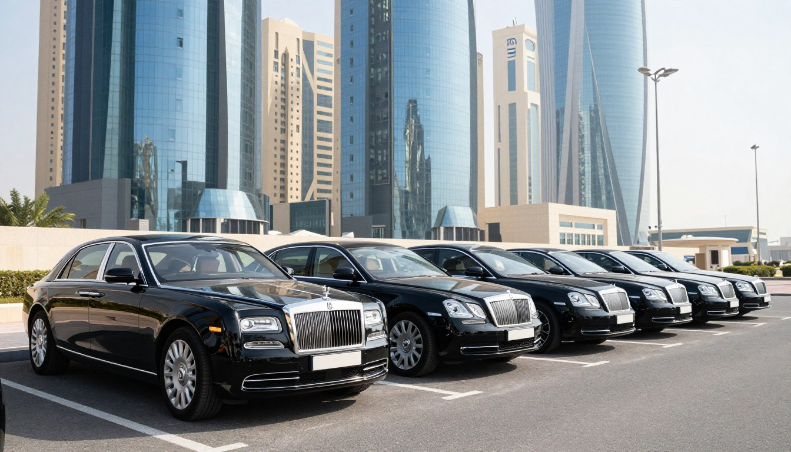
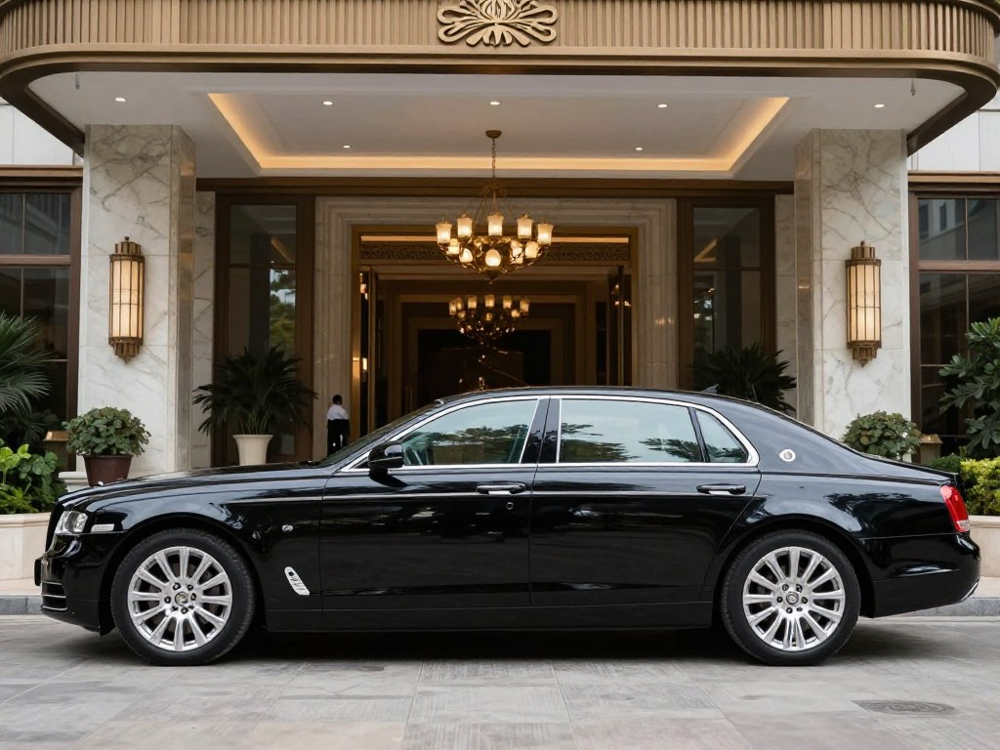
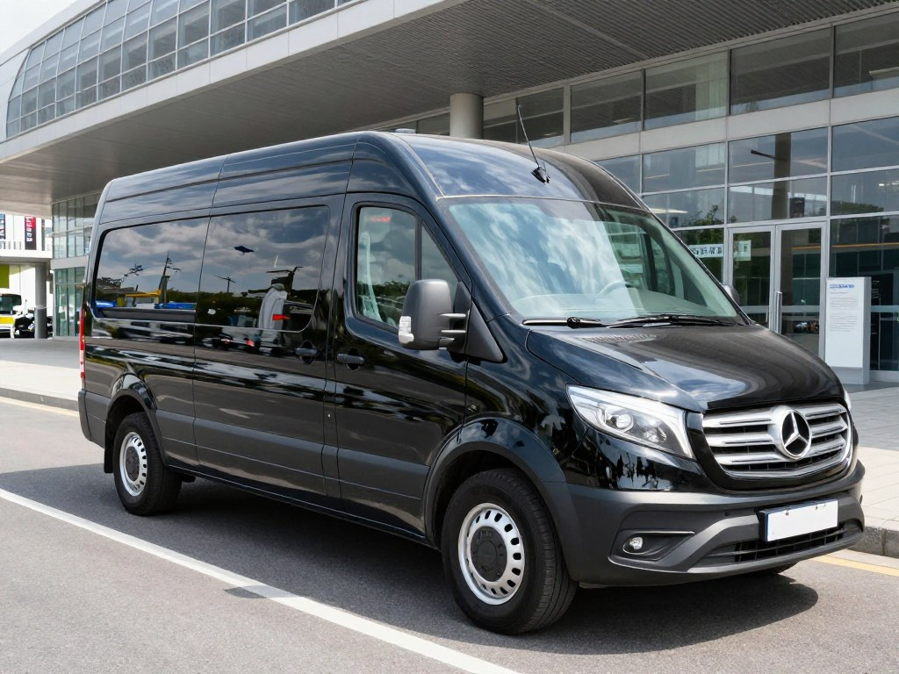
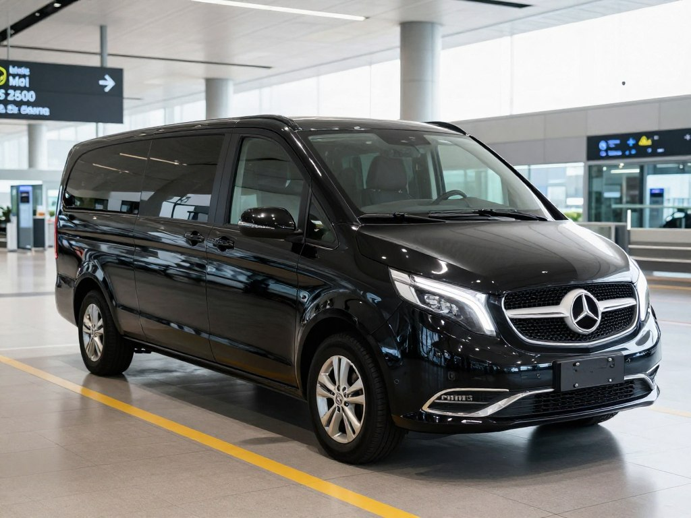
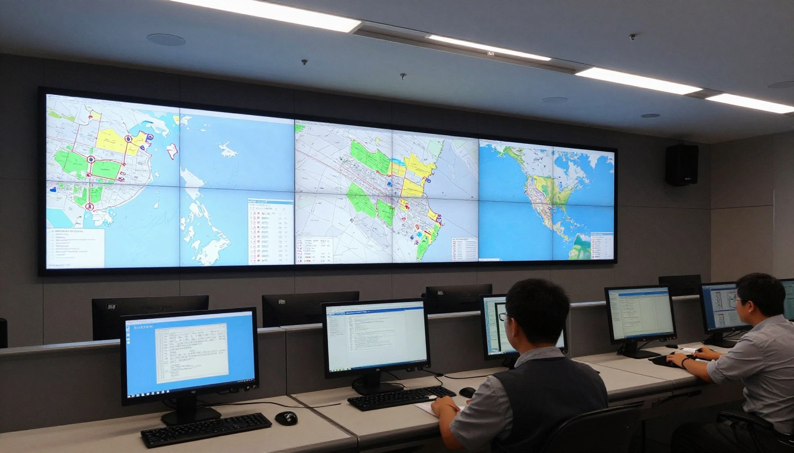

# **Corporate Transportation in Qatar: Staff Transportation Qatar**

AB delivers managed staff transportation Qatar for organisations requiring punctual, compliant employee mobility across Doha and surrounding commercial centres. Coordinated via regional dispatch desks, every route supports business continuity with vetted drivers, immaculate vehicles and real time movement oversight.

[Book now](https://seowriting.ai/services/corporate-transportation) [Request a proposal](https://seowriting.ai/services/corporate-transportation)

### **Pick up**

Specify collection location in Qatar.

### **Drop off**

Define company destination or terminal.

### **Date and time**

Schedule recurring or one off timings.

[Get a quote](https://seowriting.ai/services/corporate-transportation)

Coverage

## **Corporate Transportation across Qatar**

Coordinated ground movement demands deep familiarity with municipal road layouts, enterprise office parks and regional transit corridors. AB maintains continuous oversight across key commercial districts, providing scheduled workforce mobility that connects central corporate offices with industrial zones and project sites throughout the country.

### **Doha**

Move teams seamlessly through West Bay, Old Airport Road and Msheireb Downtown. Reserve an enterprise [corporate chauffeur service Doha](https://seowriting.ai/services/corporate-transportation/qatar/doha) for reliable site transfers and executive office commuting.

[View Doha services](https://seowriting.ai/services/corporate-transportation/qatar/doha)

Fleet

## **Fleet Options for Staff Transportation Qatar**

Selecting the right vehicle class maintains passenger comfort, route efficiency and corporate prestige across every daily commute. The AB fleet consists entirely of late model, commercially registered luxury vehicle models operated by a professional chauffeur.

### **Executive Sedan**

Mercedes S Class or similar \[Confirm\]. Ideal for individual executive transfers and director commutes, providing private driver support with quiet cabins and leather interiors.

### **Executive SUV**

Cadillac Escalade or similar \[Confirm\]. Built for senior management groups and project leadership needing ample luggage space alongside refined passenger capability.

### **Premium MPV**

Mercedes V Class or similar \[Confirm\]. Provides flexible conference seating and generous legroom for department heads travelling together between corporate facilities.

### **Executive Van**

Mercedes Sprinter or similar \[Confirm\]. Accommodates larger technical teams, workforce shifts and event delegations with high roof walk in comfort.

Operations

## **How Staff Transportation Qatar Operates**

Enterprise transportation demands systematic management to eliminate route delays and safeguard passengers. AB combines digital trip coordination with seasoned operational personnel to maintain dependable transit schedules across all operational zones.

### 1. **Schedule and Policy Alignment**

Travel managers register route parameters, shift rotations and vehicle classes through a central corporate account, establishing predefined passenger manifests and operational standards.

### 2. **Active Dispatch and Vehicle Allocation**

The 24/7 dispatch hub assigns vetted drivers, monitoring every transfer through live GPS tracking while incorporating flight tracking and meet and greet protocols where transfers originate at airport hubs.

### 3. **Consolidated Invoicing and Governance**

Every completed journey flows into an itemised monthly invoice aligned with client cost centres, upholding organisational duty of care and full route transparency.

Centralised operations oversight tracks passenger movements to maintain punctuality.

Compliance

## **Licensing and Standards for Staff Transportation Qatar**

Maintaining regulatory integrity remains non negotiable for commercial ground transportation. AB operates in strict alignment with regional ministry directives, holding \[Confirm: local Qatar transport licence or licensing details\]. Chauffeurs undergo comprehensive background checks, vehicle inspections and regular defensive driving training to deliver consistent passenger safety across all Qatari routes.

All vehicles carry comprehensive commercial passenger insurance and adhere to municipal transport standards across Doha and neighbouring municipalities.

## **Frequently Asked Questions**

### **What does staff transportation Qatar include for corporate clients?**

AB provides managed workforce commuting, facility shuttles and daily executive transfers tailored to company shift patterns. Services include dedicated vehicle allocation, active route supervision and passenger manifests that keep daily staff movements organized across Doha and industrial zones throughout Qatar.

### **How does an employee transport service Qatar support business operations?**

An organised employee transport service Qatar lowers corporate administrative overheads by eliminating individual expense claims and parking constraints. Scheduled pickups reduce commute stress, supporting prompt arrivals at headquarters or remote project compounds with verified passenger counts and predictable timelines.

### **Can organisations book a dedicated corporate car service Qatar for leadership teams?**

Companies can reserve a corporate car service Qatar on daily, weekly or long term arrangements. AB assigns premium sedans or sport utility vehicles operated by a professional chauffeur to handle visiting executives, board meetings and routine site commutes across the country.

### **What logistical support is available for roadshow transport Qatar?**

For intensive financial presentations, multi stop investor meetings and diplomatic summits, AB manages roadshow transport Qatar using standby vehicles and route planning specialists. Chauffeurs remain on site between stops, adjusting dynamically to changing itineraries across commercial districts.

### **How are recurring corporate accounts managed and invoiced?**

Corporate accounts benefit from centralised credit facilities, transparent trip auditing and a consolidated monthly invoice detailing each journey by department or cost code. Clients access verified booking tools to manage recurring employee schedules and review digital transit receipts.

### **What airport transfer services connect with corporate office transfers?**

AB coordinates arrivals and departures through Hamad International Airport, featuring real time flight tracking and a professional meet and greet inside the arrival hall. Chauffeurs assist passengers with luggage before commencing direct transfers to corporate offices or hotel accommodations.

### **Does AB provide cross border transport across the wider Gulf region?**

Headquartered in Riyadh with operational offices in Dubai, Abu Dhabi and Doha, AB coordinates direct premium transit throughout Saudi Arabia, all seven UAE emirates and Qatar. For broader mobility needs, organisations can book a vetted [chauffeur service Qatar](https://seowriting.ai/locations/qatar) that connects smoothly with regional hubs.

## **Arrange Dependable Staff Transportation Qatar**

Organise efficient employee mobility and executive road transit with AB across Doha and wider corporate districts. For long term contracts, multi vehicle shuttles or tailored corporate transportation arrangements, contact our operations desk today.

### **Request Enterprise Mobility Solutions**

Connect with our enterprise logistics team to structure scheduled workforce transfers or private executive fleet support.

+974 7734 3300

[Request a proposal](https://seowriting.ai/services/corporate-transportation) [Book a transfer](https://seowriting.ai/services/corporate-transportation)