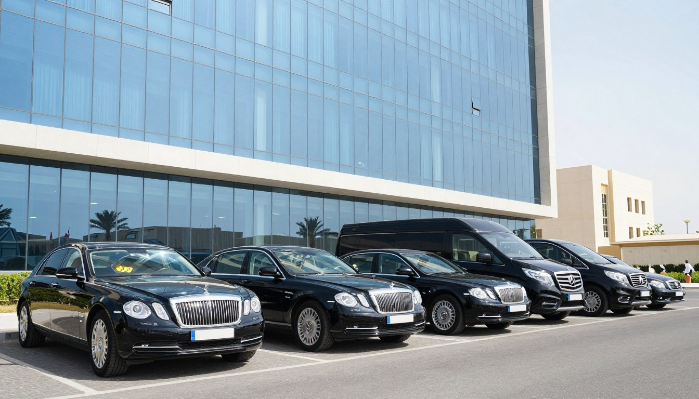
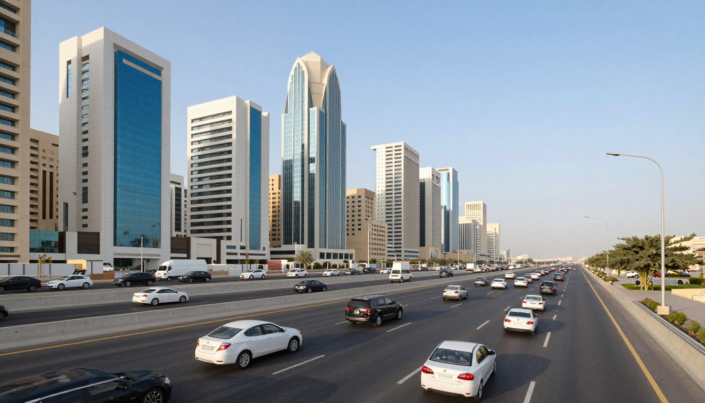
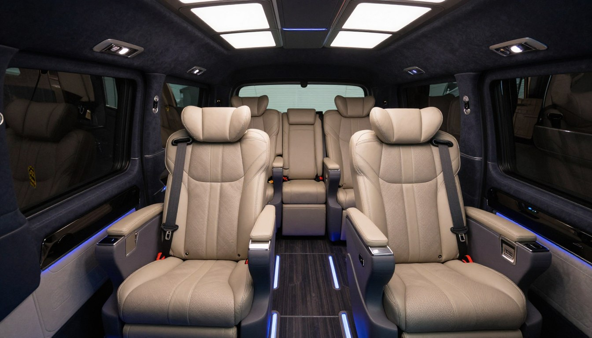
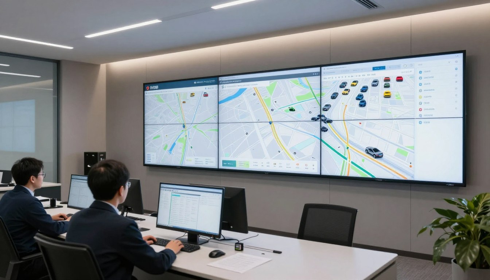
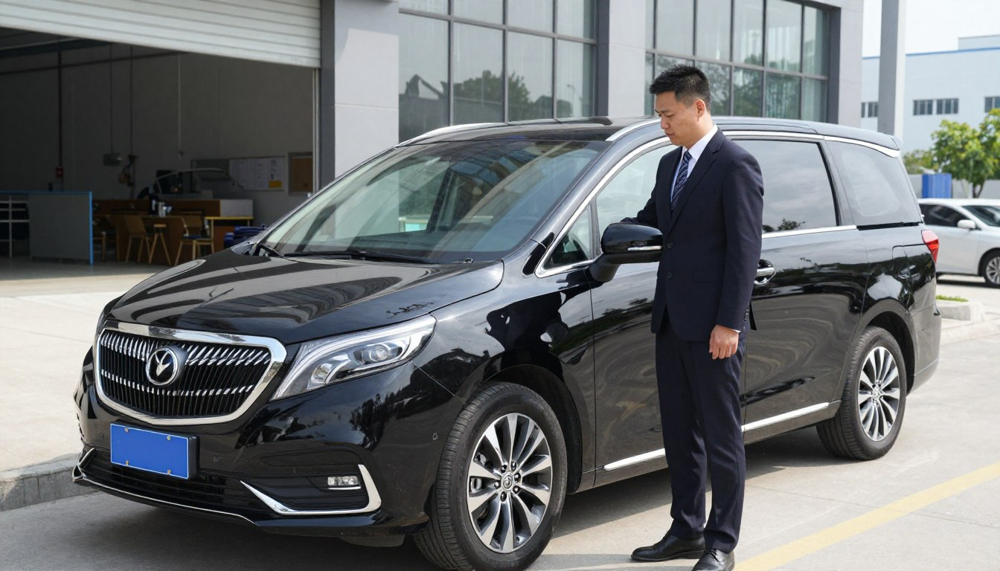

# **Corporate Transportation in Saudi Arabia: Staff Transportation Saudi Arabia**

Reliable staff transportation Saudi Arabia connects commercial facilities and business offices through coordinated routes and professional chauffeurs. Organised ground transportation maintains workplace punctuality across major business centres.

Passenger capacity, route frequency, and site locations decide the optimal operational fleet. Dedicated dispatch supports seamless daily mobility.

[Book now](https://seowriting.ai/services/corporate-transportation) [Request a proposal](https://seowriting.ai/services/corporate-transportation)

Corporate transfer planner: Pick up, Drop off, Date and time, Get a quote.

Coverage

## **Corporate Transportation across Saudi Arabia**

Managing workforce movement across the Kingdom requires deep geographic expertise and robust fleet logistics. Organisations coordinate nationwide operations through [Saudi Arabia](https://seowriting.ai/locations/saudi-arabia) regional hubs, deploying managed vehicles across industrial zones, financial centres, and infrastructure projects.

Enterprise clients rely on scheduled mobility to connect executive offices with peripheral operational sites. Strategic dispatch coordination reduces travel friction across urban corridors and emerging business developments.

From central business districts to remote project developments, scheduled ground transportation keeps corporate teams aligned with demanding work timetables. Vetted chauffeurs navigate municipal traffic patterns and regional highway systems with complete operational discipline.

Managed staff transportation Saudi Arabia delivers the operational consistency required by modern enterprises. Centralised booking oversight allows travel managers to coordinate transfers across multiple metropolitan centres through a single provider.

Dedicated corporate transport networks connect key economic zones and metropolitan hubs across the Kingdom.

### **Riyadh**

Corporate operations in the capital require structured mobility across commercial centres. Teams access vetted vehicles through a dedicated [corporate chauffeur service Riyadh](https://seowriting.ai/services/corporate-transportation/saudi-arabia/riyadh). Scheduled transfers connect headquarters with regional facilities daily.

### **Jeddah**

Coastal commercial projects demand reliable transport between corporate offices and port zones. Companies organise daily workforce transfers through [staff transport Jeddah](https://seowriting.ai/services/corporate-transportation/saudi-arabia/jeddah). Coordinated schedules support business operations across key business districts without friction.

### **Dammam**

Industrial and energy sector operations across the Eastern Province depend on punctuality. Daily employee movements operate smoothly with [staff transportation Dammam](https://seowriting.ai/services/corporate-transportation/saudi-arabia/dammam). Fleet coordination links central offices with peripheral work sites across commercial corridors.

### **Tabuk**

Regional development across the northwest requires coordinated logistics for management teams and technical personnel. Dedicated vehicle allocations connect regional offices with emerging commercial sites. Professional chauffeurs navigate local corridors with [Tabuk corporate transportation](https://seowriting.ai/services/corporate-transportation/saudi-arabia/tabuk) for continuous operational oversight.

### **NEOM**

Strategic giga project developments require managed mobility solutions for engineering and project leadership. Long distance shuttles and executive vehicles maintain connectivity between operational zones. Scheduled transfers operate via [NEOM corporate transportation](https://seowriting.ai/services/corporate-transportation/saudi-arabia/neom) across expanding infrastructure corridors.

Fleet

## **Fleet Options for Staff Transportation Saudi Arabia**

Modern enterprises require adaptable fleet configurations to accommodate diverse workforce requirements. Selecting the correct vehicle category supports passenger comfort, travel efficiency, and organisational duty of care across all corporate journeys.

Every luxury vehicle in the fleet undergoes rigorous technical inspections and routine sanitisation. Premium appointments and dependable climate control maintain a restful atmosphere for corporate passengers during daily transit.

Deploying dedicated vehicles for staff transportation Saudi Arabia allows companies to scale passenger capacity based on operational schedules. Fleet allocations adapt to fluctuating shift requirements and executive visitation timetables.

Meticulously maintained vehicle interiors support passenger comfort throughout daily workforce transit.

### **Executive Sedan**

Executive sedans provide discreet travel for individual directors and visiting executives. Premium Mercedes S Class models or similar \[Confirm\] offer quiet comfort, leather interiors, and dedicated climate control for city transfers.

### **Executive SUV**

Executive SUVs accommodate project leaders and small management teams requiring elevated road presence. Premium Cadillac Escalade models or similar \[Confirm\] deliver spacious seating and generous luggage capacity for business travel.

### **Premium MPV**

Premium MPVs suit collaborative executive teams traveling between regional meetings and corporate venues. Mercedes V Class models or similar \[Confirm\] provide conference style seating and refined interior appointments for productive transit.

### **Executive Van**

Executive vans support larger corporate groups and workforce shifts requiring reliable daily coordination. Mercedes Sprinter models or similar \[Confirm\] deliver comfortable high capacity seating and ample baggage space for corporate delegations.

Fleet allocations are customised according to passenger manifest requirements, route distances, and corporate scheduling parameters agreed during account onboarding.

Operations

## **How Staff Transportation Saudi Arabia Operates**

Executing dependable corporate ground transportation requires systematic planning and real time operational visibility. Experienced transport managers design optimized transit corridors that align employee pickup schedules with corporate working shifts.

Centralised logistics architecture coordinates daily vehicle movements, preventing scheduling conflicts and mitigating urban traffic delays. Professional chauffeurs receive clear digital manifests and route briefings prior to departure.

Managing staff transportation Saudi Arabia through dedicated dispatch desks provides corporate travel administrators with complete transparency. Continuous oversight supports passenger safety, operational punctuality, and route compliance.

Centralised dispatch coordination monitors vehicle routing and schedule adherence across all active transport corridors.

### 1. **Route Planning and Vehicle Allocation**

Operations teams evaluate corporate transit schedules, employee pickup points, and site locations. Central dispatch assigns appropriate vehicle classes from the fleet to support optimal route efficiency and punctuality across commercial destinations.

### 2. **Professional Chauffeur Coordination and Tracking**

Vetted professional chauffeurs receive shift assignments with designated routes and security clearances. Real time GPS tracking monitors vehicle progress while flight tracking coordinates corporate airport transfers with central dispatch.

### 3. **Continuous 24/7 Dispatch and Account Reporting**

The central operations control room maintains continuous 24/7 dispatch oversight for active routes. Corporate account administrators receive transparent trip logging, monthly invoice consolidation, and comprehensive duty of care documentation.

Compliance

## **Licensing and Operational Standards for Staff Transportation Saudi Arabia**

AB delivers managed [corporate transportation](https://seowriting.ai/services/corporate-transportation) solutions that adhere to rigorous safety protocols and statutory requirements. Professional chauffeurs undergo thorough background vetting, identity checks, and defensive driving reviews to fulfill duty of care standards. Every luxury vehicle receives scheduled mechanical maintenance and complete sanitisation prior to deployment. Operating under local licence \[Confirm\], services comply with national transport authority mandates and municipal regulations across Saudi Arabia.

Rigorous vehicle inspections and driver vetting protocols maintain operational excellence across all services.

National operations are coordinated from the central headquarters: Building 3036, Office 08, 2nd Floor, Umar Ibn Abdulaziz Road, Al Malaz, Riyadh, Saudi Arabia.

+966 58 111 8720

## **Frequently asked questions about staff transportation Saudi Arabia**

### **How does an employee transport service Saudi Arabia support daily corporate commutes?**

An employee transport service Saudi Arabia establishes fixed routes between residential areas and corporate workplaces. Coordinated shuttles reduce employee commuting stress and support punctual arrivals for shifts across major industrial zones and commercial districts. Dedicated fleet managers monitor daily traffic flows through central dispatch to adjust pickup schedules, helping organisations maintain structured attendance without requiring individual staff members to navigate congested metropolitan roads.

### **What vehicle choices are available for corporate car service Saudi Arabia?**

Clients booking corporate car service Saudi Arabia select from executive sedans, luxury SUVs, and multi passenger vans. Sedans accommodate individual executives attending commercial meetings, while spacious MPVs and vans transport project teams and delegations. Every luxury vehicle maintains immaculate interior presentation, working climate control, and comprehensive safety equipment, allowing corporate passengers to travel comfortably between business hubs or project facilities across the Kingdom.

### **How are multi city schedules managed for roadshow transport Saudi Arabia?**

Executing complex roadshow transport Saudi Arabia requires coordinated multi city schedules and continuous dispatch oversight. Chauffeurs remain on standby for financial presentations, board meetings, and client site inspections across Riyadh, Jeddah, and Dammam. Central operations monitor itinerary updates in real time, coordinating vehicle positioning so executives transition between commercial districts and private aviation terminals without scheduling delays or transport friction.

### **How does flight tracking integrate with executive airport transfers?**

Airport transfers incorporate flight tracking software linked directly to central dispatch desks. Chauffeurs monitor incoming commercial and private flights, adjusting terminal arrival times according to real time schedule changes. Upon landing, a professional chauffeur provides personalised meet and greet coordination at the arrival gate, assisting with luggage before escorting corporate guests to their waiting luxury vehicle for onward transit.

### **What duty of care standards apply to staff transportation in Saudi Arabia?**

Duty of care standards govern staff transportation in Saudi Arabia through comprehensive driver vetting, vehicle safety protocols, and route monitoring. Professional chauffeurs carry valid identity documents, complete defensive driving reviews, and adhere to strict non disclosure agreements. Operations desks maintain live GPS tracking on active routes, providing travel managers with complete visibility over passenger movements across metropolitan business corridors.

### **How do corporate accounts handle billing and monthly invoice management?**

Corporate accounts benefit from consolidated monthly invoice documentation with itemised expenditure by department, cost centre, or project code. Centralised billing simplifies administrative reconciliation for finance teams, eliminating individual expense claims for corporate ground transportation. Travel managers access transparent reporting detailing completed journeys, vehicle categories, passenger names, and verified transit times across all regional operations.

### **What booking lead times are recommended for corporate transport in Saudi Arabia?**

Recurring employee routes and large scale staff movements require onboarding lead times of several business days to finalize routing, vehicle staging, and chauffeur assignments. For individual executive transfers and airport pickups in Saudi Arabia, dispatch accommodates bookings with shorter advance notice based on fleet availability. Engaging the Riyadh operations centre early helps secure preferred vehicle categories during major conferences and international exhibitions.

## **Staff Transportation Saudi Arabia Solutions across Saudi Arabia**

Managed staff transportation Saudi Arabia provides organisations with reliable workforce mobility, reduced travel friction, and total duty of care compliance. Structured fleet programmes connect commercial hubs, regional offices, and industrial facilities with operational precision.

### **Reserve Managed Corporate Transport**

Establish dependable staff transportation Saudi Arabia programmes with dedicated fleet allocations, professional chauffeurs, and 24/7 central dispatch support.

[Request a proposal](https://seowriting.ai/services/corporate-transportation) [Book a transfer](https://seowriting.ai/locations/saudi-arabia)