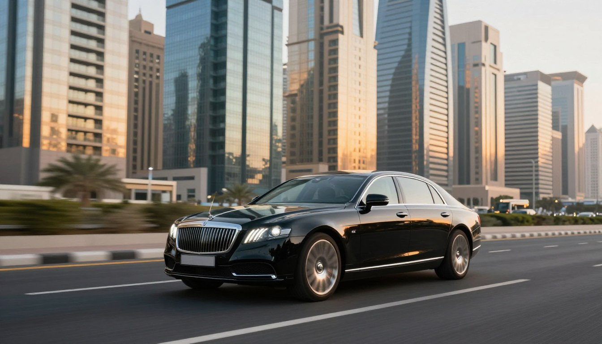
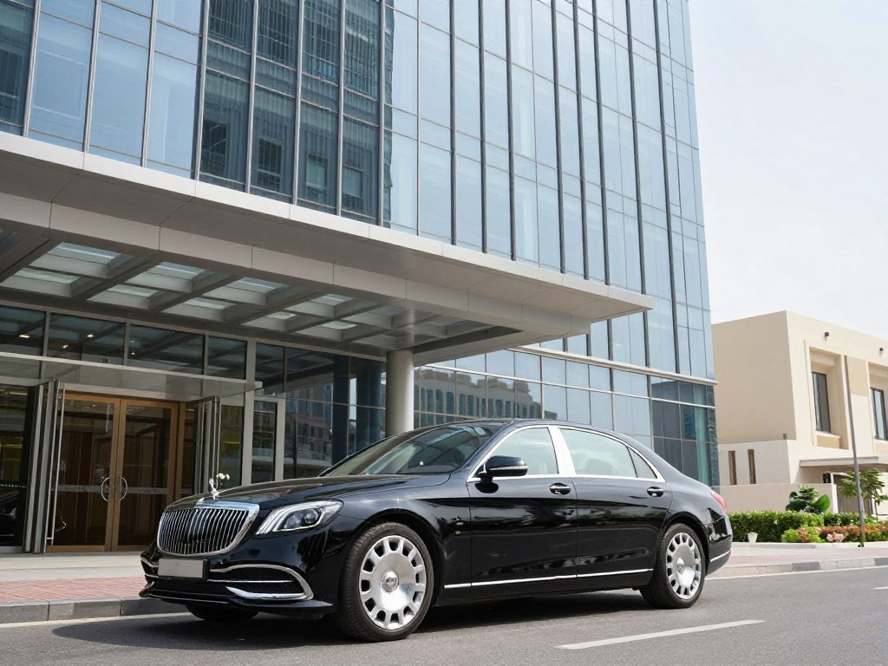
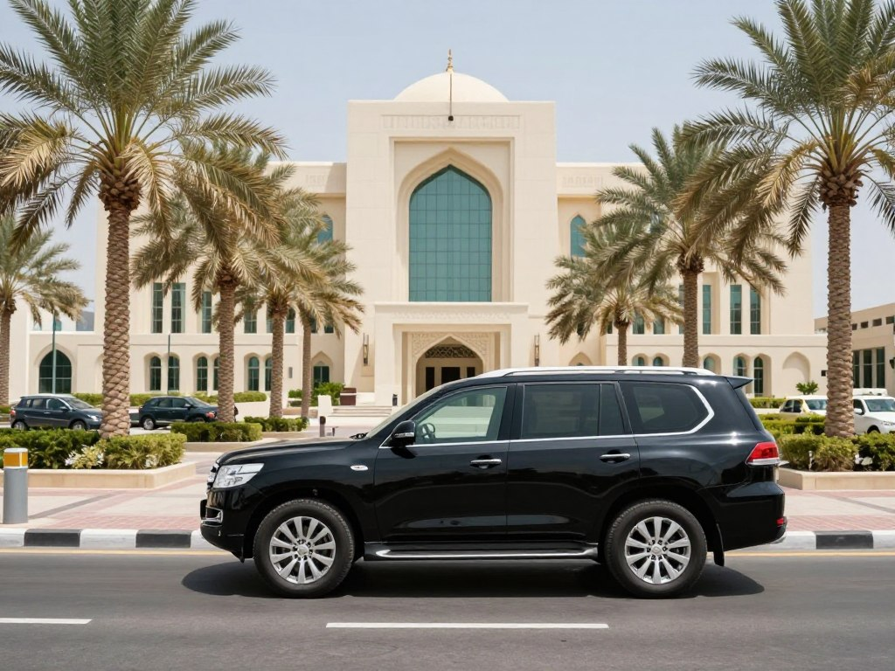
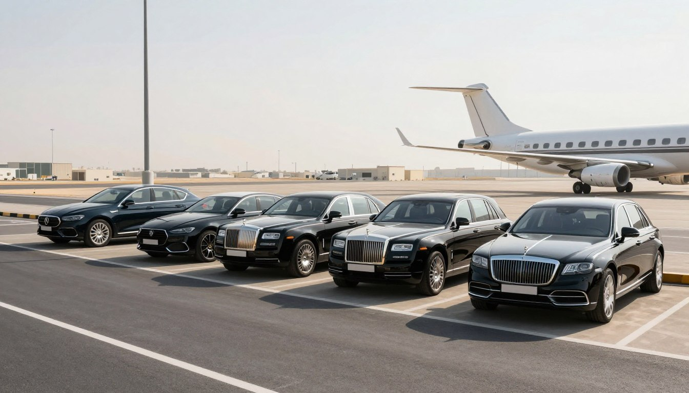
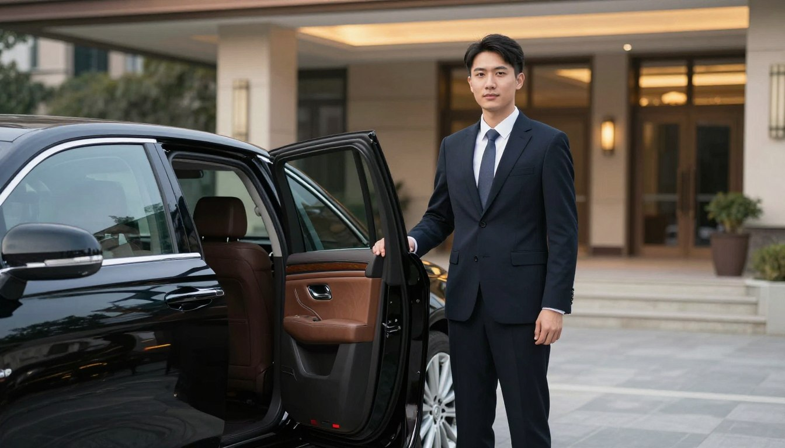

# **Corporate Transportation UAE**

AB provides managed corporate transportation UAE enterprises rely upon for punctual executive transfers, board meetings, and coordinated event logistics. Operating under strict protocol standards, our chauffeurs move visiting delegations, C level leadership, and project personnel seamlessly across all seven emirates.

Every assignment is monitored round the clock through our central operations centre, maintaining complete visibility from flight touchdown to final departure. Dedicated account managers coordinate schedules, vehicle staging, and billing structures tailored specifically to institutional travel policies.

[Book now](https://seowriting.ai/services/corporate-transportation) [Request a proposal](https://seowriting.ai/services/corporate-transportation)

| Pick up           | Drop off            | Date and time        | Get a quote                                                            |
| ----------------- | ------------------- | -------------------- | ---------------------------------------------------------------------- |
| Airport or Office | Commercial District | Immediate or Advance | [Get a quote](https://seowriting.ai/services/corporate-transportation) |

Coverage

## **Corporate Transportation across UAE**

Connecting the commercial epicentres of the nation demands deep familiarity with regional transport corridors, airport access regulations, and free zone access routes. Organising reliable [chauffeur service UAE](https://seowriting.ai/locations/uae) wide enables multinational firms to maintain productivity between high level appointments without transit delays.

Our operational network extends across Dubai, Abu Dhabi, Sharjah, Ajman, Umm Al Quwain, Ras Al Khaimah, and Fujairah. Institutional clients frequently utilise our business chauffeur hire solutions for point to point transfers between regional headquarters and production sites, supported by centralised dispatch.

Organisations requiring ongoing corporate transportation services UAE broad benefit from dedicated coordination across busy arterial highways. Whether deploying staff transport Sharjah corridors require or staging premium saloons in the capital, AB manages each route with rigorous attention to timing and safety.

### **Dubai**

Reserve a dedicated [corporate chauffeur Dubai](https://seowriting.ai/services/corporate-transportation/uae/dubai) travel managers trust for seamless transfers between Dubai International Airport, DIFC, Downtown, and dynamic regional business hubs.

[Dubai Services](https://seowriting.ai/services/corporate-transportation/uae/dubai)

### **Abu Dhabi**

Engage a professional [corporate chauffeur service Abu Dhabi](https://seowriting.ai/services/corporate-transportation/uae/abu-dhabi) organisations depend on for diplomatic arrivals, sovereign wealth summits, and continuous government quarter mobility.

[Abu Dhabi Services](https://seowriting.ai/services/corporate-transportation/uae/abu-dhabi)

Fleet

## **Fleet Options for Corporate Transportation UAE**

Selecting the appropriate vehicle class forms the cornerstone of effective corporate transportation UAE programmes. Executive travel requires pristine presentation, exceptional mechanical reliability, and quiet interiors that function as productive mobile workspaces.

Every luxury vehicle in our fleet undergoes stringent daily sanitisation, multi point safety checks, and regular mechanical servicing to prevent schedule disruptions. Enterprise clients securing corporate chauffeur hire gain access to vehicles configured with discreet privacy glass, climate control zones, and onboard mobile device charging.

For executive teams balancing demanding travel schedules, our premium corporate car service UAE packages provide punctual transit across emirates. Organisations coordinating broader team movements also rely on our structured staff transportation UAE options, aligning group movements with overarching corporate sustainability and safety goals.

### **Executive Sedan**

Refined comfort for executive travel, airport transfers, and point to point city meetings, featuring Mercedes S Class or similar \[Confirm: vehicle models\].

### **Executive SUV**

Elevated cabin space and commanding road presence suited for leadership site tours and diplomatic delegations, featuring Cadillac Escalade or similar \[Confirm: vehicle models\].

### **Premium MPV**

Spacious conference seating for mobile executive collaboration, multi passenger airport journeys, and financial roadshows, featuring Mercedes V Class or similar \[Confirm: vehicle models\].

### **Executive Van**

Generous passenger capacity and luggage storage tailored for conference transfers, board delegations, and corporate event shuttles, featuring Mercedes Sprinter or similar \[Confirm: vehicle models\].

Process

## **How Corporate Transportation UAE Operates**

Modern enterprise mobility demands structured communication, automated reservation tracking, and transparent billing procedures. Implementing a managed corporate transportation UAE account eliminates booking friction, providing executive assistants and travel teams with a central dashboard to schedule and monitor transfers.

Our dedicated operations centre operates around the clock, managing live routing, flight tracking, and chauffeur allocation. When arranging complex roadshow transport UAE itineraries, dispatchers study local traffic patterns, venue drop off procedures, and security gate clearances well in advance of departure.

Through our comprehensive employee transport service UAE framework, organisations can scale passenger numbers effortlessly across recurring weekly commutes or multi day summit schedules. Every passenger benefits from professional meet and greet handling, real time itinerary updates, and professional chauffeur conduct throughout the journey.

### 1. **Account Setup and Route Consultation**

Our corporate desk reviews your travel policy, identifies frequent routes, establishes billing parameters, and assigns a dedicated transport coordinator.

### 2. **Automated Booking and Vehicle Dispatch**

Reservations are submitted online or via direct dispatch, confirming vehicle staging, driver credentials, and real time GPS tracking alerts before departure.

### 3. **Journey Execution and Consolidated Billing**

Chauffeurs conduct the journey in full compliance with corporate safety guidelines, concluding with centralised monthly invoice documentation for simplified internal reconciliation.

Compliance

## **Regulatory Licensing and Operational Standards**

Operating executive ground transport within the country requires rigorous adherence to local municipal transport authorities. All vehicles in our corporate transportation UAE fleet operate under valid commercial limousine permits issued by the Roads and Transport Authority in Dubai and the Integrated Transport Centre in Abu Dhabi \[Confirm: licence numbers and regulatory bodies\].

Every private driver deployed by AB holds the required professional chauffeur permit, undergoing thorough background vetting, continuous driving record evaluation, and defensive driving instruction. Comprehensive commercial passenger insurance protects corporate travellers on every route, while strict non disclosure agreements safeguard client confidentiality during high stakes negotiations.

Our operational architecture integrates comprehensive duty of care protocols across every booking, maintaining continuous vehicle tracking and proactive journey management. Managing an employee transportation service requires robust adherence to health, safety, and driver welfare standards, creating a secure environment for all personnel.

Compliance documentation, commercial insurance certificates, and local transport authority accreditations remain verified and available for corporate risk audits \[Confirm: audit requirements\].

## **Frequently Asked Questions**

### **What does corporate transportation UAE coverage include?**

Our managed corporate transportation UAE services cover point to point executive transfers, private airport meet and greet, financial roadshows, intercity travel, and dedicated conference shuttle fleets. We serve all seven emirates directly from regional offices, managing routes between major commercial centres, international airports, free trade zones, and government quarters with round the clock operational support.

### **How does AB support business chauffeur hire across multiple emirates?**

Clients booking our business chauffeur hire solutions receive coordinated dispatch across municipal borders. Chauffeurs understand specific toll gate systems, cross emirate traffic regulations, and commercial hub access points, allowing business travellers to attend consecutive meetings in Dubai and Abu Dhabi on the same day without logistical disruptions or navigation concerns.

### **Can corporate accounts access consolidated monthly invoice billing?**

Yes, corporate accounts receive structured monthly invoice packages broken down by department, employee, or project cost centre. This centralised billing framework streamlines expense auditing, integrates applicable regional tax documentation, and eliminates the administrative burden of handling individual paper receipts for frequent corporate travel.

### **What duty of care measures apply to corporate transportation UAE bookings?**

Duty of care forms an essential foundation of our corporate transportation UAE operations. Every vehicle is monitored through live GPS tracking, and chauffeurs adhere to mandatory working hour caps to prevent driver fatigue. All personnel pass comprehensive background checks, defensive driving assessments, and hold verified municipal commercial driving permits.

### **Is flight tracking included for international airport pickups?**

Yes, our operations centre actively monitors inbound commercial and private aviation arrivals in real time. Chauffeurs adjust vehicle staging schedules automatically based on updated flight telemetry, reducing passenger waiting times at Dubai International, Al Maktoum International, Abu Dhabi International, and regional executive terminals.

### **How are roadshow transport UAE itineraries managed?**

Coordinating roadshow transport UAE itineraries requires dedicated project management. Our team maps multi stop executive routes, schedules standby buffer windows, coordinates building security perimeters, and maintains live communication between executive assistants and the lead chauffeur throughout the full day schedule.

### **What vehicle options support employee transport service UAE requirements?**

Organisations utilising our employee transport service UAE solutions can select from luxury people movers and executive vans, such as the Mercedes V Class and Mercedes Sprinter. These vehicles provide professional group transit for visiting technical teams, board members, or executive project staff between hotels and operational facilities.

### **Does AB operate across other Middle Eastern business centres?**

AB operates direct managed ground transportation infrastructure across Saudi Arabia, all seven UAE emirates, and Qatar, with headquarters in Riyadh and regional offices in Dubai, Abu Dhabi, and Doha. Services in Bahrain, Kuwait, and Oman are provided on request through vetted, audited regional partners.

## **Book Corporate Transportation UAE for Your Organisation**

Connect with our corporate team to establish tailored executive mobility, priority fleet dispatch, and centralised billing for your enterprise.

### **Establish Your Corporate Transport Account**

Discuss recurring route requirements, executive roadshows, or protocol mobility contracts with our regional operations desk.

[Request a proposal](https://seowriting.ai/services/corporate-transportation) [Book a transfer](https://seowriting.ai/services/corporate-transportation)

| Office       | Address                                                                                      | Direct Phone     |
| ------------ | -------------------------------------------------------------------------------------------- | ---------------- |
| AB Riyadh HQ | Building 3036, Office 08, 2nd Floor, Umar Ibn Abdulaziz Road, Al Malaz, Riyadh, Saudi Arabia | +966 58 111 8720 |
| AB Dubai     | Suite 206, DBC Building, Al Khabaisi, Deira, Dubai, UAE                                      | +971 50 781 3880 |
| AB Abu Dhabi | Office 03, Mezzanine Floor, Building C57, Abu Dhabi, UAE                                     | +971 50 918 0556 |
| AB Doha      | Office 110, Building 100, Zone 26, Street 310, Old Airport Road, Doha, Qatar                 | +974 7734 3300   |