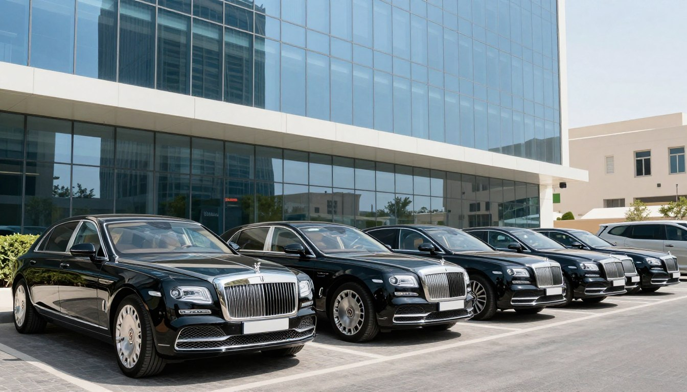
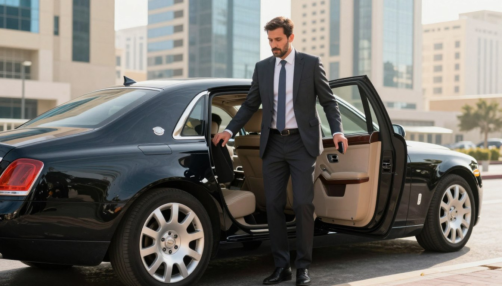

# **Reliable corporate transportation across the Middle East**

AB delivers corporate transportation built for organisations that require punctuality, discretion and regional reach. Headquartered in Riyadh with central operations, we manage executive travel, employee commuter routes and business delegations across the Gulf Cooperation Council.

[Request a proposal](https://seowriting.ai/quote/tender) [All services](https://seowriting.ai/services)

24/7dispatch

3countries with our own fleet

8airports served

How we work

## **Operational governance for business mobility**

Our corporate transportation programmes integrate licensed drivers, rigorous safety standards and real time vehicle tracking under one transparent contract. Clients receive dedicated account management, clear service level agreements and predictable reporting across every regional facility.

What you get

## **Built for corporate transportation**

### **1\. Dedicated vehicles**

Assigned luxury vehicle options with a full time private driver for senior executives. Maintenance, insurance, regulatory licensing and relief driver coverage remain entirely managed by our operations control room.

### **2\. Daily staff routes**

Scheduled employee transport service solutions connecting residential communities to business parks and operational headquarters. Route schedules adapt directly to shift patterns and corporate headcount changes.

### **3\. Roadshows**

Precision roadshow transport designed for high profile investor itineraries and multi destination site inspections. Dedicated dispatch coordinators monitor every stop to support tight executive meeting agendas.

### **4\. Central billing and reporting**

Consolidated billing structured by cost centre, corporate entity or project code. Travel administrators access detailed passenger manifests, journey logs and uniform monthly invoicing across all regional locations.

How it runs

## **Three stages, one accountable partner**

### 1. **Set up**

We review passenger counts, itinerary demands, preferred vehicle specifications and security requirements to configure your service scope.

### 2. **Book**

Authorised travel arrangers schedule rides through direct integration, verified email dispatch or round the clock telephone booking channels.

### 3. **Reconcile**

Your finance department receives a single validated monthly invoice backed by complete route metrics and performance reports.

Proven in the region

## **Recent work**

### **Roshn Group Staff Shuttle**

Mobilised multi vehicle daily commuter routes across Riyadh to transport workforce personnel between residential districts and corporate office facilities. Programme metrics recorded \[Confirm: what is needed\] on time schedule completion across the active operational lifecycle.

### **Siemens Energy**

Supplied executive ground transportation and technical site transit across strategic industrial locations in the Kingdom. Delivered continuous operations with fully vetted drivers and on demand dispatch managed through our Riyadh control desk.

Coverage and fleet

## **Regional network and executive fleet**

AB operates direct ground logistics across Saudi Arabia, all seven emirates in the UAE and Qatar. Additional GCC requirements across Bahrain, Kuwait and Oman are fulfilled on request through audited regional transport associates.

### **Where we run it**

- [Corporate Transportation in Saudi Arabia](https://seowriting.ai/services/corporate-transportation/saudi-arabia)
- [Corporate Transportation in UAE](https://seowriting.ai/services/corporate-transportation/uae)
- [Corporate Transportation in Qatar](https://seowriting.ai/services/corporate-transportation/qatar)

### **Vehicles typically deployed**

- Business Sedan
- First Class Sedan
- Executive SUV
- Premium MPV

### **Fleet standards**

All vehicles meet rigorous age restrictions and undergo daily safety inspections. Explore our complete range of premium sedans, sport utility vehicles and executive coaches.

[View the full fleet](https://seowriting.ai/fleet)

Questions

## **Frequently asked questions**

### **How does AB manage duty of care for business travellers?**

Our duty of care framework applies vetted chauffeurs, continuous GPS tracking and active monitoring from our operations centre in Riyadh. Vehicles undergo mechanical reviews prior to departure, while drivers follow strict working hour regulations. This centralised approach lowers travel risks for visiting staff and senior executives navigating unfamiliar cities across the Gulf region.

### **Can we book a corporate car service across multiple Gulf cities under one agreement?**

Yes. A single master service agreement with AB covers your [corporate transportation services UAE](https://seowriting.ai/services/corporate-transportation/uae) requirements, operations across Qatar and domestic routes in the Kingdom. Corporate bookers arrange rides in Riyadh, Jeddah, Dubai, Abu Dhabi and Doha using identical service tiers, eliminating the administrative friction of contracting separate suppliers in each regional territory.

### **How are airport transfers coordinated for visiting delegations?**

Our central dispatch team conducts real time flight tracking to adjust pickup timings for early landings or customs delays automatically. Arriving guests receive a personalised meet and greet service inside the terminal before being escorted to their luxury vehicle. Chauffeurs assist with luggage and provide seamless transfers directly to regional headquarters or hotel accommodations.

### **What operational model was applied for the Roshn Group Staff Shuttle?**

For the Roshn Group Staff Shuttle, AB deployed structured route planning, scheduled departures and dedicated fleet assets to transfer employee teams safely each workday. The deployment maintained strict departure timetables through active route monitoring, providing workforce mobility that aligned perfectly with corporate shift arrangements in the capital.

### **What vehicle classes and logistics support were provided for Siemens Energy?**

During our engagement with Siemens Energy, AB supplied executive sedans and multi passenger vehicles for technical leadership and operational personnel. The project relied on experienced private driver personnel familiar with industrial site security protocols, supported by immediate dispatch adjustments through our twenty four hour operations team.

### **How does consolidated billing operate through a corporate account?**

A corporate account centralises every trip completed across Saudi Arabia, the Emirates and Qatar into one consolidated monthly invoice. Invoices contain granular journey manifests detailing passenger names, departmental billing codes and travel times. This itemised breakdown simplifies financial reconciliation for procurement managers and removes the need for individual expense reimbursements.

### **Can corporate clients arrange staff transportation in specific metropolitan areas?**

We provide specialised [staff transportation Riyadh](https://seowriting.ai/services/corporate-transportation/saudi-arabia/riyadh) services for corporate headquarters based in the capital, alongside bespoke [staff transportation Saudi Arabia](https://seowriting.ai/services/corporate-transportation/saudi-arabia) wide. Route managers plan optimal transit lines connecting residential districts with business hubs such as the King Abdullah Financial District, reducing commuter fatigue for company employees.

### **What chauffeur standards are maintained for executive transfers in Dubai?**

Every professional chauffeur assigned to our [corporate chauffeur service Dubai](https://seowriting.ai/services/corporate-transportation/uae/dubai) undergoes extensive background vetting, local route navigation assessments and corporate etiquette training. Chauffeurs operate late model premium vehicles, maintain complete passenger confidentiality and coordinate seamlessly with corporate protocol assistants throughout demanding business itineraries.

More solutions

## **Comprehensive business transport services**

In addition to managed corporate transportation programmes, AB delivers specialized mobility solutions tailored to specific commercial operational demands:

- Airport Transfers
- Executive Chauffeur Service
- Event Transportation
- Financial Roadshows
- Private Jet Chauffeur
- Diplomatic and Protocol Transport
- Crew Transportation
- Workforce Mobility and [corporate bus rental Doha](https://seowriting.ai/services/bus-coach-hire/qatar/doha)

Learn more about our full service portfolio by visiting [Services](https://seowriting.ai/services) or establish an enterprise framework through [Corporate Accounts](https://seowriting.ai/corporate-accounts).

### **Formal procurement tenders and custom fleet allocations**

Submit your travel schedule, route manifests or RFP documentation for comprehensive operational evaluation and commercial quotation.

[Request a proposal](https://seowriting.ai/quote/tender)

## **Planning corporate transportation?**

Connect with AB to structure dependable corporate transportation programmes across Saudi Arabia, the UAE and Qatar backed by regional dispatch control.

[Request a proposal](https://seowriting.ai/quote/tender) [Talk to a planner](https://seowriting.ai/quote/tender)