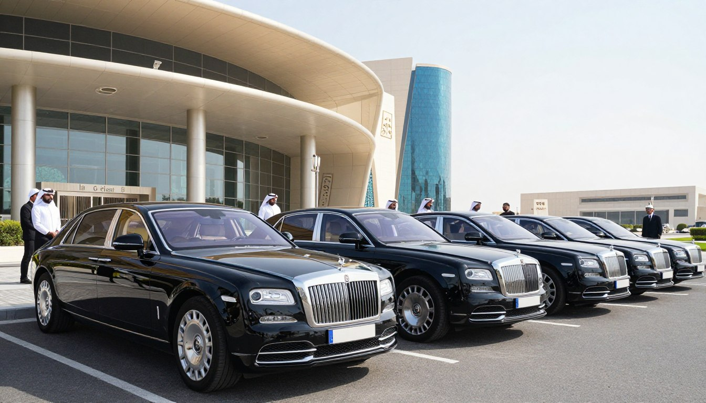

# **Event Transportation in Qatar**

AB delivers managed event transportation Qatar solutions tailored for corporate summits, international exhibitions and diplomatic gatherings. We deploy premium motorcades, dedicated shuttles and discreet transfers connecting major event venues with executive accommodations across the country.

[Book now](https://seowriting.ai/services/event-transportation) [Request a proposal](https://seowriting.ai/services/event-transportation)

Pick up / Drop off / Date and time / Get a quote

Coverage

## **Event Transportation across Qatar**

Our operational network spans key commercial and administrative districts, supporting high density passenger movements during major international gatherings. You can also review our broader [chauffeur service Qatar](https://seowriting.ai/locations/qatar) network for ongoing executive travel across the country.

### **Doha**

We coordinate complete delegate transfers across West Bay, Lusail and the capital city perimeter. Organisers can review dedicated [event transportation Doha](https://seowriting.ai/services/event-transportation/qatar/doha) services for urban summit corridors, airport arrivals and hotel runs.

Fleet

## **Fleet Options for Event Transportation Qatar**

Every luxury vehicle deployed for event logistics undergoes rigorous inspection and detailing before entering service. Organisers select from diverse vehicle categories to accommodate individual dignitaries, corporate boards or large delegate delegations.

### **Executive Saloon**

Mercedes S Class or similar \[Confirm\]. Ideal for single dignitaries and board executives requiring discreet travel between official functions, diplomatic offices and premier hotels.

### **Executive SUV**

Cadillac Escalade or similar \[Confirm\]. Suited for VIP delegations, executive leadership teams and dynamic roadshows requiring expansive cabin room and luggage space.

### **Premium MPV**

Mercedes V Class or similar \[Confirm\]. Configured for executive working groups, delegation support staff and small committee transfers during multi venue conferences.

Operations

## **How Event Logistics Management Works**

Delivering reliable conference transportation Qatar demands rigorous planning, real time supervision and strict schedule adherence across every transport phase.

### **Manifest Analysis**

Our logistics specialists examine your complete delegate flight manifests, venue itineraries and transfer times to structure an efficient event schedule.

### **Central Dispatch Staging**

Our operations hub assigns dedicated vehicles and monitors flight updates, supported by our regional 24/7 dispatch desk in Riyadh.

### **Onsite Oversight**

A professional chauffeur and onsite coordinators manage passenger boarding at terminal gates, utilizing live GPS tracking to maintain timing precision.

Compliance

## **Licensing and Operational Standards**

AB enforces comprehensive safety and operational standards across all ground transportation assignments. Every chauffeur maintains full local accreditation, commercial permits and valid credentials in compliance with local licence \[Confirm: licensing authority name\]. Our enterprise protocols satisfy rigorous duty of care obligations for multinational institutions, diplomatic missions and corporate partners operating throughout the Gulf region.

## **Frequently Asked Questions**

### **What vehicle types support large conferences in Qatar?**

Event organisers can reserve premium saloons, spacious SUVs and multi passenger executive vans. These options accommodate everything from a private driver booking for key speakers to an extensive event shuttle service Qatar for general attendees travelling between convention halls.

### **How are airport arrivals handled for international delegates?**

Our operations team monitors flights continuously using integrated flight tracking systems. Uniformed greeters manage the meet and greet procedure inside the terminal, assisting arriving guests with luggage and escorting them directly to awaiting vehicles.

### **Can corporate clients set up unified billing for event transfers?**

Yes. Organisations planning large scale gatherings can establish a centralized corporate account. This arrangement consolidates all transfer charges, standby hours and fleet allocations into a single transparent monthly invoice for straightforward financial reconciliation.

### **How is delegate transport Qatar managed across multiple venues?**

We deploy dedicated transport managers to direct vehicle flows between exhibition centres, gala dinner venues and partner hotels. Detailed route planning helps drivers avoid peak urban congestion and keep passenger groups moving smoothly on schedule.

### **Do you provide VIP car pool Qatar services for government delegations?**

AB provides coordinated VIP car pool Qatar services designed for high protocol delegations and summit committees. These convoys utilize late model vehicles and vetted personnel trained in security awareness and discreet executive service.

### **How far in advance should we confirm event transportation Qatar bookings?**

We advise confirming fleet allocations at least three to four weeks before major summits and exhibitions. Early booking allows our team to reserve preferred vehicle classes and establish custom staging zones near your key event venues.

### **Does AB operate across other regional destinations?**

AB serves Saudi Arabia, all seven UAE emirates and Qatar directly through company offices in Dubai, Abu Dhabi, Doha and our headquarters in Riyadh. Partner connections also support regional transfers into Jeddah and neighbouring Gulf markets upon request.

## **Reserve Event Transportation Qatar**

Contact our event desk to coordinate your upcoming summit transfers, executive motorcades and venue shuttles across the region.

[Book now](https://seowriting.ai/services/event-transportation) [Request a proposal](https://seowriting.ai/services/event-transportation)