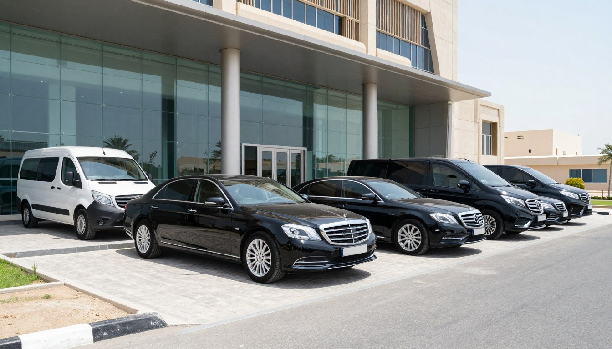
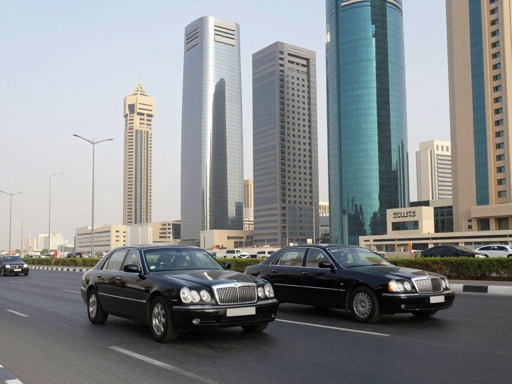
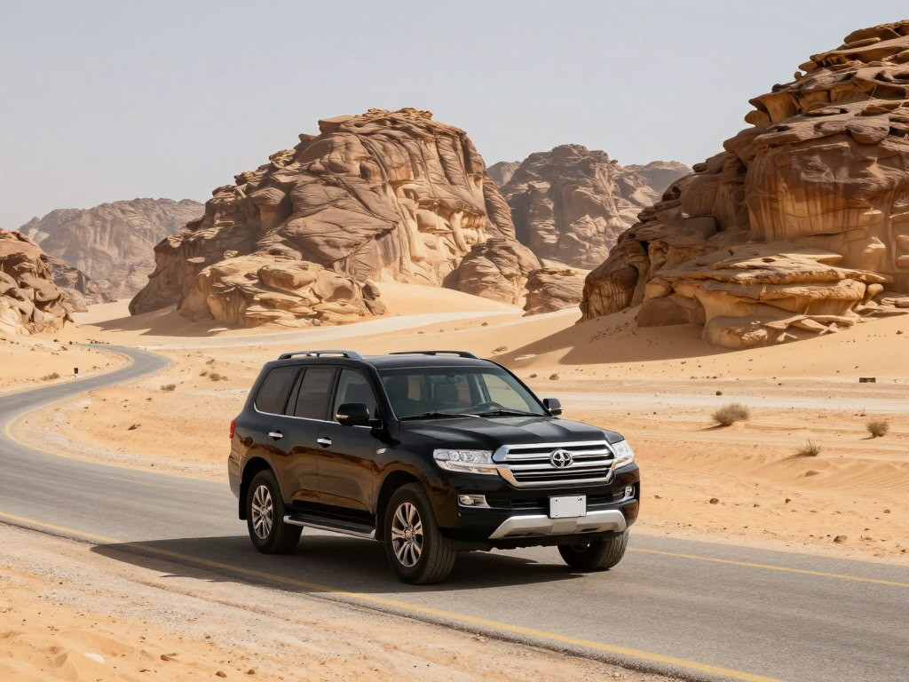
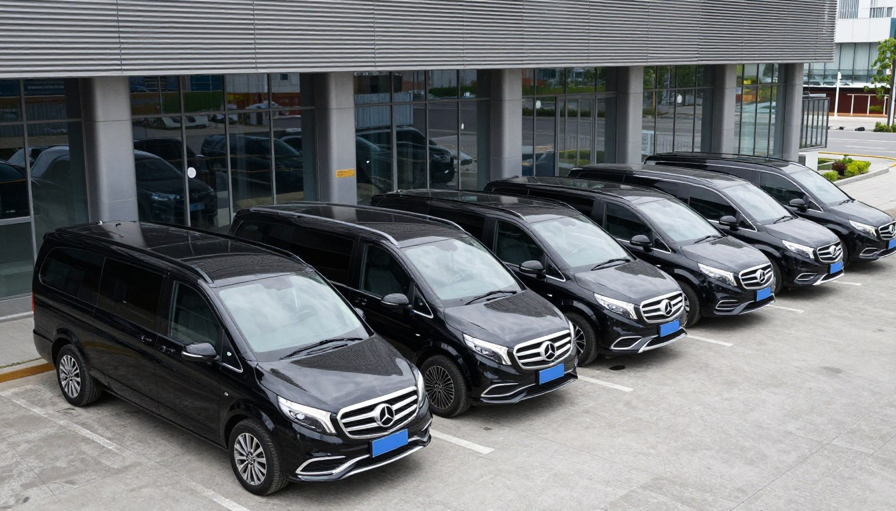
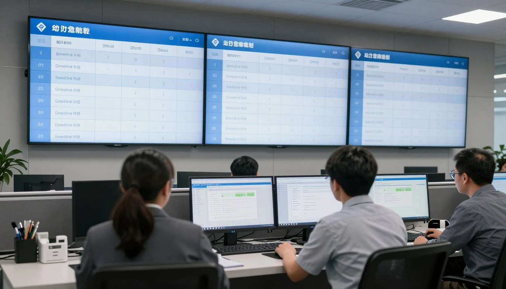

# **Event Transportation in Saudi Arabia**

AB coordinates premier event transportation Saudi Arabia solutions for summits, international exhibitions and executive delegations across the Kingdom. Managed operations connect arriving attendees with dedicated chauffeurs, scheduled airport routes and on site coordinators supported by our central operations desk.

Organising teams match vehicle tiers and movement schedules to their itinerary requirements, keeping group movements orderly between international airports, hospitality venues and conference halls.

[Book now](https://seowriting.ai/services/event-transportation) [Request a proposal](https://seowriting.ai/locations/saudi-arabia)

| Pick up           | Drop off         | Date and time       | Get a quote                  |
| ----------------- | ---------------- | ------------------- | ---------------------------- |
| Terminal or hotel | Convention venue | Scheduled itinerary | Submit details to operations |

Coverage

## **Event Transportation across Saudi Arabia**

AB provides coordinated ground transport services across key economic centres in the Kingdom. Regional teams manage local traffic variables, venue staging areas and regional terminal arrivals through direct coordination with our central command desk in the capital.

### **Riyadh**

Our capital headquarters manages major government summits, financial forums and large trade exhibitions with dedicated staging areas near international terminals and diplomatic venues.

[Riyadh](https://seowriting.ai/services/event-transportation/saudi-arabia/riyadh)

### **Jeddah**

Coastal operations deliver executive transfers for international trade events, coastal summits and delegate arrivals connecting through King Abdulaziz International Airport to commercial districts.

[Jeddah](https://seowriting.ai/services/event-transportation/saudi-arabia/jeddah)

### **AlUla**

Bespoke guest transfers for cultural gatherings and remote conferences are coordinated directly through our nearest regional facility, AB Riyadh, maintaining strict vehicle standards.

[AlUla](https://seowriting.ai/services/event-transportation/saudi-arabia/alula)

Fleet

## **Fleet for Event Transportation Saudi Arabia**

AB maintains an all black fleet suited for ministerial delegations, executive speakers and corporate attendees. Every luxury vehicle undergoes regular detailing and mechanical maintenance prior to event deployment.

### **Executive Sedan**

Mercedes S Class or similar \[Confirm\] vehicles provide discreet transit for keynote presenters, dignitaries and executive travellers requiring quiet cabin space.

### **Executive SUV**

Cadillac Escalade or similar \[Confirm\] models accommodate senior teams and leadership groups requiring generous luggage capacity and elevated road presence.

### **Premium MPV**

Mercedes V Class or similar \[Confirm\] options offer configurable passenger seating for working groups, board members and hospitality delegations traveling between sessions.

Process

## **How Event Transportation Saudi Arabia Operates**

Managed event movements require strict operational planning and constant oversight to align with changing conference programs and flight schedules.

### 1. **Schedule and Manifest Alignment**

Operations teams review delegate flight schedules and venue itineraries to structure vehicle distribution, group pickups and dedicated routing plans.

### 2. **On Site Staging and Meet and Greet**

Airport marshals receive arriving guests at designated terminals, while on site supervisors organize boarding queues and direct drivers through venue security gates.

### 3. **Central Dispatch and Duty of Care**

Our operations hub utilizes GPS tracking and real time flight tracking to coordinate fleet positioning, fulfilling duty of care requirements across all routes.

Standards

## **Professional Standards and Managed Ground Transport**

AB operates as a fully compliant managed ground transportation provider across the Kingdom. All services operate under local licence \[Confirm: local licence details\], with certified professional chauffeurs who have completed defensive driving courses and security checks.

Vehicles carry full commercial passenger insurance, and corporate clients receive transparent billing structured through a single corporate account with itemised monthly invoice options. You can review national infrastructure on our [Saudi Arabia](https://seowriting.ai/locations/saudi-arabia) location page.

Drivers undergo comprehensive background vetting and sign strict non disclosure agreements to safeguard client confidentiality during high profile summits.

## **Frequently Asked Questions**

### **How does an event shuttle service Saudi Arabia setup operate for large conferences?**

An event shuttle service Saudi Arabia deployment uses dedicated premium vans and coaches running continuous or scheduled loops between partner hotels and venue halls. Route marshals manage boarding zones, while central dispatch adjusts vehicle frequency to match opening sessions and evening galas without congestion.

### **What is included when booking conference transportation Saudi Arabia for international delegates?**

Booking conference transportation Saudi Arabia covers airport meet and greet services, flight tracking for incoming groups, scheduled transfers and on demand vehicle standby. Our operations desk assigns a dedicated coordinator who tracks arrivals, adjusts for delays and provides passenger manifest updates to event planning committees.

### **Can AB manage high volume delegate transport Saudi Arabia across multiple venues?**

Yes. AB coordinates delegate transport Saudi Arabia programs spanning convention centres, cultural dinner locations and satellite hotels. Central dispatch in Riyadh synchronises vehicle dispatches across distinct geographic zones, keeping group transfers aligned with overall conference agendas.

### **How is a VIP car pool Saudi Arabia structured for visiting dignitaries?**

A VIP car pool Saudi Arabia assignment allocates dedicated luxury sedans and premium SUVs on an as directed basis. Each private driver remains on standby with the designated principal, facilitating immediate departures between diplomatic meetings, private dinners and summit venues.

### **Which Middle East territories does AB support directly?**

AB directly serves Saudi Arabia, all seven UAE emirates and Qatar through owned offices in Riyadh, Dubai, Abu Dhabi and Doha. Ground operations in Bahrain, Kuwait and Oman are arranged on request through vetted partner networks to maintain consistent service standards.

### **Can our organisation establish a corporate account with consolidated invoicing?**

Enterprise clients and planning agencies can open a corporate account with centralized credit terms. All vehicle hire, airport transfers and standby hours consolidate into an itemised monthly invoice with detailed trip manifests and transparent tax receipts.

### **What airport protocols are managed for arriving speakers and executives?**

Our airport team monitors flight arrivals using live radar tracking to adjust pickup timings for early or delayed landings. Chauffeurs meet passengers at terminal exits with personalised paging boards, assist with baggage and escort guests directly to their waiting limousine.

## **Arrange Event Transportation Saudi Arabia with AB**

Coordinate seamless executive journeys and group delegate shuttles for your upcoming summit through our dedicated national operations office.

### **Event Ground Logistics Planning**

Submit your delegation itinerary, passenger counts and venue requirements to receive a detailed fleet proposal from our planning desk.

[Request a proposal](https://seowriting.ai/services/event-transportation) [Book a transfer](https://seowriting.ai/locations/saudi-arabia)