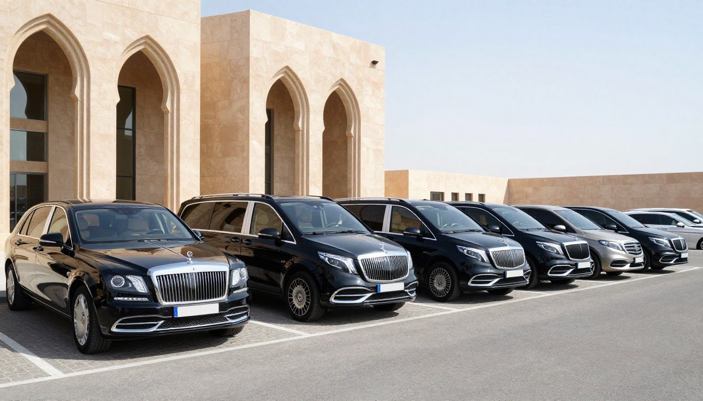
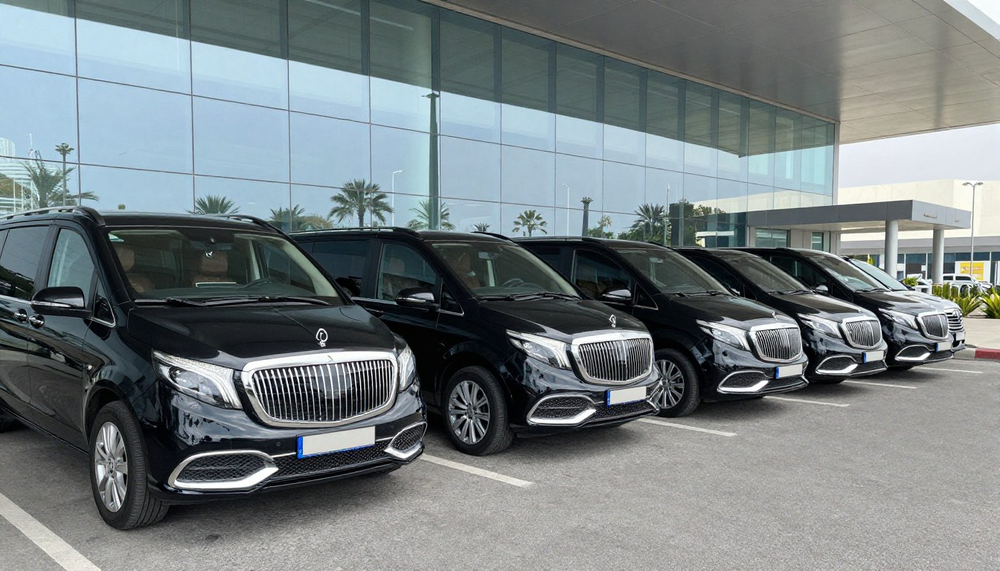

# **Event Transportation in UAE: Corporate Event Transportation**

AB provides corporate event transportation across the United Arab Emirates with managed fleet operations and local protocol expertise. Coordinated through 24/7 dispatch from our Riyadh headquarters, our professional chauffeur teams manage delegate arrivals, summit shuttles and executive itineraries with complete precision.

[Book now](https://seowriting.ai/services/event-transportation) [Request a proposal](https://seowriting.ai/services/event-transportation)

**Pick up:** \[Confirm: pick up location\]. **Drop off:** \[Confirm: drop off location\]. **Date and time:** \[Confirm: schedule\].

[Get a quote](https://seowriting.ai/services/event-transportation)

Coverage

## **Corporate Event Transportation across UAE**

AB coordinates managed ground transportation for international conferences, governmental summits and industry expos across the Emirates. Operating with established regional offices in Dubai and Abu Dhabi, our local operations teams supervise vehicle staging and route logistics to maintain punctual transfers for every visiting business delegation.

### **Dubai Summit Logistics**

Serving trade congresses at Dubai World Trade Centre and conventions across Expo City Dubai, our operations manage high volume delegate transfers. Organise your venue transfers through our dedicated [chauffeur service for events Dubai](https://seowriting.ai/services/event-transportation/uae/dubai) connecting Dubai International Airport with primary commercial districts.

### **Abu Dhabi Capital Summits**

Supporting intergovernmental forums, bilateral gatherings and international symposiums at ADNEC, our team coordinates executive motorcades with formal protocol procedures. Organise your summit fleet with our specialised [corporate event transportation Abu Dhabi](https://seowriting.ai/services/event-transportation/uae/abu-dhabi) desk based directly inside the capital.

Fleet

## **Executive Fleet for Corporate Event Transportation**

Deploying uniform luxury vehicles across each corporate event transportation project preserves brand prestige and passenger comfort. Every vehicle class receives thorough mechanical preparation, interior detailing and real time telemetry tracking prior to active delegate service.

### **Executive Sedans**

Discreet luxury saloons configured for keynote speakers, chief executives and visiting dignitaries requiring individual transfers. Typical models include Mercedes S Class or similar \[Confirm\] featuring spacious leather seating, climate zoning and quiet travel environments.

### **Executive SUVs**

Prestigious sport utility vehicles suited for senior management entourages, corporate roadshows and technical event directors. Typical models include Cadillac Escalade or similar \[Confirm\] providing generous legroom, elevated road vision and luggage capacity.

### **Luxury People Movers**

Refined multi passenger vehicles designed for executive committee transfers, VIP board delegations and event sponsor groups. Typical models include Mercedes V Class or similar \[Confirm\] with adaptable conference cabin seating configurations and dedicated privacy glass.

### **Executive Minibuses**

Spacious executive coaches tailored for recurring delegate hotel runs, airport group arrivals and large event support teams. Typical models include Mercedes Sprinter or similar \[Confirm\] offering ergonomic high back seating and centralised climate control.

Process

## **How Corporate Event Transportation Operates**

Successful event logistics depend on structured coordination across booking desks, fleet dispatchers and venue staging supervisors. AB manages every movement through standardised operational phases to maintain alignment with your master event agenda.

### 1. **Logistics Planning and Schedule Analysis**

Our transport specialists review flight manifests, hotel allocations and venue access points to build comprehensive vehicle schedules. Flight tracking systems monitor inbound arrivals while dispatchers establish dedicated pickup corridors.

### 2. **Centralised Dispatch and Chauffeur Briefing**

Coordinated from our 24/7 dispatch desk in Riyadh, chauffeurs receive passenger manifests, route itineraries and security checkpoint accreditations. Vehicle tracking verifies on schedule staging before passenger pickups commence.

### 3. **On Site Coordination and Manifest Updates**

Dedicated ground coordinators supervise passenger boarding zones and manage luggage handling directly outside venue halls. Real time GPS tracking enables the dispatch team to accommodate dynamic itinerary alterations instantly.

Compliance

## **Operational Standards and Safety Compliance**

Operating under official transport authority licensing \[Confirm: UAE commercial transport licence details\], AB maintains rigorous duty of care protocols across every regional deployment. Professional chauffeurs undergo background vetting, defensive driving assessments and non disclosure compliance. Every luxury vehicle undergoes regular mechanical inspections and carries real time GPS tracking. Our 24/7 dispatch desk oversees flight tracking for airport arrivals, coordinating personalised meet and greet services at terminal gates to assist arriving executive guests.

Corporate accounts benefit from consolidated monthly invoice reporting, transparent passenger manifest audits and centralized billing aligned with designated enterprise cost centers.

## **Frequently Asked Questions**

### **How does corporate event chauffeur hire work for large conferences?**

Arranging corporate event chauffeur hire involves assigning dedicated vehicles to executive itineraries, VIP speakers and conference venues. AB coordinates movements from our regional operations hub with complete flight tracking and on site coordination. When booking a dedicated [chauffeur service UAE](https://seowriting.ai/locations/uae) planners receive central billing and continuous route monitoring, keeping event schedules running smoothly throughout each business summit.

### **What roles does a corporate events chauffeur manage during summits?**

A corporate events chauffeur manages passenger arrivals, venue transfers and dynamic as directed movements for VIP delegations. Chauffeurs assist with luggage handling, coordinate terminal gate meet and greet procedures, and follow dedicated security access routes. Backed by 24/7 dispatch and continuous GPS tracking, each driver maintains punctual service between corporate hotels, gala dinners and convention facilities across the Emirates.

### **How is VIP event transportation UAE coordinated for high profile guests?**

Delivering VIP event transportation UAE requires discreet vehicle staging, professional chauffeurs and coordinated protocol management. AB provides dedicated luxury sedans and premium SUVs for keynote speakers, ambassadors and C level executives. Each journey benefits from real time monitoring, flight tracking for airport arrivals, and direct communication between local ground coordinators and our central operations desk in Riyadh.

### **What vehicle types support an event shuttle service UAE?**

Operating an event shuttle service UAE relies on high capacity executive minibuses and premium people movers. These vehicles transfer delegates efficiently between international airport terminals, recommended partner hotels and exhibition halls. With scheduled dispatch intervals and professional drivers, group shuttles reduce congestion around busy venues like Dubai Exhibition Centre and Abu Dhabi National Exhibition Centre.

### **How does AB manage complex conference transportation UAE schedules?**

Managing conference transportation UAE demands proactive scheduling and rigorous fleet oversight. AB centralises delegate manifests through our transport management architecture, synchronising hotel departures with master congress timelines. Our Riyadh command centre works alongside ground teams in Dubai and Abu Dhabi to coordinate traffic detours, venue access passes and emergency backup vehicles across all major corporate summits.

### **How are group transfers organised for delegate transport UAE?**

Organising delegate transport UAE requires structured coordination across arrival terminals, convention centres and accommodation hubs. AB deploys executive vans and luxury coaches configured for comfortable group travel, tracking inbound flights to adjust for delays automatically. Uniformed ground coordinators direct passengers at pickup bays, maintaining orderly departures and simplified manifest accounting for conference planning committees.

### **When should corporate event planners set up a VIP car pool UAE?**

Setting up a VIP car pool UAE is ideal for corporate summits hosting multiple VIP delegations, board members or government dignitaries. Dedicated executive sedans and SUVs remain on standby under as directed terms to accommodate shifting meeting schedules. Planners can also review our wider [event transportation services](https://seowriting.ai/services/event-transportation) to combine on call executive cars with scheduled attendee shuttles under a single corporate account.

## **Corporate Event Transportation in UAE**

### **Reserve Executive Ground Transportation**

Connect with our regional mobility desk to coordinate executive fleet logistics, summit manifests and delegate transfers across the Emirates.

[Request a proposal](https://seowriting.ai/services/event-transportation) [Book a transfer](https://seowriting.ai/services/event-transportation)

+971 50 781 3880