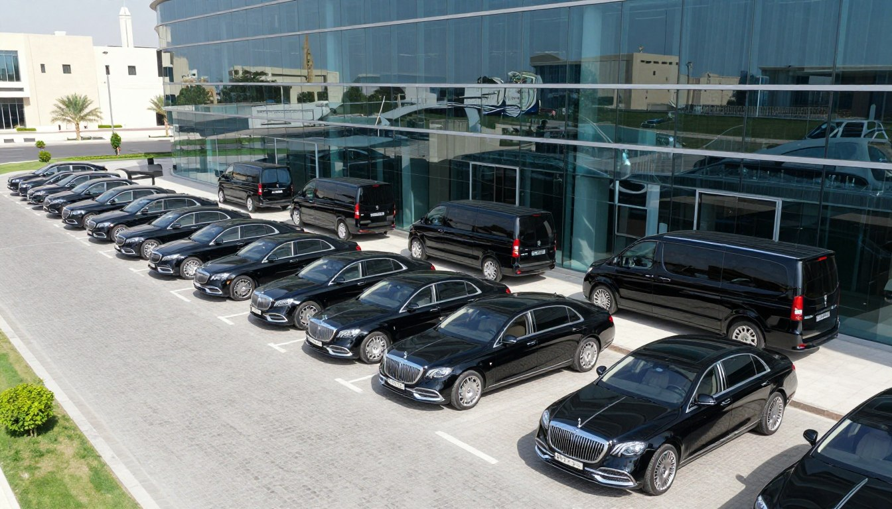
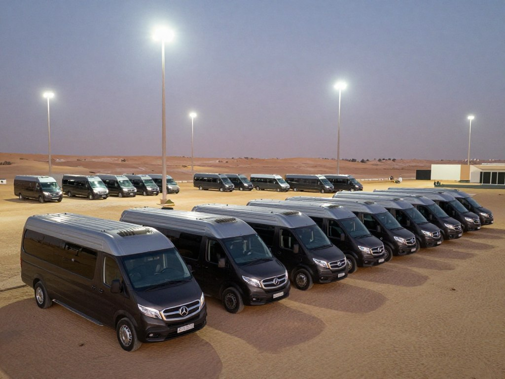
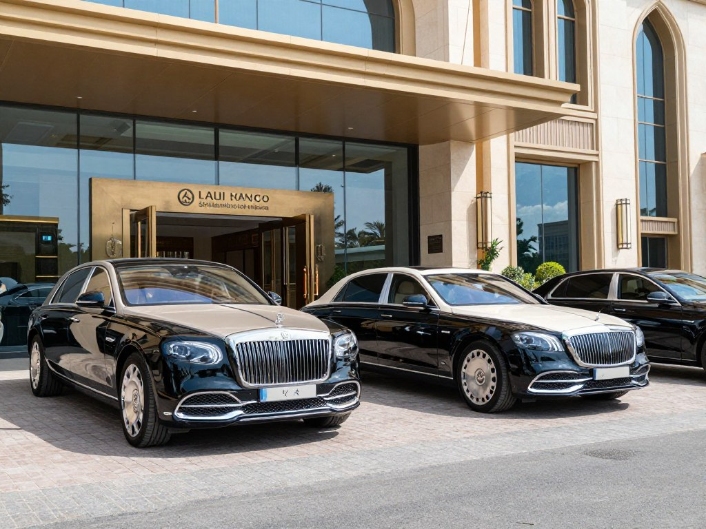

# **Reliable Event Transportation for Flawless Regional Summits**

Coordinated event transportation requires punctual fleet positioning, vetted professional chauffeurs and continuous central supervision across host cities. AB manages large delegate movements and private VIP motorcades for premier conferences, state gatherings and exhibitions across Saudi Arabia, the UAE and Qatar.

[Request a proposal](https://seowriting.ai/quote/event) [All services](https://seowriting.ai/services)

24/7dispatch

3countries with our own fleet

8airports served

How we work

## **Coordinated Fleet Control**

Executing professional event transportation demands rigorous planning, immediate communication and strict duty of care. AB deploys dedicated local project leads and continuous GPS tracking from our central operations centre, keeping delegate transfers smooth between international airport terminals, official hotels and major exhibition venues.

What you get

## **Built for event transportation**

### **1\. Delegate shuttles**

Scheduled coach and minibus loops connect primary conference hotels directly with summit venues. Continuous timetable monitoring manages passenger volume efficiently during peak arrival and departure cycles.

### **2\. VIP car pools**

Dedicated luxury vehicle allocations with a private driver serve keynote speakers, corporate executives and ministerial delegations. Chauffeurs remain on standby for unexpected schedule modifications and private side meetings.

### **3\. On site coordinators**

Uniformed ground marshals direct passengers at arrival gates, curbside pickup points and venue staging lanes. Our team coordinates vehicle movement directly to prevent curbside congestion.

### **4\. Live control room**

Operations specialists track all vehicle positions through satellite telematics from our 24/7 dispatch office. Route planners monitor local road congestion and direct drivers around bottlenecks in real time.

How it runs

## **Three stages, one accountable partner**

### 1. **Plan**

Route assessment, airport arrival mapping, vehicle staging permits and hotel access protocols are finalised well before delegate arrivals begin.

### 2. **Operate**

On site personnel coordinate vehicle departures while our operations room tracks flight schedules and highway traffic patterns continuously.

### 3. **Report**

Consolidated journey logs, passenger manifest counts and itemised billing data are provided immediately after event operations conclude.

Proven in the region

## **Recent work**

AB delivers high capacity ground transportation programmes for major global gatherings across the Middle East. Our dedicated fleet operations support cultural summits and energy conventions requiring exacting coordination.

### **MDL Beast Soundstorm Festival**

Delivered round the clock artist shuttles, crew logistics and executive guest movements across remote festival grounds outside Riyadh, operating continuous fleet links between central hotels and production perimeters.

### **ADIPEC VIP Shuttle Services**

Managed point to point transfers, ministerial motorcades and dedicated delegate transit for international energy industry leaders attending Abu Dhabi National Exhibition Centre, supported by on site coordination teams.

Where we run it

## **Regional Coverage and Deployed Fleets**

AB provides directly managed operations across primary commercial centres in three Gulf states. Planners organising regional roadshows can review our dedicated territory networks:

- [Event Transportation in Saudi Arabia](https://seowriting.ai/services/event-transportation/saudi-arabia)
- [Event Transportation in UAE](https://seowriting.ai/services/event-transportation/uae)
- [Event Transportation in Qatar](https://seowriting.ai/services/event-transportation/qatar)

When executing complex [corporate event transportation](https://seowriting.ai/services/event-transportation/uae) programmes, having access to vetted chauffeurs and diverse premium vehicles is vital. Our teams deliver bespoke VIP event transportation UAE solutions across Dubai and Abu Dhabi, as well as managed [event transportation Saudi Arabia](https://seowriting.ai/services/event-transportation/saudi-arabia) programmes throughout Riyadh and Jeddah. Clients hosting international summits in Qatar rely on our specialised [event transportation Doha](https://seowriting.ai/services/event-transportation/qatar/doha) team for airport receptions. For regional corporate summits, our planners arrange seamless [corporate event transportation Dubai](https://seowriting.ai/services/event-transportation/uae/dubai) transfers connecting international airports with major downtown hotels.

Vehicles typically deployed:

- First Class Sedan
- Executive SUV
- Executive Van
- Coach

Browse our complete selection of luxury vehicles by visiting the [View the full fleet](https://seowriting.ai/fleet) page.

Questions

## **Frequently asked questions**

### **How does AB coordinate large delegate transport from airports?**

AB assigns uniformed greeting personnel inside the terminal arrivals area who track inbound flights in real time. Arriving attendees receive personal assistance with luggage before being guided to reserved executive vans or waiting coaches. Our central dispatch room monitors incoming flights to adjust vehicle staging times when flight delays occur.

### **What experience does AB have managing music and entertainment events?**

Our operations team managed large fleet logistics during the MDL Beast Soundstorm Festival, transferring performers, international production teams and VIP guests between Riyadh hotels and outer desert venue perimeters. That deployment demonstrated our capacity to maintain reliable shuttle frequencies under complex traffic restrictions and high volume staging environments.

### **How are VIP car pool requirements handled for executive speakers?**

Keynote dignitaries, board members and government delegations receive assigned premium sedans with a dedicated professional chauffeur throughout the conference schedule. Chauffeurs remain positioned within designated secure parking bays adjacent to the main conference hall, ready for unscheduled meetings, private dinners or rapid airport departures.

### **How did AB manage energy delegations during ADIPEC VIP Shuttle Services?**

During our work on the ADIPEC VIP Shuttle Services project, AB coordinated executive ground transport for global energy executives visiting Abu Dhabi. Our team placed dedicated on site dispatchers at designated hotel curbsides and exhibition gates, keeping VIP passenger transfers prompt despite dense citywide traffic around the venue.

### **What duty of care standards are applied across the event fleet?**

Every private driver completes rigorous background verification, defensive driving assessments and executive protocol training. All deployed vehicles carry valid commercial licensing, comprehensive insurance and satellite GPS tracking units connected directly to our 24/7 dispatch desk in Riyadh, maintaining total operational oversight throughout the project.

### **Can corporate account holders access consolidated post event invoicing?**

Yes, enterprise clients and travel agencies can establish a [corporate account](https://seowriting.ai/corporate-accounts) with AB. This facility allows all vehicle hire charges, on site marshalling hours and airport parking fees to be gathered onto a single transparent monthly invoice, complete with individual trip validation receipts for simple accounting reconciliation.

### **How does AB design an event shuttle service between hotels and venues?**

Our route planners examine delegate accommodation distributions, venue access roads and municipal peak traffic patterns to design an efficient timetable. We deploy luxury coaches and executive mini buses on scheduled circular routes, adjusting departure cadences dynamically using real time telemetry to match morning registrations and evening conference receptions.

### **What conference transportation options exist for multi day regional summits?**

Multi day conference transportation requires structured vehicle tiers, combining continuous high capacity guest shuttles with dedicated on call executive limousines for committee leaders. AB assigns a dedicated operations manager who attends daily organiser briefings, reallocating vehicle assignments as delegate attendance numbers fluctuate throughout the summit programme.

Our capabilities

## **Other chauffeured ground services**

Alongside comprehensive conference transportation, AB delivers full spectrum ground logistics throughout Saudi Arabia, the United Arab Emirates and Qatar. Explore our other dedicated transportation categories on the [services](https://seowriting.ai/services) overview page:

- Airport Transfers
- Chauffeur Service
- City to City Transfers
- Corporate Chauffeur Service
- Financial Roadshows
- Hourly Chauffeur Service
- Private Aviation Chauffeur
- Diplomatic and Protocol Transportation

## **Planning event transportation?**

### **Speak with our regional fleet operations desk**

Connect with our dedicated planning team to structure reliable event transportation for your upcoming summit or corporate conference across the Gulf region.

[Request a proposal](https://seowriting.ai/quote/event) [Talk to a planner](https://seowriting.ai/quote/event)