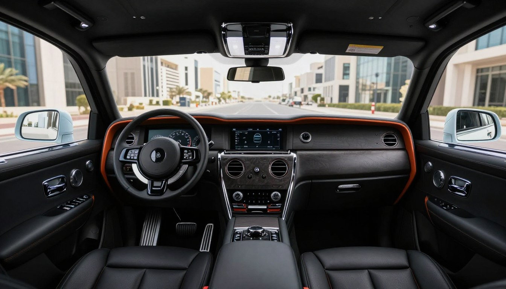
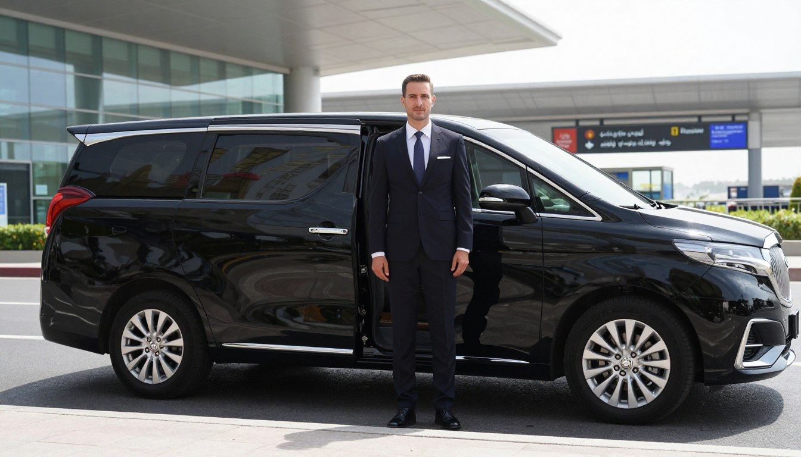

# **Dubai to Abu Dhabi transfer**

A professional Dubai to Abu Dhabi transfer provides scheduled intercity travel between the two emirates in comfort. Dedicated chauffeurs manage the route directly via the E11 or E311 motorways.

Passenger group sizes and vehicle preferences decide the ideal vehicle class for every journey.

[Request a proposal](https://seowriting.ai/quote/book) [Book a transfer](https://seowriting.ai/quote/book)

Pickup: Dubai International Airport (DXB) · Drop off: Abu Dhabi

## **Essential Route Facts for Dubai and Abu Dhabi Travel**

Intercity transit between the two emirates connects major business centres, federal offices and transport hubs along modern highway corridors. Operating logistics require precise planning around urban traffic patterns, customs corridors and airport schedules.

Continuous central oversight supports seamless transit for single travellers, corporate delegations and official protocol personnel moving between Dubai and the UAE capital.

### **Journey Time**

Travel duration between Dubai and Abu Dhabi requires \[Confirm: journey time\] depending on the chosen origin, final destination and prevailing traffic flow.

### **Journey Type**

Intercity itineraries run as single one way transfers or scheduled same day return trips aligned with executive business agendas.

### **Availability**

Fleet dispatch operates 24/7 to support early flight arrivals, evening diplomatic functions and round the clock corporate movements.

## **Vehicle Options for Every Dubai to Abu Dhabi Transfer**

Choosing the appropriate vehicle class for a luxury car transfer Dubai to Abu Dhabi depends on group composition, work requirements during transit and baggage requirements. Corporate planners booking a Dubai to Abu Dhabi chauffeur service demand impeccably maintained vehicles equipped with climate control, leather upholstery and quiet cabins suitable for mobile meetings.

AB operates a modern fleet across Saudi Arabia, the UAE and Qatar, meeting stringent regional regulatory standards. Clients seeking a dedicated [chauffeur service Dubai](https://seowriting.ai/locations/uae/dubai) can select from executive saloons, first class flagship vehicles and spacious multi passenger options.

### **Executive Saloon**

Guests: \[Confirm: passenger capacity\] · Bags: \[Confirm: luggage capacity\]

The executive saloon provides quiet refinement for individual business travellers and corporate managers. Premium seating, climate regulation and quiet cabin acoustics support productive travel between cities.

### **Luxury Saloon**

Guests: \[Confirm: passenger capacity\] · Bags: \[Confirm: luggage capacity\]

First class saloons deliver elevated comfort for senior dignitaries and executives. Extended legroom, superior interior finishes and refined suspension create an ideal environment for rest or agenda preparation.

### **Executive MPV**

Guests: \[Confirm: passenger capacity\] · Bags: \[Confirm: luggage capacity\]

The executive MPV accommodates project delegations, event production teams and travelling families. Flexible seating layouts and generous cargo room handle substantial luggage alongside supreme passenger comfort.

Each vehicle class undergoes rigorous inspection and detailing before intercity deployment.

## **Popular Pickup Locations for a Dubai to Abu Dhabi Transfer**

Intercity transit corridors frequently link aviation gateways with commercial zones, financial institutions and hospitality properties across both emirates. Scheduling a [Dubai airport transfer with chauffeur](https://seowriting.ai/airports/dubai-international-dxb) provides arriving international passengers with prompt curb side reception and uninterrupted onward transit. Similar precision applies when managing an Abu Dhabi to Dubai private transfer for executives finishing government consultations in the capital.

AB coordinates intercity movements through central management, connecting passengers efficiently across all seven UAE emirates. Scheduled [intercity transfers](https://seowriting.ai/services/intercity-transfers) eliminate the inconvenience of regional taxi queues and multiple car changes.

### **DXB Airport to Abu Dhabi City**

From \[AED price\] · \[Confirm\] minutes

Direct collection from Dubai International Airport terminal arrivals with scheduled transit to central Abu Dhabi hotels or diplomatic compounds.

### **DWC Airport to Abu Dhabi City**

From \[AED price\] · \[Confirm\] minutes

Efficient south Dubai pickup from Al Maktoum International Airport delivering fast highway access toward Abu Dhabi commercial zones.

### **AUH Airport to Dubai City**

From \[AED price\] · \[Confirm\] minutes

Inbound arrivals at [Zayed International Airport (AUH)](https://seowriting.ai/airports/zayed-international-auh) receive immediate connection to Downtown Dubai, Business Bay or surrounding districts.

### **Downtown Dubai to Abu Dhabi Corniche**

From \[AED price\] · \[Confirm\] minutes

Direct city centre hotel and office collection connecting central Dubai financial towers directly to seaside government and corporate offices in Abu Dhabi.

### **Dubai Marina to Yas Island**

From \[AED price\] · \[Confirm\] minutes

Southern Dubai coastal pickup routed toward Yas Island entertainment venues, race circuits, convention facilities and leisure resorts.

Airport and downtown pickups include designated meeting points and professional luggage handling.

## **How Booking Works for Intercity Chauffeur Travel**

Booking a private driver through AB follows a streamlined process designed for corporate travel managers, executive assistants, event organisers and government protocol offices. Operational teams coordinate every detail through 24/7 dispatch centres in Riyadh, Dubai and Abu Dhabi, verifying itinerary parameters before vehicle dispatch. Clients booking a [chauffeur service Abu Dhabi](https://seowriting.ai/locations/uae/abu-dhabi) or a Dubai to Abu Dhabi chauffeur benefit from unified operational coordination across borders.

Each assigned professional chauffeur undergoes comprehensive background checks and route orientation. Central systems supervise vehicle positions along major highway networks using continuous GPS tracking.

### **1\. Route Selection and Quotation**

Travel organisers submit route requirements, passenger figures, luggage totals and flight numbers to receive an itemised commercial quotation.

### **2\. Dispatch and Confirmation**

The operations desk assigns the appropriate luxury vehicle, issues written confirmation and tracks inbound flight movements in real time.

### **3\. Meet and Greet Arrival**

The chauffeur performs an arrival meet and greet with personalised name boards, assists with luggage and conducts the intercity transit.

Central dispatch teams supervise intercity transfers continuously across the Arabian Gulf.

## **Pricing Approach for Dubai to Abu Dhabi Transfer Services**

Transparent rates for every transfer depend on the vehicle class, passenger capacity, luggage volume, selected pickup points and timing. Fixed rates apply to both single one way journeys and return bookings, with final fees confirmed upon booking \[Confirm: pricing schedule\]. All quotes include vehicle hire, professional chauffeur services, road tolls and fuel without hidden surcharges.

## **Frequently Asked Questions**

### **What is the expected journey duration for a private transfer Dubai to Abu Dhabi?**

Transit between Dubai and Abu Dhabi typically requires \[Confirm: journey time\] depending on specific departure points, arrival destinations and highway congestion. Motorway routes along the E11 corridor move efficiently outside peak morning and late afternoon commuting hours. Central dispatch tracks regional traffic conditions continuously to guide chauffeurs along the most practical path.

### **How does a Dubai airport to Abu Dhabi transfer handle flight delays?**

Central operations teams implement real time flight tracking for all airport arrivals across DXB, DWC and Zayed International Airport. Chauffeur dispatch schedules adjust automatically when airline schedules alter. Arriving passengers receive dedicated meet and greet services in the terminal without concern over unexpected gate delays or adjusted landing slots.

### **Can corporate clients arrange an Abu Dhabi to Dubai transfer as a same day return?**

Same day return transfers between Abu Dhabi and Dubai represent a common booking option for corporate delegations attending board meetings or government summits. Chauffeurs remain on standby or return at an agreed hour according to corporate instructions. Itineraries can accommodate multiple intermediate stops within city limits before the return leg.

### **What vehicle capacity is recommended for delegations travelling with extensive luggage?**

Executive MPV vehicles or full size luxury utility vehicles are recommended when transporting multiple passengers with substantial baggage. Saloon boots comfortably carry standard corporate luggage, whereas multi passenger vehicles provide flexible configurations for exhibition materials, diplomatic equipment and multiple large suitcases. Sizing verification is completed during initial booking quotation.

### **How does AB apply duty of care across its regional chauffeur operations?**

Duty of care forms the bedrock of every ground transportation operation conducted by AB across Saudi Arabia, the UAE and Qatar. All fleet vehicles undergo regular mechanical maintenance and rigorous hygiene checks before passenger collection. Professional chauffeurs maintain valid commercial licences, undergo defensive driving education and receive 24/7 dispatch monitoring via live GPS tracking.

### **Is chauffeur service Abu Dhabi to Dubai available for early morning departures?**

Intercity chauffeur services operate on a continuous 24/7 schedule throughout the year. Chauffeurs support pre dawn collections for international departures, early morning government appointments and late evening returns. Advance reservations confirm vehicle allocation regardless of departure hour, supported by operations centres in Riyadh, Dubai and Abu Dhabi.

### **Can multinational companies establish a corporate account with consolidated invoicing?**

Corporate travel managers and enterprise organisations can establish a dedicated corporate account with AB for regional ground travel. Account benefits include pre agreed corporate rates, dedicated booking coordinators, priority vehicle allocation and consolidated monthly invoice billing. Central accounting accommodates operations across Riyadh, Jeddah, Dubai, Abu Dhabi and Doha seamlessly.

### **How are multi vehicle movements managed for large international events and summits?**

Event organisers and government protocol teams receive dedicated project managers for large scale intercity transport programmes. AB coordinates multi vehicle staging, VIP convoy arrangements and guest logistics between airports, conference centres and regional hotels. Dispatchers monitor vehicular movements in real time to coordinate arrivals and departure flows.

### **What amenities are provided inside an executive limousine on the Dubai to Abu Dhabi route?**

Vehicles operating on the intercity corridor feature quiet passenger cabins, rear seat climate regulation, mobile device charging ports and bottled mineral water. Privacy window glazing and refined seating materials allow executives to conduct confidential discussions or rest comfortably during the motorway journey between emirates.

## **Reserve a Dubai to Abu Dhabi Transfer**

Coordinated ground transportation connects the commercial hubs of Dubai and Abu Dhabi with executive comfort, rigorous safety standards and continuous dispatch oversight. Travellers and corporate planners can secure vehicles through advance reservation or ongoing corporate agreements.

[Request a proposal](https://seowriting.ai/quote/book) [Book a transfer](https://seowriting.ai/quote/book)