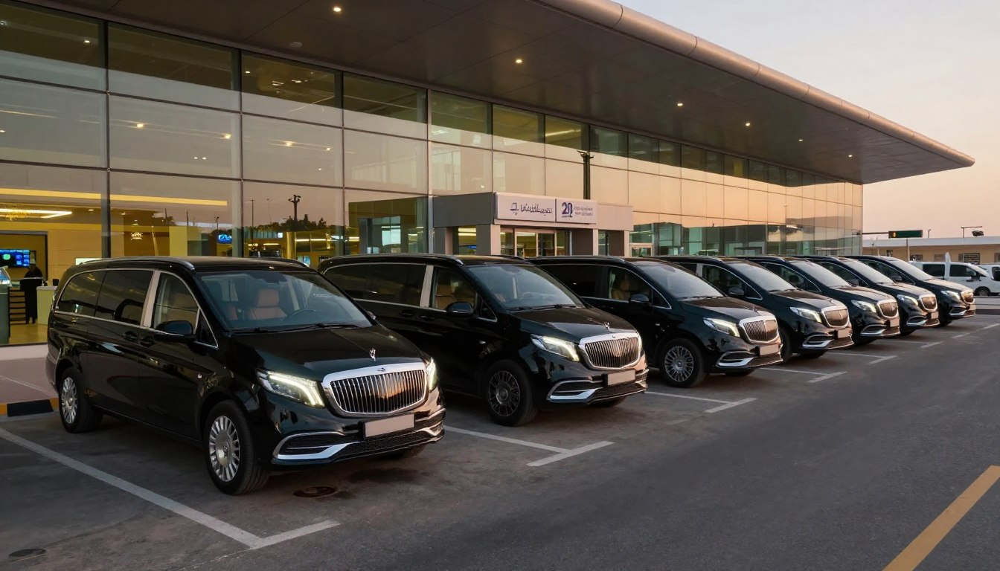
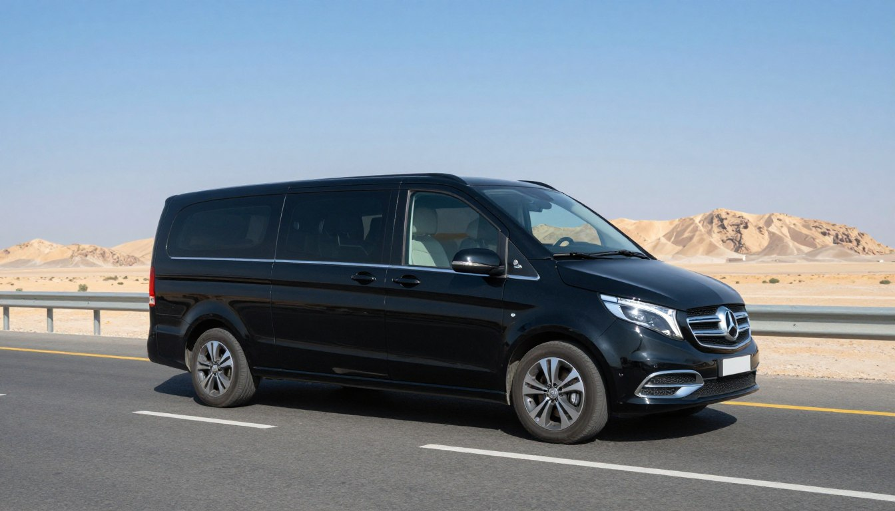

# **Executive Umrah transportation for seamless pilgrimages and corporate delegations**

Executive Umrah transportation provides corporate delegations, VIP guests, and pilgrim groups with dependable, managed travel between international airports and holy sanctuaries. AB coordinates private transfers, luxury vehicles, and scheduled group shuttles across Jeddah, Makkah, and Madinah under continuous operational supervision.

[Request a proposal](https://seowriting.ai/quote/book) [All services](https://seowriting.ai/services)

### **24/7 dispatch**

Continuous monitoring from our central operations command in Riyadh.

### **3 countries with our own fleet**

Direct operations across Saudi Arabia, the UAE, and Qatar.

### **8 airports served**

Dedicated meet and greet reception at major regional aviation hubs.

How we work

## **Managed Umrah transportation across the Kingdom**

Operating private Umrah transportation requires rigorous scheduling, verified regulatory compliance, and active flight tracking across Western Province terminals. AB deploys professional chauffeurs and immaculate vehicles supported by central dispatch in Riyadh to maintain seamless movement between Jeddah airport, Makkah hotels, and sacred sites.

What you get

## **Built for religious tourism (umrah & hajj)**

Our Umrah transportation services combine verified flight coordination, licensed drivers, and vehicle sanitisation across the major pilgrimage corridors of Saudi Arabia.

### **1\. JED and MED arrivals**

Direct meet and greet reception at King Abdulaziz International Airport in Jeddah and Prince Mohammad Bin Abdulaziz Airport in Madinah, featuring luggage coordination and expedited curb clearance.

### **2\. Jeddah to Makkah transfers**

Chauffeured transit along the express highway to holy hotels, utilising live route management to bypass city congestion and deliver pilgrims smoothly to their accommodation.

### **3\. Makkah to Madinah journeys**

Intercity highway transfers connecting the two holy cities, executed by experienced chauffeurs in luxury sedans, family minivans, or executive coaches equipped for long distance passenger comfort.

### **4\. Group Umrah logistics**

Synchronised coach movements for large pilgrim parties, guided delegations, and institutional sponsors, structured around strict hotel check in schedules and religious visitation windows.

How it runs

## **Three stages, one accountable partner**

AB manages Umrah transportation through a centralised operational structure that keeps travel organizers informed at every project milestone.

### **Brief**

Submit passenger counts, flight schedules, hotel reservations, and specific vehicle preferences through our booking portal or dedicated account team.

### **Plan**

Our operations desk confirms vehicle allocations, assigns licensed chauffeurs, maps transit routes, and coordinates terminal access clearances in advance.

### **Operate**

Central dispatch tracks incoming flights, monitors live road progress via telemetry, and supports local coordinators until the delegation completes its journey.

Proven in the region

## **Recent work**

Operating footprint and fleet

## **Umrah transportation coverage and executive fleet**

AB delivers specialised Umrah transportation across key regional hubs, maintaining uniform service standards for international pilgrims and corporate sponsors travelling to the holy cities.

### **Where we run it**

- [Saudi Arabia](https://seowriting.ai/locations)
- [UAE](https://seowriting.ai/locations)
- [Qatar](https://seowriting.ai/locations)

Delegations commencing their journey from the United Arab Emirates or Qatar receive coordinated transfers connecting regional flights with onward ground itineraries in the Kingdom.

### **Vehicles typically deployed**

- Premium MPV
- Executive Van
- Coach

[View the full fleet](https://seowriting.ai/fleet)

Questions

## **Frequently asked questions about Umrah transportation**

### **How are airport arrivals handled at Jeddah and Madinah?**

Arriving passengers receive a professional meet and greet service inside the terminal halls at King Abdulaziz International Airport in Jeddah and Prince Mohammad Bin Abdulaziz Airport in Madinah. Our dispatch team conducts continuous flight tracking to adjust for schedule revisions or gate changes. Chauffeurs assist with heavy luggage, provide paging boards displaying corporate or group names, and escort travellers directly to awaiting air conditioned vehicles.

### **What is the procedure for booking a Jeddah to Makkah transfer?**

Arranging a Jeddah to Makkah transfer involves selecting preferred vehicle classes, detailing flight schedules, and confirming the specific hotel in Makkah. AB schedules private chauffeurs who understand local highway conditions and hotel access regulations around the Haram district. The operations centre monitors transit progress through telemetry, helping guests transition smoothly from the terminal to their sacred accommodation without unexpected curbside negotiations or vehicle shortages.

### **How is intercity Makkah to Madinah transport coordinated?**

Direct Makkah to Madinah transport is coordinated through scheduled point to point itineraries along the main western highway corridor. Private sedans, luxury minivans, and executive coaches are assigned based on passenger counts and luggage capacity. Chauffeurs plan refreshment pauses at vetted service stops, observe national road speed rules, and maintain direct contact with the central control room in Riyadh throughout the entire intercity journey.

### **What capacity and support do you provide for Hajj transportation?**

Our dedicated Hajj transportation solutions accommodate official delegations, diplomatic missions, and corporate sponsors requiring managed ground travel during peak pilgrimage seasons. Deployments involve experienced drivers with valid security clearances, continuous route surveillance, and contingency backup vehicles stationed along strategic transit corridors. Central operations maintains twenty four hour contact with group leaders to adapt to municipal movement restrictions and designated protocol access schedules.

### **How do you handle large scale Umrah group transport?**

For institutional travel organisers managing Umrah group transport, AB supplies modern coaches and coordinated vehicle convoys capable of moving large delegations together. We assist organisers with bus rental Makkah options that include licensed drivers, luggage handling logistics, and timed hotel shuttle rotations. Dedicated dispatchers monitor convoy progress using GPS tracking, helping large parties maintain strict schedules for scheduled prayers, ziyarah tours, and airport departures.

### **Which executive vehicle and chauffeur options are available?**

Organisations seeking premium mobility can reserve a private driver and luxury vehicle suited for dignitaries, executive committees, and VIP pilgrims. Options include executive sedans, spacious MPVs, and luxury Mercedes vans equipped with leather interiors and wireless connectivity. Clients can reserve a dedicated [chauffeur service Makkah](https://seowriting.ai/locations/saudi-arabia/mecca) or book our specialised [chauffeur service Madinah](https://seowriting.ai/locations/saudi-arabia/medina) for private city and regional travel.

### **What corporate account and consolidated billing facilities exist?**

Travel managers and corporate entities can establish a verified [corporate account](https://seowriting.ai/corporate-accounts) to streamline booking across multiple religious delegations. Account holders benefit from itemised billing, transparent cost centre allocation, and a consolidated monthly invoice that complies with regional tax standards. This framework eliminates cash transactions for arriving guests and allows corporate procurement teams to manage ground transport expenses through single source administrative oversight.

### **How does AB uphold duty of care and passenger safety?**

Passenger safety and duty of care form the foundation of our operational architecture across Saudi Arabia. All vehicles undergo routine preventative safety checks, commercial sanitisation, and active GPS tracking monitored from the Riyadh dispatch facility. Chauffeurs undergo extensive background vetting, defensive driving training, and protocol instruction. In the event of unforeseen regional route diversions, dispatchers promptly coordinate alternative pathways to keep passenger movements secure.

Comprehensive mobility

## **Other ground transportation services**

Beyond dedicated Umrah transportation, AB delivers managed ground transport across corporate, government, and event sectors in Saudi Arabia, the UAE, and Qatar.

- [VIP and Executive Transport](https://seowriting.ai/services)
- [Hourly Standby Chauffeur](https://seowriting.ai/services)
- [Strategic Route Logistics](https://seowriting.ai/services)
- [Dedicated Fleet Allocation](https://seowriting.ai/services)
- [Enterprise Transport Contracts](https://seowriting.ai/services)
- [Executive Airport Transfers](https://seowriting.ai/services)
- [Corporate Event Transportation](https://seowriting.ai/services)
- [Financial Roadshow Transport](https://seowriting.ai/services)

## **Planning religious tourism (umrah & hajj)?**

Coordinate executive Umrah transportation across Saudi Arabia with dedicated 24/7 dispatch, premium vehicles, and direct corporate billing support for your arriving delegations.

[Request a proposal](https://seowriting.ai/quote/book) [Talk to a planner](https://seowriting.ai/quote/book)