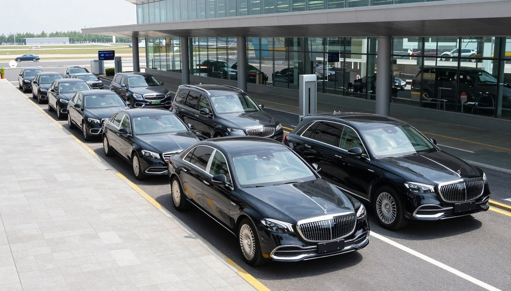
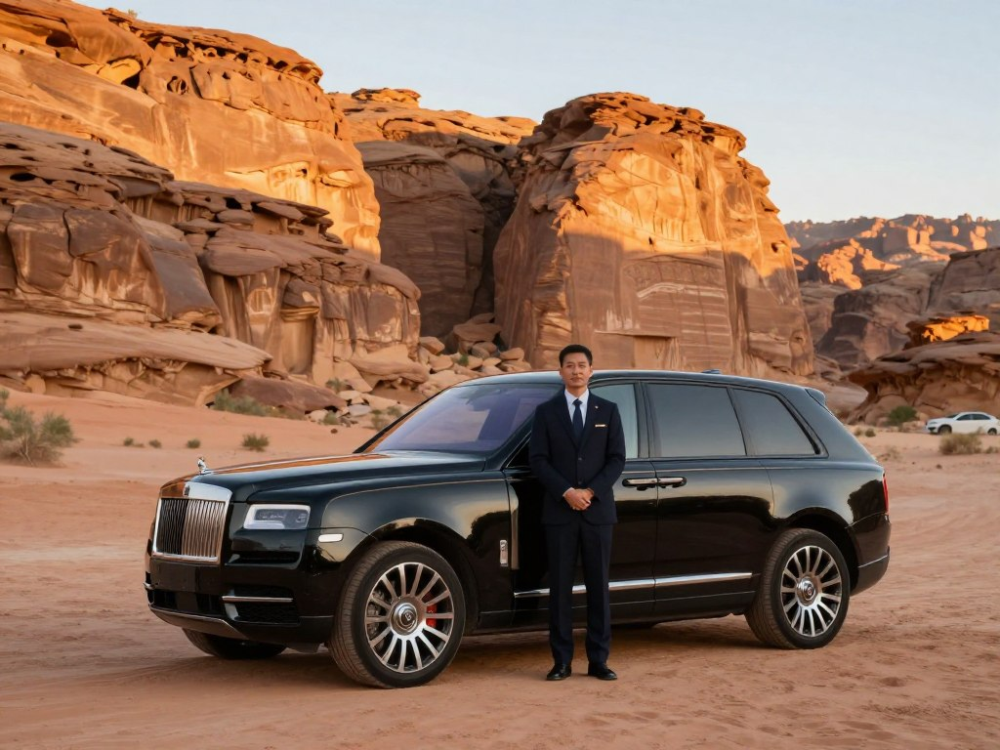
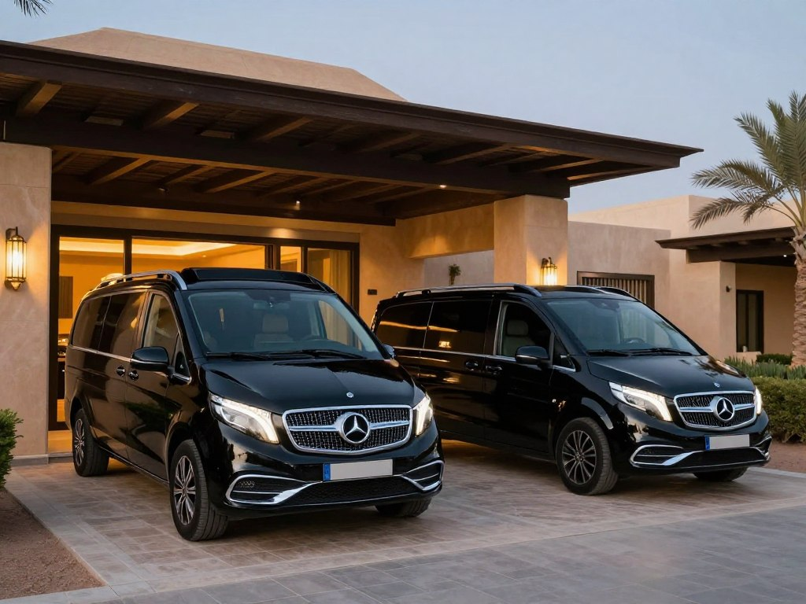

# **Reliable Tourism Transportation for Seamless Regional Travel**

Professional tourism transportation delivers seamless journeys across major cultural sites, leisure destinations and hospitality hubs in the Middle East. AB manages premium fleets and vetted chauffeurs to support international visitors, corporate groups and travel organisers throughout every itinerary stage.

Coordinated logistics eliminate transit friction between airports, private hotels and heritage attractions across the Gulf. Our operations teams supervise vehicle dispatch around the clock to maintain complete schedule control.

[Request a proposal](https://seowriting.ai/quote/book) [All services](https://seowriting.ai/services)

### **24/7 dispatch**

Centralised flight tracking and operational control from our Riyadh operations centre.

### **3 countries with our own fleet**

Direct premium ground operations active across Saudi Arabia, the UAE and Qatar.

### **8 airports served**

Dedicated meet and greet transfers across the premier aviation hubs of the region.

How we work

## **Operational Standard for Middle East Tourism**

Our approach to tourism transportation combines centralised logistics with regional execution across Saudi Arabia, the UAE and Qatar. Dedicated project teams manage vehicle allocation, route scheduling and real time updates so every passenger movement proceeds without delay or operational friction.

What you get

## **Built for tourism transportation**

Ground operations require rigorous standards when moving leisure guests and official travel delegations across busy regional capitals. Each service component reflects extensive operational experience in regional hospitality and protocol logistics.

### **1\. Guest transfers**

Coordinated airport arrivals, hotel departures and private transfers between leisure destinations. Professional chauffeurs provide flight tracking and meet and greet services for smooth arrivals across all major regional terminals.

### **2\. Day tours and itineraries**

Flexible full day hire for sightseeing transport and bespoke city excursions. Your dedicated driver follows tailored routes across heritage landmarks, shopping districts and dining venues at your chosen pace.

### **3\. Multilingual coordination \[Confirm\]**

Multilingual coordination \[Confirm: language capabilities and dispatch support\]. Central operations maintain constant communication between dispatchers, local chauffeurs and travel planners throughout the entire itinerary schedule.

### **4\. Group programmes**

Scalable fleet solutions for delegations, travel groups and corporate leisure retreats. Premium minivans, coaches and executive sedans move parties of any size safely between attractions and scheduled events.

How it runs

## **Three stages, one accountable partner**

Coordinated transit management reduces administrative burden for overseas tour operators and corporate planners. A single operational workflow governs every movement from initial intake to post trip reconciliation.

### **1\. Brief**

Submit guest manifests, itinerary timings, vehicle categories and special routing requirements. Our team analyses schedule feasibility and local transit patterns immediately.

### **2\. Plan**

We confirm vehicle assignments, run chauffeur briefings and map primary and secondary travel routes. Chauffeur details and staging positions are shared prior to passenger arrival.

### **3\. Operate**

Central dispatch tracks vehicle positions using onboard telemetry while chauffeurs execute the schedule. Planners receive direct notifications as milestones complete.

Proven in the region

## **Recent work**

Complex regional events test logistics precision under demanding desert terrain and rapid timeline constraints. Our field teams deliver structured operational support for high profile gatherings requiring flawless guest transport.

### **Azimuth Music Festival**

AB managed guest logistics and staging coordination for the Azimuth Music Festival in AlUla. The project involved fleet deployment, airport reception, remote desert transfers and round the clock operations \[Confirm: fleet counts and guest numbers\].

### **Regional Protocol Deployments**

AB coordinates multi vehicle convoys for diplomatic delegations and cultural authorities touring heritage sites across Saudi Arabia, Qatar and the UAE. Operations include dedicated tarmac coordination, police escort integration and continuous dispatch monitoring \[Confirm: project metrics\].

## **Regional Coverage and Vehicle Fleet**

AB operates company owned fleet infrastructure across the Arabian Gulf, maintaining consistent vehicle quality and uniform service delivery in every market. Centralised supervision from our headquarters supports local operational branches in three key nations.

### **Where we run it**

Explore dedicated territorial operations and booking details across our primary service markets:

- [Tourism Transportation in Saudi Arabia](https://seowriting.ai/services/tourism-transportation/saudi-arabia)
- [Tourism Transportation in UAE](https://seowriting.ai/services/tourism-transportation/uae)
- [Tourism Transportation in Qatar](https://seowriting.ai/services/tourism-transportation/qatar)

Corporate accounts benefit from unified service agreements across all three territories. Set up a centralised [corporate account](https://seowriting.ai/corporate-accounts) for transparent consolidated billing.

### **Vehicles typically deployed**

Our fleet features pristine, late model luxury vehicles prepared specifically for private touring and group itineraries:

- Business Sedan
- First Class Sedan
- Executive SUV
- Premium MPV

Review comprehensive seating capacities, luggage limits and onboard features: [View the full fleet](https://seowriting.ai/fleet).

AB maintains company offices staffed by experienced operational teams across the Gulf: AB Riyadh, headquarters and 24/7 dispatch: Building 3036, Office 08, 2nd Floor, Umar Ibn Abdulaziz Road, Al Malaz, Riyadh, Saudi Arabia, +966 58 111 8720. AB Dubai: Suite 206, DBC Building, Al Khabaisi, Deira, Dubai, UAE, +971 50 781 3880. AB Abu Dhabi: Office 03, Mezzanine Floor, Building C57, Abu Dhabi, UAE, +971 50 918 0556. AB Doha: Office 110, Building 100, Zone 26, Street 310, Old Airport Road, Doha, Qatar, +974 7734 3300.

Questions

## **Frequently asked questions**

### **How does AB coordinate airport arrivals for tourism transportation?**

AB pairs advanced flight tracking with in terminal meet and greet services at all major international airports. Chauffeurs monitor incoming flight schedules in real time, adjusting arrival timings automatically for early arrivals or flight delays. Guests are greeted immediately past customs with personalised signage, assisted with luggage handling, and escorted directly to their waiting luxury vehicle without terminal delay.

### **Can we book a private tour driver for multiday city itineraries?**

Yes, AB provides a dedicated private tour driver for comprehensive multiday touring across Riyadh, Jeddah, Dubai, Abu Dhabi and Doha. Your driver remains assigned to your party throughout the full booking duration, following your custom schedule and adapting stops spontaneously. This continuity allows leisure visitors and visiting executives to explore historic quarters, commercial districts and cultural venues with complete flexibility.

### **What options exist for group tour bus movements and large delegations?**

AB coordinates group transport using executive minivans, luxury midi coaches and large capacity coaches configured for premium passenger comfort. When your organisation requires a group tour bus for delegate sightseeing or conference excursions, central dispatch plans optimal parking staging, security clearances and scheduled departure windows. Every vehicle undergoes safety inspections and carries comprehensive passenger transit insurance.

### **How does AB manage tour transport for major cultural events such as the Azimuth Music Festival?**

Large scale cultural projects demand dedicated on site ground transport controllers and remote dispatch staging. During our tour transport deployment for the Azimuth Music Festival in AlUla, AB established local satellite dispatch hubs, scheduled dedicated shuttle rotations between desert camps and stage venues, and coordinated continuous fuel and maintenance routines to manage guest flows through challenging desert environments without transit disruption.

### **Can clients reserve an hourly chauffeur service Dubai for custom sightseeing?**

Clients can book an experienced [private driver Dubai](https://seowriting.ai/locations/uae/dubai) through AB for flexible hourly and daily charters. Selecting an hourly chauffeur service Dubai allows private guests to navigate the city without pre set route restrictions. Whether arranging a Dubai chauffeur for shopping trips across luxury malls or exploring Old Dubai heritage sites, your chauffeur remains on standby outside each location.

### **What vehicle options are available when clients rent a car with driver in Qatar?**

When international visitors arrange to [rent a car with driver in Qatar](https://seowriting.ai/locations/qatar), AB deploys First Class Sedans, Business Sedans and Executive SUVs suited for desert highway travel or city touring. Our professional chauffeur service in Doha covers airport arrival transfers, Katara Cultural Village excursions and bespoke travel to the National Museum of Qatar with punctual, courteous local navigation.

### **How does AB manage duty of care, GPS tracking and flight tracking across the fleet?**

Every AB vehicle incorporates satellite GPS tracking linked directly to our central Riyadh operations centre. Central dispatchers monitor real time speed, road conditions and schedule adherence across Saudi Arabia, the UAE and Qatar. Our strict duty of care protocols include thorough chauffeur background checks, scheduled vehicle maintenance cycles, comprehensive passenger liability coverage and emergency roadside assistance protocols active twenty four hours a day.

### **How do billing and corporate account services work for regional travel partners?**

AB supports corporate travel departments, destination management firms and travel agents through centralised corporate account facilities. Rather than requiring individual card payments per transfer, corporate clients receive a consolidated monthly invoice detailing all passenger journeys, vehicle categories, routes and charges across all three countries. This streamlined accounting eliminates currency conversion complexities and simplifies travel expenditure auditing.

## **Complementary Ground Transport Solutions**

Alongside leisure touring and sightseeing transport, AB delivers specialised ground transportation programmes tailored to corporate, diplomatic and large scale event requirements across the Middle East. Explore our complete portfolio through our central [services](https://seowriting.ai/services) portal:

- Airport Transfers: Chauffeur meet and greet services at regional aviation terminals.
- Corporate Chauffeur Services: Executive daily travel for corporate leadership and personnel.
- Event Transportation: Full logistics coordination for global summits and exhibitions.
- Intercity Transfers: Long distance city to city highway travel in executive comfort.
- Financial Roadshows: Punctual, multi stop transport for banking and investor itineraries.
- VIP Delegations: Discreet protocol transport for government officials and dignitaries.
- Crew Transportation: Coordinated transfer solutions for airline and maritime staff.
- Long Term Chauffeur Hire: Dedicated monthly and annual executive vehicle placements.

## **Planning tourism transportation?**

Contact our operations team to structure custom tourism transportation across Saudi Arabia, the UAE and Qatar with dedicated chauffeurs and premium vehicles.

[Request a proposal](https://seowriting.ai/quote/book) [Talk to a planner](https://seowriting.ai/quote/book)