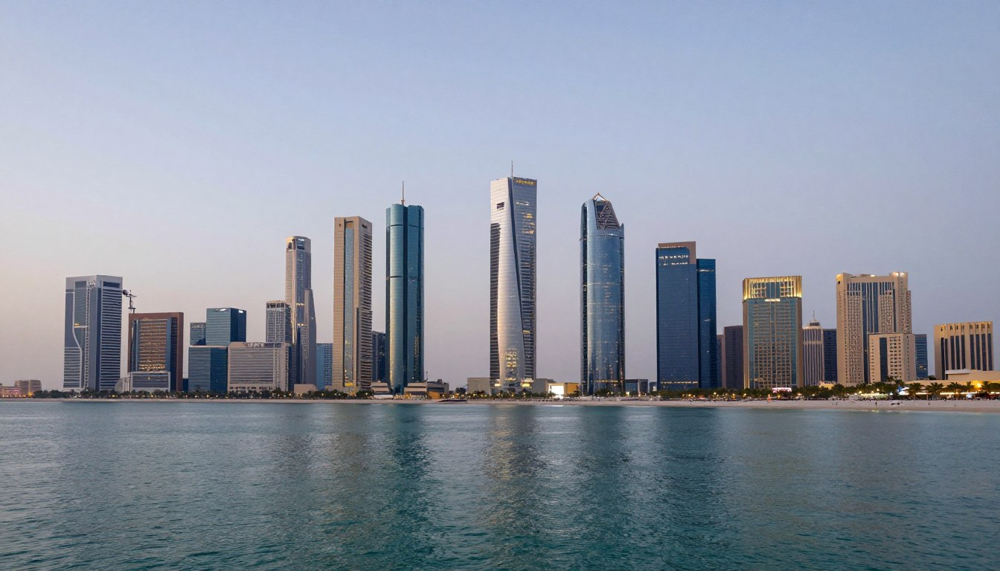
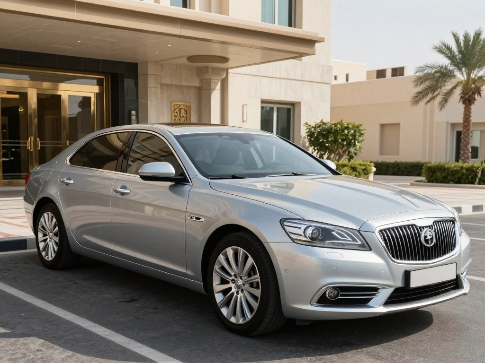
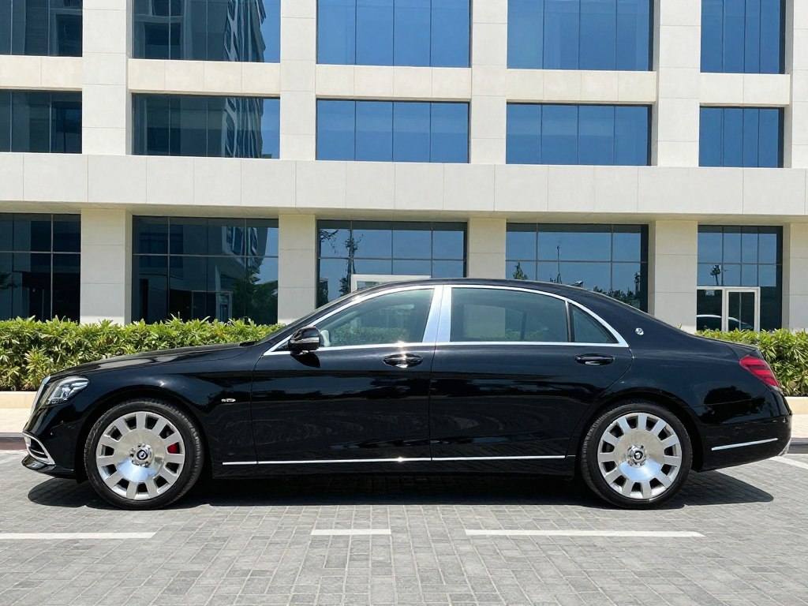
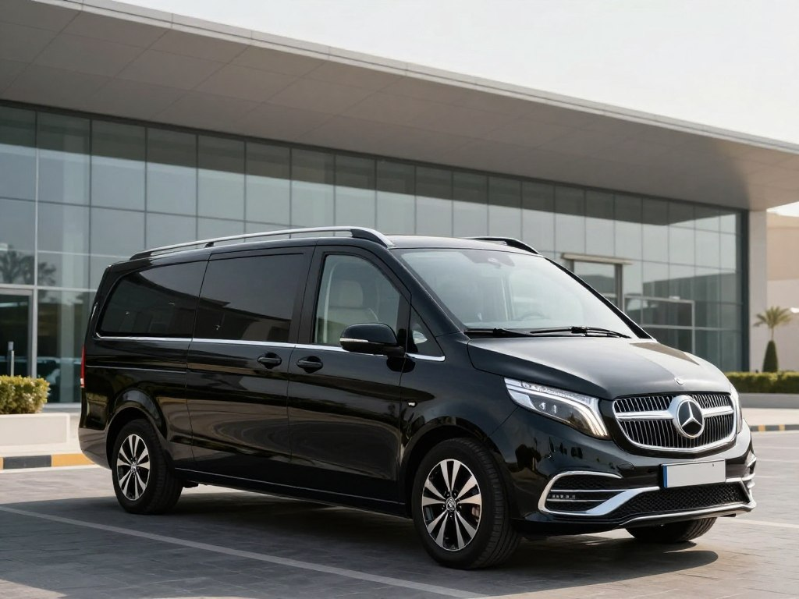
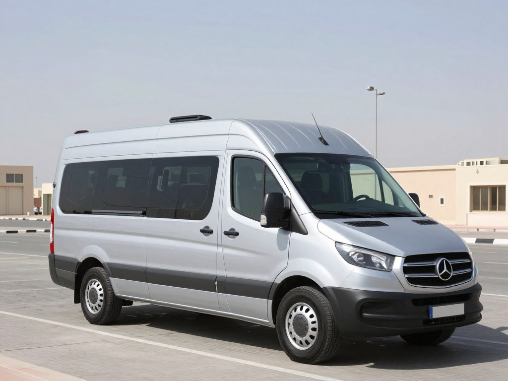
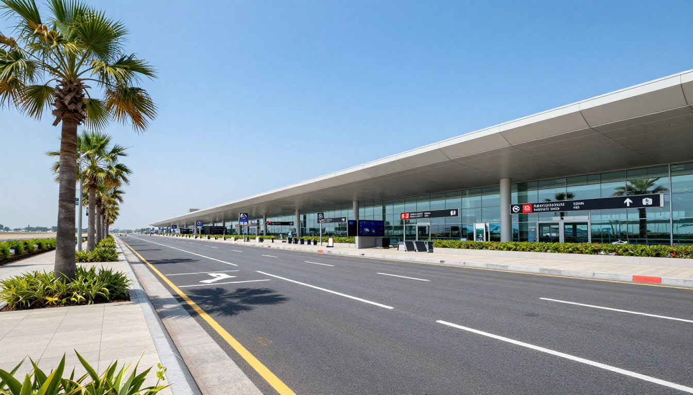

# **Chauffeur service in Ajman**

AB provides premier chauffeur service Ajman solutions for executive travel, corporate events and private airport journeys across the growing coastal emirate. Our managed transport delivers refined vehicles and courteous drivers for every journey.

Travellers between Sharjah International Airport (SHJ) and Ajman rely on professional chauffeurs dedicated to punctual timing and discreet passenger comfort. We coordinate every route with meticulous attention to passenger schedules and flight movements.

Book now View the fleet

**Pick up:** Sharjah International Airport (SHJ)

**Drop off:** Ajman Corniche, Ajman

**Date and time:** Select preferred schedule

Get a quote

The Ajman fleet

## **Executive vehicles for chauffeur service Ajman travel**

Every vehicle scheduled for travel in Ajman is prepared meticulously and dispatched directly from our regional office, AB Dubai. Our operations team maintains rigorous safety, hygiene and mechanical standards across the complete premium collection.

### **Standard Sedan**

Sedan · 3 guests · 2 bags

Typical model: Toyota Camry or similar \[Confirm\]

**Ideal for:** Daily city travel and transfers

A comfortable option for individual business travel across Ajman districts. Guests enjoy quiet cabins, climate control and professional chauffeurs who navigate local routes with complete route familiarity and courteous attention.

Book this class Request a quote Airport transfer Hourly chauffeur Full specifications

### **Business Sedan**

Sedan · 3 guests · 2 bags

Typical model: Mercedes E Class or similar \[Confirm\]

**Ideal for:** Executive meetings and corporate travel

Engineered for corporate executives requiring mobile productivity between meetings. The refined cabin provides leather seating, acoustic insulation and charging points for seamless working sessions between Ajman and neighbouring commercial hubs.

Book this class Request a quote Airport transfer Hourly chauffeur Full specifications

### **First Class Sedan**

Flagship sedan · 3 guests · 2 bags

Typical model: Mercedes S Class or similar \[Confirm\]

**Ideal for:** VIP hospitality and protocol travel

Our flagship sedan delivers superior prestige for distinguished guests and executive leadership. Reclining rear seats, advanced ride damping and discreet personal service create an unmatched environment for luxury car travel.

Book this class Request a quote Airport transfer Hourly chauffeur Full specifications

### **Executive SUV**

SUV · 6 guests · 5 bags

Typical model: Cadillac Escalade, GMC Yukon or similar \[Confirm\]

**Ideal for:** Delegations and spacious family journeys

Spacious and commanding, this full size luxury SUV accommodates delegations with generous luggage capacity. Elevated seating and expansive interior room provide relaxed travel throughout coastal Ajman and across regional highways.

Book this class Request a quote Airport transfer Hourly chauffeur Full specifications

### **Premium MPV**

MPV · 6 guests · 5 bags

Typical model: Mercedes V Class or similar \[Confirm\]

**Ideal for:** Mobile meetings and executive teams

Configured with face to face conference seating, this cabin functions as a mobile workspace. Ideal for corporate roadshows and visiting delegations that value collaborative discussions while travelling between scheduled appointments.

Book this class Request a quote Airport transfer Hourly chauffeur Full specifications

### **Executive Van**

Van · 14 guests · 10 bags

Typical model: Mercedes Sprinter or similar \[Confirm\]

**Ideal for:** Event groups and airport shuttles

Designed for larger parties requiring coordinated group transit without compromising comfort. Dedicated luggage space, wide aisles and individual climate vents support seamless logistics for conferences and private delegations.

Book this class Request a quote Airport transfer Hourly chauffeur Full specifications

Popular journeys

## **Across Ajman and beyond**

We provide point to point transfers connecting coastal resorts, commercial districts and airport terminals across the northern emirates.

Airport transfer

### **SHJ to Ajman Corniche**

From \[AED price\]

Airport transfer

### **SHJ to Al Nuaimiya**

From \[AED price\]

Intercity

### **Ajman to Dubai**

From \[AED price\] · \[Confirm\] hours

Intercity

### **Ajman to Sharjah**

From \[AED price\] · \[Confirm\] hours

Explore additional intercity transfer Ajman options across the emirates on our Intercity Transfers page.

Services in Ajman

## **One partner for every movement in Ajman**

AB delivers managed ground logistics, luxury transport and coach coordination tailored to commercial and private requirements throughout the northern emirate.

- Chauffeur & VIP in Ajman
- Bus & Coach Hire in Ajman

Airport transfers

## **Arriving at Sharjah International Airport (SHJ)**

Arriving passengers at Sharjah International Airport (SHJ) receive dedicated support from the moment their flight touches down. Our central operations team monitors real time flight tracking for every arrival, adjusting chauffeur schedules automatically for early arrivals or flight delays. Inside the terminal, your professional chauffeur welcomes you with a personalised digital name board at the meeting point \[Confirm\]. Guests benefit from complimentary waiting time \[Confirm\], allowing unhurried navigation through passport clearance, baggage reclaim and customs. From the terminal curb, your private driver assists with all luggage before conducting a smooth transfer to your residence, hotel or corporate office in Ajman.

- Flight tracking: Every arrival
- Meet and greet: Inside the terminal
- SHJ to Ajman Corniche: \[Confirm\] minutes

For arrivals connecting via the neighbouring international hub, review our dedicated guide to Dubai International Airport (DXB) transfers.

Coverage

## **Where we work in Ajman**

AB provides comprehensive coverage across the emirate, supporting executive travel between commercial centres, hospitality resorts and civic institutions. Whether your itinerary involves morning conferences, waterfront resort transfers or industrial site inspections, our drivers maintain thorough local knowledge of routes, traffic patterns and property access protocols. Seamless dispatch from our regional hub delivers punctual transport across every major municipal district.

| Business            | Events and conferences | Heritage and leisure | Government or Industry    |
| ------------------- | ---------------------- | -------------------- | ------------------------- |
| Ajman Free Zone     | Ajman Hotel            | Ajman Museum         | Ajman Chamber of Commerce |
| City Centre Ajman   | Bahi Ajman Palace      | Al Zorah Golf Club   | Ajman Port Terminal       |
| Nuaimiya Commercial | Radisson Blu Ajman     | Ajman Corniche       | Al Jurf Industrial Area   |

Clients coordinating wider regional travel can also inspect our network of UAE locations.

Our office

## **Regional office support for chauffeur service Ajman**

Ajman operations are managed and dispatched directly from our regional office, AB Dubai, with strategic coordination from our Riyadh headquarters. Our fleet staging and maintenance protocols adhere to strict corporate standards \[Confirm\]. Dedicated fleet specialists handle custom itinerary requirements, airport meet and greet logistics and round the clock operations.

### **AB Dubai**

Regional Office

Suite 206, DBC Building, Al Khabaisi, Deira, Dubai, UAE

+971 50 781 3880

Get directions

### **AB Riyadh**

Headquarters and 24/7 Dispatch

Building 3036, Office 08, 2nd Floor, Umar Ibn Abdulaziz Road, Al Malaz, Riyadh, Saudi Arabia

+966 58 111 8720

Get directions

Questions

## **Chauffeur service in Ajman: your questions**

### **How does an SHJ airport transfer to Ajman operate with AB?**

Your chauffeur tracks your flight status automatically to accommodate schedule variations at Sharjah International Airport (SHJ). Upon clearance, your private driver greets you inside the terminal arrivals hall holding a digital name board at meeting point \[Confirm\]. The transfer includes luggage assistance and complimentary waiting time \[Confirm\], delivering a comfortable journey directly to your designated destination along Ajman Corniche.

### **Can I hire a private driver Ajman service on an hourly or full day basis?**

Hourly chauffeur and full day hire options are available across Ajman for executive meetings, VIP transport and shopping itineraries. A dedicated chauffeur remains at your disposal throughout the booking duration, accommodating custom schedules and multi stop routes without delay. Rates and vehicle availability for extended hire are structured transparently through our operations team \[Confirm: booking terms\].

### **How do intercity transfer Ajman bookings to Dubai or Abu Dhabi work?**

AB coordinates direct intercity journeys from Ajman to Dubai, Abu Dhabi and other emirates with fixed booking parameters and executive vehicles. Your professional chauffeur collects you from your residence or hotel, managing highway navigation for a quiet, productive travel experience. Intercity transfers eliminate taxi queues, providing seamless travel across emirate borders with confirmed scheduling \[Confirm: advance notice\].

### **What vehicle categories are available for limousine service Ajman and group travel?**

Our fleet encompasses premium sedans, executive SUVs, luxury MPVs and high capacity executive vans. For larger delegations, corporate events or staff transport, we also arrange bus rental Ajman solutions through our dedicated group services team. Every vehicle is licensed, commercially insured and maintained to strict executive standards, providing tailored capacity for individual VIPs or large corporate groups.

### **How far in advance should I complete a chauffeur booking in Ajman?**

We recommend confirming your reservation at least 24 hours prior to travel to secure your preferred vehicle class. However, our central dispatch operates 24/7, enabling our team to accommodate urgent requests whenever fleet capacity allows \[Confirm: minimum booking lead time\]. Corporate clients with established accounts benefit from expedited reservations and flexible scheduling options across the United Arab Emirates.

## **Your chauffeur is ready in Ajman.**

Book your chauffeur service Ajman transfer today or contact our central dispatch operations team directly on +966 58 111 8720 for tailored corporate transport coordination across the emirates.

### **Reserve executive ground travel**

Coordinate single transfers or ongoing corporate transport schedules with our 24/7 operations team.

Book now Request a proposal